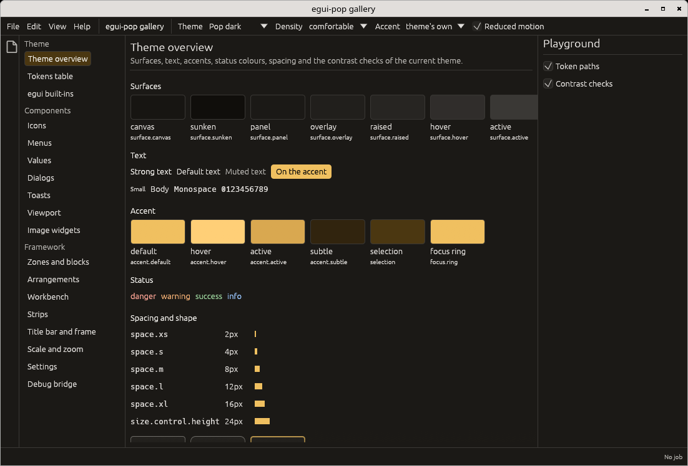
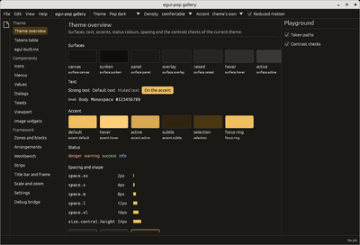
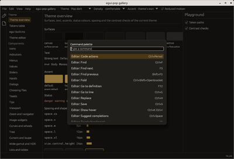
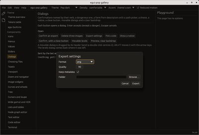
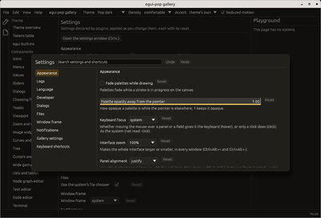
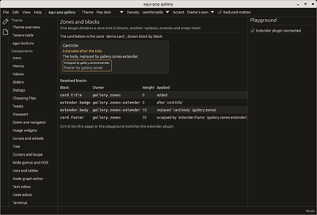
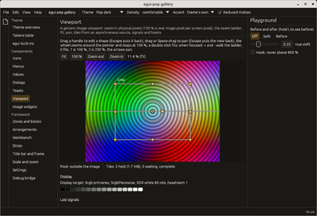
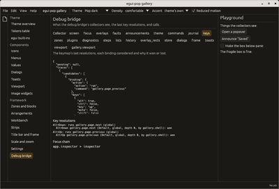
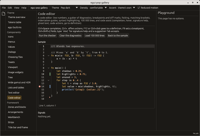

# egui-pop

[](https://crates.io/crates/egui-pop)



egui-pop is an application framework and component library on
[egui](https://github.com/emilk/egui) for desktop applications. It wraps
your application's kernel through a host contract and gives it design
tokens, themes and visual kits, commands with shortcuts, a workbench of
panels, components (dialogs, palettes, sliders and inputs, trees and
tables, text and code editors, an image viewport), and hooks at every
step of its life: observe, veto, replace, extend. Your egui code keeps
working inside it: egui-pop lays out and draws around it, and styles
egui's own widgets from the theme. It is for people building a real tool
on egui (an editor, a viewer, a control panel) who want that plumbing
done once. Not an official egui crate.

## Quickstart

```sh
cargo add egui-pop
```

```rust no_run
use egui_pop::eframe;
use egui_pop::prelude::*;

struct Hello;

impl Plugin for Hello {
    fn id(&self) -> PluginId { PluginId::from_static("hello") }

    fn connect(&mut self, ctx: &mut Ctx<'_>) -> Result<(), PluginError> {
        ctx.block(zones::MAIN, Block::add(BlockId::from_static("hello.text"), 0, |ui, _| {
            ui.heading("Hello");
        }));
        Ok(())
    }
}

fn main() -> eframe::Result {
    App::builder()
        .plugins(DefaultPlugins)
        .plugin(Hello)
        .run_native("Hello", eframe::NativeOptions::default())
}
```

`DefaultPlugins` brings the command palette, dialogs, toasts, the
settings window, the window's place and saved layouts. For a fuller
start (a panel, a setting, a command), see
[Getting started](docs/getting-started.md).

## A command with a shortcut

Declared once: its key, menu entry, palette entry and agent surface come
from it. More in [Plugins, commands and steps](docs/plugins.md).

```rust
use egui_pop::egui;
use egui_pop::prelude::*;

struct Greeter;

impl Plugin for Greeter {
    fn id(&self) -> PluginId { PluginId::from_static("greeter") }

    fn connect(&mut self, ctx: &mut Ctx<'_>) -> Result<(), PluginError> {
        let greet = CommandSpec::new(CommandId::from_static("greeter.greet"), "Greet", "Greeter");
        ctx.command(greet.key("Ctrl+G"), |_| Ok(serde_json::json!("hello")))?;
        Ok(())
    }
}

let mut app = App::builder().plugin(Greeter).build(&egui::Context::default()).unwrap();
let out = app.run(&CommandId::from_static("greeter.greet"), serde_json::Value::Null, Origin::User);
assert_eq!(out.now(), Some(Ok(serde_json::json!("hello"))));
```

## A theme

Fifteen built-in themes, two densities, five accents, any token
overridden. More in [Themes](docs/themes.md).

```rust
use egui_pop::egui;
use egui_pop::prelude::*;
use serde_json::json;

let spec = ThemeSpec::new("catppuccin-mocha")
    .density(Density::Compact)
    .accent("blue")
    .override_token("radius.widget", json!({ "value": 2, "unit": "px" }));
let app = App::builder().theme(spec).build(&egui::Context::default()).unwrap();

// Later, from a command or a settings page: installed before the next frame.
app.handle().theme().set(ThemeSpec::new("pop-light"));
```

## A visual kit

What a component looks like is data: a box per state (rest, hover,
active, focus, selected, disabled) and per tone, and the handler that
draws it, compiled once when the theme is installed. A kit changes it
with tokens alone, or brings handlers of its own. More in
[Visual kits](docs/kit.md) and [Kits as packages](docs/kit-packages.md).

```rust
use egui_pop::egui;
use egui_pop::prelude::*;
use egui_pop::tokens::kit::KitData;

// The workbench's tabs underlined instead of boxed.
let kit = KitData::from_text(
    "underline",
    r#"
    tab:
      shape: {$type: "string", $value: "underline"}
      selected:
        indicator-color: {$type: "color", $value: "{accent.default}"}
    "#,
);
let ctx = egui::Context::default();
let _app = App::builder().kit(kit).theme(ThemeSpec::new("underline")).build(&ctx).unwrap();
assert_eq!(egui_pop::core::kit::Kit::of(&ctx).tab.shape, "underline");
```

## A hook on a step

egui-pop names the moments of each feature's life (`frame.close`,
`workbench.detach`, `arrangement.switch`...). A plugin may observe,
veto, replace or extend any of them
([ADR 0011](docs/adr/0011-lifecycle-steps.md)). Here a plugin keeps the
window open while work is unsaved (`frame.close` is run by
`FramePlugin`). More in [Plugins, commands and steps](docs/plugins.md).

```rust
use egui_pop::api::frame::STEP_CLOSE;
use egui_pop::prelude::*;

struct Guard;

impl Plugin for Guard {
    fn id(&self) -> PluginId { PluginId::from_static("guard") }

    fn connect(&mut self, ctx: &mut Ctx<'_>) -> Result<(), PluginError> {
        ctx.before(STEP_CLOSE, |app, _| {
            if app.context().get("unsaved") == "true" { Before::Veto("unsaved work".into()) } else { Before::Go }
        });
        ctx.after(STEP_CLOSE, |_, args, result| eprintln!("closed {args}: {result:?}"));
        Ok(())
    }
}
```

## An image viewport

The `viewport` feature shows an image your application computes, in
tiles, zoomed in physical pixels. You implement the tile source. More in
[The image viewport](docs/viewport.md).

```rust
use egui_pop::viewport::ViewportState;
use egui_pop::viewport::source::{Pixels, Tile, TileRequest, TileSink, TileSource};

struct Grey(TileSink);

impl TileSource for Grey {
    fn size(&self) -> Option<[u32; 2]> { Some([6000, 4000]) }

    fn request(&self, requests: Vec<TileRequest>) {
        for r in requests {
            let n = r.size[0] as usize * r.size[1] as usize;
            self.0.deliver(Tile::answer(&r, Pixels::Scene(vec![0.18; n * 4])));
        }
    }
}

let state = ViewportState::new();
let _source = Grey(state.sink());
```

## Screenshots

Captured from [the gallery](docs/gallery.md). Click a thumbnail for the
full image; every built-in theme is in [Themes](docs/themes.md#the-built-in-themes).

<table>
  <tr>
    <td align="center"><a href="docs/screenshots/overview-pop-dark.png"></a><br>Theme overview</td>
    <td align="center"><a href="docs/screenshots/palette-pop-dark.png"></a><br>Command palette</td>
    <td align="center"><a href="docs/screenshots/settings-window-pop-dark.png"></a><br>Settings window</td>
    <td align="center"><a href="docs/screenshots/dialogs-pop-dark.png"></a><br>Dialogs</td>
  </tr>
  <tr>
    <td align="center"><a href="docs/screenshots/shortcuts-pop-dark.png"></a><br>Shortcuts editor</td>
    <td align="center"><a href="docs/screenshots/zones-pop-dark.png"></a><br>Zones and blocks</td>
    <td align="center"><a href="docs/screenshots/viewport-pop-dark.png"></a><br>Image viewport</td>
    <td align="center"><a href="docs/screenshots/debug-pop-dark.png"></a><br>Debug bridge</td>
  </tr>
  <tr>
    <td align="center"><a href="docs/screenshots/code-editor-pop-dark.png"></a><br>Code editor</td>
  </tr>
</table>

## Refreshing the screenshots

Every screenshot is the gallery's real window, captured headless in a
nested compositor with [wbox](tools/wbox). Nobody opens the gallery on a
desktop to capture it. One command refreshes the full images, their
thumbnails and the themes gallery:

```sh
cargo xtask screenshots              # everything
cargo xtask screenshots palette      # only the shots whose name matches
```

It builds the gallery in release mode, runs each page and theme in wbox,
presses the keys a shot needs, crops to the window, writes
`docs/screenshots/` and the reduced copies beside it. Review the images
in the diff before committing. The steps it automates are in
[CONTRIBUTING.md](CONTRIBUTING.md#screenshots).

## Documentation

The [docs index](docs/README.md) lists every page: getting started,
themes and tokens, plugins and steps, the image viewport, debugging, the
gallery, testing, API stability and the design decisions.

## Extensions

Extensions add components and plugins through the same API: start one
from the [extension template](templates/extension)
(`cargo generate --git https://github.com/quazardous/egui-pop templates/extension`),
and list it in the [registry of extensions](docs/extensions.md).

## Versions

egui-pop has its own 0.x version; one egui-pop minor per egui minor,
released within days of it.

| egui-pop | egui | Rust |
|---|---|---|
| 0.1.x | 0.36 | 1.95 |

## Contributing

See [CONTRIBUTING.md](CONTRIBUTING.md) (with a section for extension
authors), [GOVERNANCE.md](GOVERNANCE.md), [AGENTS.md](AGENTS.md) and
[CHANGELOG.md](CHANGELOG.md).

## License

MIT, see [LICENSE](LICENSE).
