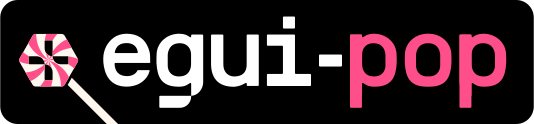
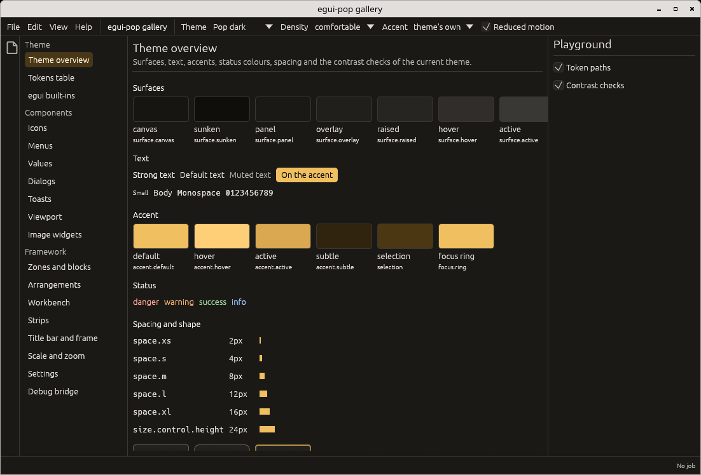
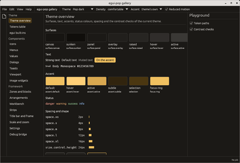
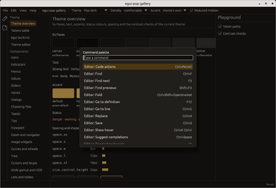
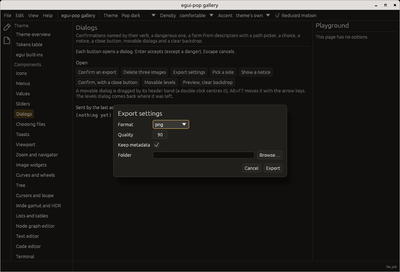
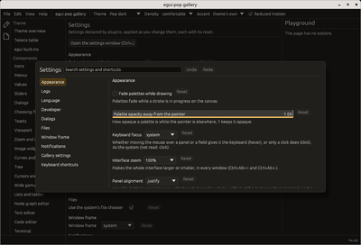
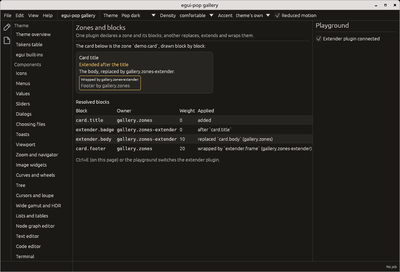
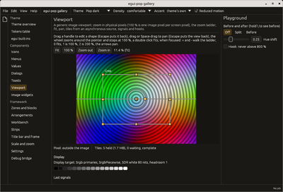
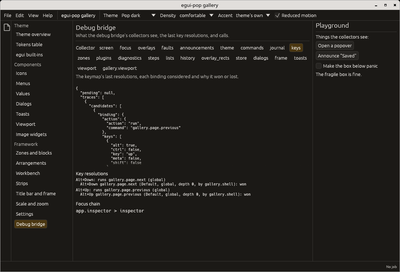
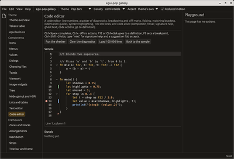

# egui-pop

<a href="https://quazardous.github.io/egui-pop/"></a>

[](https://github.com/quazardous/egui-pop)
[](https://crates.io/crates/egui-pop)
[](https://docs.rs/egui-pop)
[](#unsafe-code)
[](https://quazardous.github.io/egui-pop/gallery/)
[](https://github.com/quazardous/egui-pop/actions/workflows/ci.yml)
[](https://github.com/quazardous/egui-pop/blob/main/LICENSE-MIT)
[](https://github.com/quazardous/egui-pop/blob/main/LICENSE-APACHE)

egui-pop is an application framework and component library on
[egui](https://github.com/emilk/egui) for desktop applications. It wraps
your application's kernel through a host contract and gives it design
tokens, themes and visual kits, commands with shortcuts, a workbench of
panels, components (dialogs, palettes, sliders and inputs, trees and
tables, text and code editors, an image viewport), and hooks at every
step of its life: observe, veto, replace, extend. Your egui code keeps
working inside it: egui-pop lays out and draws around it, and styles
egui's own widgets from the theme. It is for people building a real tool
on egui (an editor, a viewer, a control panel) who want that plumbing
done once. Not an official egui crate.

**New here?** [Your first application](https://github.com/quazardous/egui-pop/blob/main/docs/first-app.md)
builds a small one in eight steps (a window, a command, panels, a
setting, a theme, undo, the agent bridge, tests), and
`cargo generate --git https://github.com/quazardous/egui-pop templates/app`
starts from where it ends.

[](https://quazardous.github.io/egui-pop/gallery/)

## Five words before any code

- **Plugin**: what the application can do. Everything comes in as a
  plugin, egui-pop's own parts included.
- **Block**: where it shows. A plugin puts blocks (and panels) in the
  zones of the window.
- **Command**: what can be triggered. Declared once, it gets its key,
  menu entry, palette entry and agent surface.
- **Bus**: how the parts talk without knowing each other. Requests can
  be vetoed, events are announced, answers are collected.
- **Kit**: how it looks. Themes and visual kits are data (design
  tokens), not code.

## What is stable, what is extra

The core is always built; the rest comes with Cargo features of the
`egui-pop` facade. Each part sits in a tier of
[API stability](https://github.com/quazardous/egui-pop/blob/main/docs/stability.md):
stable (kept within a minor), supported (kept unless a defect forces a
change) or experimental (may change in any release).

| Part | Crate (feature) | Tier |
|---|---|---|
| Design tokens, themes, the DTCG format | `egui-pop-tokens` | stable |
| Ids, commands, keymap, menus, value store, saved documents | `egui-pop-model` | stable |
| Theme, focus, key dispatch, overlays, persistence, value binding | `egui-pop-core` | stable |
| `Plugin`, `Ctx`, `App`, zones and blocks, hooks, steps | `egui-pop-api` | stable |
| Command palette, dialogs, toasts, settings, menus, sliders, icons | `egui-pop-api` | supported |
| Test kit | `egui-pop-test` | supported |
| Translations | `egui-pop-i18n` (`i18n`) | supported |
| Workbench, host contract, visual kits, the other components | `egui-pop-api`, `egui-pop-core` | experimental |
| Image viewport, image tools, node graph | `egui-pop-viewport` (`viewport`), `egui-pop-imaging` (`imaging`) | experimental |
| Tree, list, data table, viewer, photo library | `egui-pop-views` (`views`) | experimental |
| Text and code editors, terminal | `egui-pop-editors` (`editors`) | experimental |
| Platform services | `egui-pop-platform` (`platform`) | experimental |

## What features cost

Measured by the `egui-pop-cost` bench job
([What a build costs](https://github.com/quazardous/egui-pop/blob/main/docs/quality.md#what-a-build-costs)) on a
one-panel probe application, release builds with the compile cache
off, the binary stripped. Measured 2026-11-21 on egui-pop `next`
(0.21), Rust 1.95, Linux, five threads of a shared bench box
that ran other jobs at the same time: read the times as an order of
size, not to the second. The minimal build took 281 s in one run and
270 s in the other.

| Features | Dependencies | Release build | Binary |
|---|---:|---:|---:|
| minimal (`--no-default-features`) | 120 | 281 s, clean | 20.9 MiB |
| default | 294 | 423 s, clean | 36.4 MiB |
| full (every feature but three, below) | 385 | 812 s: 270 s minimal, then 542 s | 38.7 MiB |

Most of what the defaults add is eframe (winit, wgpu and the windowing
stack); a host running its own event loop leaves the `eframe` feature
out. An optional feature the application never calls costs dependencies
and build time, not binary size: the linker drops what is not reached,
so the full set adds 2.3 MiB to the defaults. "Full" leaves out
`views-video` and `views-webview` (they need GStreamer and WebKitGTK
installed) and `native-dialogs` (a fallback kept off).

## Quickstart

```sh
cargo add egui-pop
```

Depend on `egui-pop` only: the sub-crates come with it, at versions
that fit together, and its features turn the optional ones on (use
`egui_pop::egui` rather than adding egui yourself). Name a sub-crate
directly only when you want it without the rest: `egui-pop-tokens`
alone for the design tokens with no egui, or `egui-pop-test` as a
dev-dependency for the test kit.

```rust no_run
use egui_pop::eframe;
use egui_pop::prelude::*;

struct Hello;

impl Plugin for Hello {
    fn id(&self) -> PluginId { PluginId::from_static("hello") }

    fn connect(&mut self, ctx: &mut Ctx<'_>) -> Result<(), PluginError> {
        ctx.block(zones::MAIN, Block::add(BlockId::from_static("hello.text"), 0, |ui, _| {
            ui.heading("Hello");
        }));
        Ok(())
    }
}

fn main() -> eframe::Result {
    App::builder()
        .plugins(DefaultPlugins)
        .plugin(Hello)
        .run_native("Hello", eframe::NativeOptions::default())
}
```

`DefaultPlugins` brings the command palette, dialogs, toasts, the
settings window, the window's place and saved layouts. From there,
[Your first application](https://github.com/quazardous/egui-pop/blob/main/docs/first-app.md)
adds one thing per step, each a running program:

1. [a window](https://github.com/quazardous/egui-pop/blob/main/docs/first-app.md#1-a-window),
2. [a command](https://github.com/quazardous/egui-pop/blob/main/docs/first-app.md#2-a-command-its-key-and-its-menu-entry), with its key and menu entry,
3. [panels](https://github.com/quazardous/egui-pop/blob/main/docs/first-app.md#3-panels-in-the-workbench) in the workbench,
4. [a setting](https://github.com/quazardous/egui-pop/blob/main/docs/first-app.md#4-a-setting),
5. [a theme](https://github.com/quazardous/egui-pop/blob/main/docs/first-app.md#5-a-theme-then-a-kit-of-your-own), then a kit of your own,
6. [undo](https://github.com/quazardous/egui-pop/blob/main/docs/first-app.md#6-undo),

then the agent bridge and tests.

## A command with a shortcut

Declared once: its key, menu entry, palette entry and
[agent surface](https://github.com/quazardous/egui-pop/blob/main/docs/agents.md) come
from it. More in [Plugins, commands and steps](https://github.com/quazardous/egui-pop/blob/main/docs/plugins.md).

```rust
use egui_pop::egui;
use egui_pop::prelude::*;

struct Greeter;

impl Plugin for Greeter {
    fn id(&self) -> PluginId { PluginId::from_static("greeter") }

    fn connect(&mut self, ctx: &mut Ctx<'_>) -> Result<(), PluginError> {
        let greet = CommandSpec::new(CommandId::from_static("greeter.greet"), "Greet", "Greeter");
        ctx.command(greet.key("Ctrl+G"), |_| Ok(serde_json::json!("hello")))?;
        Ok(())
    }
}

let mut app = App::builder().plugin(Greeter).build(&egui::Context::default()).unwrap();
let out = app.run(&CommandId::from_static("greeter.greet"), serde_json::Value::Null, Origin::User);
assert_eq!(out.now(), Some(Ok(serde_json::json!("hello"))));
```

### Agent guard-rails

What an agent may do through the debug bridge, in short (the details
and the known gaps are in
[Agents and the debug bridge](https://github.com/quazardous/egui-pop/blob/main/docs/agents.md)):

- **Nothing listens by default**: no port, no socket, no pipe. The
  bridge is a Rust API in the process; the opt-in `egui-pop-agent`
  crate serves it over a private local socket (a Unix socket only its
  user can open, a named pipe on Windows), never TCP.
- **One description to discover**: `bridge.describe` lists every
  command and action, under protocol 1.
- **Arguments are checked**: a command declared with a JSON Schema has
  every run checked against it.
- **`mutates`** marks what changes state; the bridge can be set
  read-only (only calls that change nothing) or off.
- **`destructive`**: the user confirms an agent's call first.
- **`private`**: a result holding private data an agent may be refused.

## A theme

Fifteen built-in themes, two densities, five accents, any token
overridden. More in [Themes](https://github.com/quazardous/egui-pop/blob/main/docs/themes.md).
No `App` needed for this: see [Using parts without App](https://github.com/quazardous/egui-pop/blob/main/docs/standalone.md).

```rust
use egui_pop::egui;
use egui_pop::prelude::*;
use serde_json::json;

let spec = ThemeSpec::new("catppuccin-mocha")
    .density(Density::Compact)
    .accent("blue")
    .override_token("radius.widget", json!({ "value": 2, "unit": "px" }));
let app = App::builder().theme(spec).build(&egui::Context::default()).unwrap();

// Later, from a command or a settings page: installed before the next frame.
app.handle().theme().set(ThemeSpec::new("pop-light"));
```

## A visual kit

What a component looks like is data: a box per state (rest, hover,
active, focus, selected, disabled) and per tone, and the handler that
draws it, compiled once when the theme is installed. A kit changes it
with tokens alone, or brings handlers of its own. More in
[Visual kits](https://github.com/quazardous/egui-pop/blob/main/docs/kit.md) and [Kits as packages](https://github.com/quazardous/egui-pop/blob/main/docs/kit-packages.md).

```rust
use egui_pop::egui;
use egui_pop::prelude::*;
use egui_pop::tokens::kit::KitData;

// The workbench's tabs underlined instead of boxed.
let kit = KitData::from_text(
    "underline",
    r#"
    tab:
      shape: {$type: "string", $value: "underline"}
      selected:
        indicator-color: {$type: "color", $value: "{accent.default}"}
    "#,
);
let ctx = egui::Context::default();
let _app = App::builder().kit(kit).theme(ThemeSpec::new("underline")).build(&ctx).unwrap();
assert_eq!(egui_pop::core::kit::Kit::of(&ctx).tab.shape, "underline");
```

## A hook on a step

egui-pop names the moments of each feature's life (`frame.close`,
`workbench.detach`, `arrangement.switch`...). A plugin may observe,
veto, replace or extend any of them
([ADR 0011](https://github.com/quazardous/egui-pop/blob/main/docs/adr/0011-lifecycle-steps.md)). Here a plugin keeps the
window open while work is unsaved (`frame.close` is run by
`FramePlugin`). More in [Plugins, commands and steps](https://github.com/quazardous/egui-pop/blob/main/docs/plugins.md).

```rust
use egui_pop::api::frame::STEP_CLOSE;
use egui_pop::prelude::*;

struct Guard;

impl Plugin for Guard {
    fn id(&self) -> PluginId { PluginId::from_static("guard") }

    fn connect(&mut self, ctx: &mut Ctx<'_>) -> Result<(), PluginError> {
        ctx.before(STEP_CLOSE, |app, _| {
            if app.context().get("unsaved") == "true" { Before::Veto("unsaved work".into()) } else { Before::Go }
        });
        ctx.after(STEP_CLOSE, |_, args, result| eprintln!("closed {args}: {result:?}"));
        Ok(())
    }
}
```

Steps are the requests of [the bus](#the-bus).

## The bus

What is not on the bus does not exist
([ADR 0029](https://github.com/quazardous/egui-pop/blob/main/docs/adr/0029-not-on-the-bus.md)):
a part of the application knows the bus, not its neighbours. egui-pop's
kernel implements the public [`bus-contract`](https://github.com/quazardous/bus-contract)
crate, and the application supplies the bus (`AppBuilder::bus`, or
egui-pop makes its own), shared with its other libraries
([ADR 0030](https://github.com/quazardous/egui-pop/blob/main/docs/adr/0030-the-bus-is-a-contract.md)).

```text
  plugin A        plugin B        the application
     |  ^            |  ^               |  ^
 emit|  |listen  emit|  |listen     emit|  |listen
     v  |            v  |               v  |
 +------------------------------------------------+
 |  the bus (egui-pop's kernel, or the app's own) |
 |  points:  event    announced, every listener   |
 |           request  a listener may veto it      |
 |           collect  each listener answers       |
 +------------------------------------------------+
         |                          |
         v                          v
   the journal                bus-bridge (relay)
   events numbered,           the same points
   read again from one        in another process
```

Nobody calls a neighbour: each part emits on a point or listens to one,
and the kernel runs the listeners in their declared order. The journal
and the crossing to another process come from the host;
[bus-bridge](https://github.com/quazardous/bus-bridge) is a transport
for that crossing.

- **Points** are requests, which a listener may veto, or events, each
  declared in a library's contract table (`egui_pop::api::bus::CONTRACT`).
- **Listeners** are named and owned, and run in the order they declare
  (`after`, `before`, `last`, then priority), never registration order.
- **Names** start with the declaring crate's prefix: `pop.*` for
  egui-pop (`pop.window.close`, `pop.command.run`), `stack.*` for
  egui_stack's optional `bus` feature, the application's own for its own.
- **The journal and the relay**: events numbered, read again from a
  number, relayed to another process, when the host gives the bus one.
- **Timings and budgets**: every listener run is timed; a pass over its
  point's budget is said as `bus.overBudget`.

```rust
use std::sync::Arc;
use egui_pop::api::bus::bus_contract::{
    Bus, HookError, ListenOpts, Point, PointDecl, PointId, PointKind, declare_all,
};
use egui_pop::api::bus::egui_pop_hooks::Kernel;
use egui_pop::egui;
use egui_pop::prelude::*;

/// The application's request, under its own prefix: a note is deleted.
struct NoteDelete;
impl Point for NoteDelete {
    const ID: PointId = PointId::new("notes.note.delete");
    const KIND: PointKind = PointKind::Request;
    type Input = String;
    type Value = ();
}

/// The application's contract table.
const POINTS: &[PointDecl] = &[PointDecl::of::<NoteDelete>("A note is deleted.")];

let bus: Arc<dyn Bus> = Arc::new(Kernel::new()); // or the application's own
let _app = App::builder().bus(bus.clone()).build(&egui::Context::default()).unwrap();
assert!(declare_all(&*bus, POINTS).is_empty());
let opts = ListenOpts::new().owner("notes");
bus.listen::<NoteDelete>("notes.keep-pinned", opts, |note, _| {
    if note == "pinned" { Err(HookError::refuse("pinned notes stay")) } else { Ok(()) }
})
.unwrap();
assert!(bus.alter::<NoteDelete>("pinned".into(), ()).refused.is_some());
```

More in [The hook kernel](https://github.com/quazardous/egui-pop/blob/main/docs/hook-kernel.md)
and the `egui_pop::api::bus` module.

## An image viewport

The `viewport` feature shows an image your application computes, in
tiles, zoomed in physical pixels. You implement the tile source. More in
[The image viewport](https://github.com/quazardous/egui-pop/blob/main/docs/viewport.md).

```rust
use egui_pop::viewport::ViewportState;
use egui_pop::viewport::source::{Pixels, Tile, TileRequest, TileSink, TileSource};

struct Grey(TileSink);

impl TileSource for Grey {
    fn size(&self) -> Option<[u32; 2]> { Some([6000, 4000]) }

    fn request(&self, requests: Vec<TileRequest>) {
        for r in requests {
            let n = r.size[0] as usize * r.size[1] as usize;
            self.0.deliver(Tile::answer(&r, Pixels::Scene(vec![0.18; n * 4])));
        }
    }
}

let state = ViewportState::new();
let _source = Grey(state.sink());
```

## Screenshots

Captured from [the gallery](https://github.com/quazardous/egui-pop/blob/main/docs/gallery.md). Click a thumbnail for the
full image; every built-in theme is in [Themes](https://github.com/quazardous/egui-pop/blob/main/docs/themes.md#the-built-in-themes).

<table>
  <tr>
    <td align="center"><a href="https://github.com/quazardous/egui-pop/raw/main/docs/screenshots/overview-pop-dark.png"></a><br>Theme overview</td>
    <td align="center"><a href="https://github.com/quazardous/egui-pop/raw/main/docs/screenshots/palette-pop-dark.png"></a><br>Command palette</td>
    <td align="center"><a href="https://github.com/quazardous/egui-pop/raw/main/docs/screenshots/settings-window-pop-dark.png"></a><br>Settings window</td>
    <td align="center"><a href="https://github.com/quazardous/egui-pop/raw/main/docs/screenshots/dialogs-pop-dark.png"></a><br>Dialogs</td>
  </tr>
  <tr>
    <td align="center"><a href="https://github.com/quazardous/egui-pop/raw/main/docs/screenshots/shortcuts-pop-dark.png"></a><br>Shortcuts editor</td>
    <td align="center"><a href="https://github.com/quazardous/egui-pop/raw/main/docs/screenshots/zones-pop-dark.png"></a><br>Zones and blocks</td>
    <td align="center"><a href="https://github.com/quazardous/egui-pop/raw/main/docs/screenshots/viewport-pop-dark.png"></a><br>Image viewport</td>
    <td align="center"><a href="https://github.com/quazardous/egui-pop/raw/main/docs/screenshots/debug-pop-dark.png"></a><br>Debug bridge</td>
  </tr>
  <tr>
    <td align="center"><a href="https://github.com/quazardous/egui-pop/raw/main/docs/screenshots/code-editor-pop-dark.png"></a><br>Code editor</td>
  </tr>
</table>

## Refreshing the screenshots

Every screenshot is the gallery's real window, captured headless in a
nested compositor with [wbox](https://github.com/quazardous/egui-pop/blob/main/tools/wbox). Nobody opens the gallery on a
desktop to capture it. One command refreshes the full images, their
thumbnails and the themes gallery:

```sh
cargo xtask screenshots              # everything
cargo xtask screenshots palette      # only the shots whose name matches
```

It builds the gallery in release mode, runs each page and theme in wbox,
presses the keys a shot needs, crops to the window, writes
`docs/screenshots/` and the reduced copies beside it. Review the images
in the diff before committing. The steps it automates are in
[CONTRIBUTING.md](https://github.com/quazardous/egui-pop/blob/main/CONTRIBUTING.md#screenshots).

## Documentation

The [docs index](https://github.com/quazardous/egui-pop/blob/main/docs/README.md) lists every page: getting started,
themes and tokens, plugins and steps, the bus and its hook kernel, the
image viewport, debugging, the gallery, testing, API stability and the
design decisions.
They are also online, with search, at
<https://quazardous.github.io/egui-pop/docs/>, and the API documentation
of every crate, with every feature on (docs.rs shows the default
features), at <https://quazardous.github.io/egui-pop/api/>.

## Extensions

Extensions add components and plugins through the same API: start one
from the [extension template](https://github.com/quazardous/egui-pop/blob/main/templates/extension)
(`cargo generate --git https://github.com/quazardous/egui-pop templates/extension`),
and list it in the [registry of extensions](https://github.com/quazardous/egui-pop/blob/main/docs/extensions.md).

## Versions

egui-pop has its own 0.x version. A new egui minor brings a new
egui-pop minor, released within days of it; egui-pop's own breaking
changes bring one too, so several egui-pop minors share one egui. The
sub-crates have their own versions, which move only when their code
does; depending on `egui-pop` alone picks the right ones.

| egui-pop | egui | Rust |
|---|---|---|
| 0.1.x to 0.3.x | 0.36 | 1.95 |
| 0.4.x to 0.21.x | 0.37 | 1.95 |

egui-phosphor has no release on egui 0.37 yet, so egui-pop depends on
`egui-pop-phosphor`, a fork published under its own name that carries
upstream's pending update; egui-pop moves back to egui-phosphor once
upstream releases
([#146](https://github.com/quazardous/egui-pop/issues/146)).

Rerun's `egui_inspection_tools`, which `egui-pop-agent`'s `widget_*`
MCP tools serve, is not on crates.io yet, so `egui-pop-agent` depends
on `egui-pop-inspection-tools`, its temporary, unchanged fork published
under its own name; egui-pop moves back to `egui_inspection_tools` once
Rerun publishes it, and the fork is yanked
([#660](https://github.com/quazardous/egui-pop/issues/660)).

## Accessibility: what is verified

Every interactive widget is meant to have a name and a role that
assistive technologies read, through egui's AccessKit tree. What backs
that today
([Accessibility](https://github.com/quazardous/egui-pop/blob/main/docs/accessibility.md)):

| | Verified | How |
|---|---|---|
| Every interactive node has a name | yes, in tests | the test kit fails a test on an unnamed node (`egui_pop_test::assert_all_named`) |
| The accessibility tree, for review | yes, in tests | `egui_pop_test::a11y_tree` prints it as text |
| Every gallery page reachable by keys alone | yes, in tests | a keyboard walk over the gallery |
| A real screen reader (Orca on Linux, or any other) | **no** | not run yet; it is planned |

The accessibility helpers (`egui_pop_core::a11y`: names for custom
widgets, the announcer) and the test kit's checks are in the
supported tier.

## How quality is held

egui-pop is developed with AI assistance: most of its code is written by
AI coding agents, to the maintainer's plan and recorded design
decisions. Every pull request merges only after CI passes: formatting,
clippy with warnings as errors, unit, UI (egui_kittest) and snapshot
tests per theme, the layering test, licence and advisory checks, the
docs build, a web smoke test, a packaging dry run, a changeset for what
users notice and semver checks against crates.io. Windows, macOS and
real windows are not tested in CI. The checks, which ones block a merge,
and what they leave out are in
[How quality is held](https://github.com/quazardous/egui-pop/blob/main/docs/quality.md).

## Contributing

See [CONTRIBUTING.md](https://github.com/quazardous/egui-pop/blob/main/CONTRIBUTING.md) (with a section for extension
authors), [GOVERNANCE.md](https://github.com/quazardous/egui-pop/blob/main/GOVERNANCE.md), [AGENTS.md](https://github.com/quazardous/egui-pop/blob/main/AGENTS.md) and
[CHANGELOG.md](https://github.com/quazardous/egui-pop/blob/main/CHANGELOG.md).

## Unsafe code

`unsafe` is forbidden in the whole workspace (`unsafe_code = "forbid"` in
the workspace lints), except in the three crates that call the operating
system directly:

- `egui-pop-win32`, the Windows layer of the window frame (Snap Layouts,
  rounded corners). Its `unsafe` code is compiled on Windows only; other
  platforms get safe stubs.
- `egui-pop-wayland`, the Wayland layer of the image viewport (a colour
  managed subsurface), only with the viewport's `wayland` feature.
- `egui-pop-winit`, the runner's winit layer: it borrows a window's raw
  handles from its winit id, so every window of the application is
  reachable (the file chooser's parent, the hit test).

## License

Licensed under either of

- Apache License, Version 2.0 ([LICENSE-APACHE](https://github.com/quazardous/egui-pop/blob/main/LICENSE-APACHE))
- MIT license ([LICENSE-MIT](https://github.com/quazardous/egui-pop/blob/main/LICENSE-MIT))

at your option.
