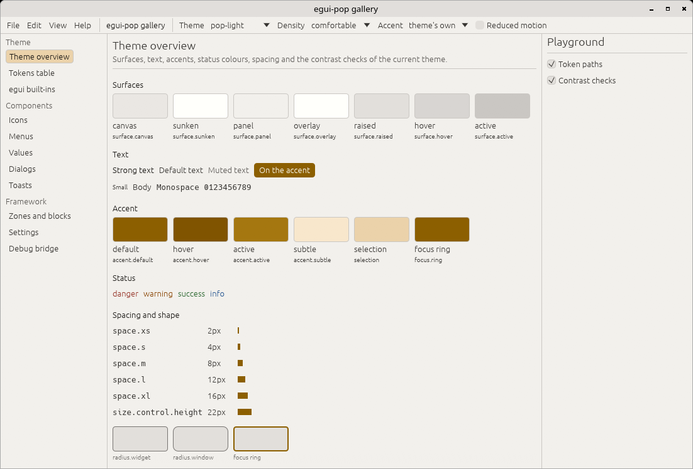
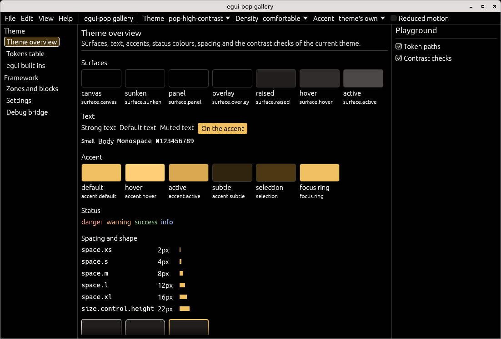
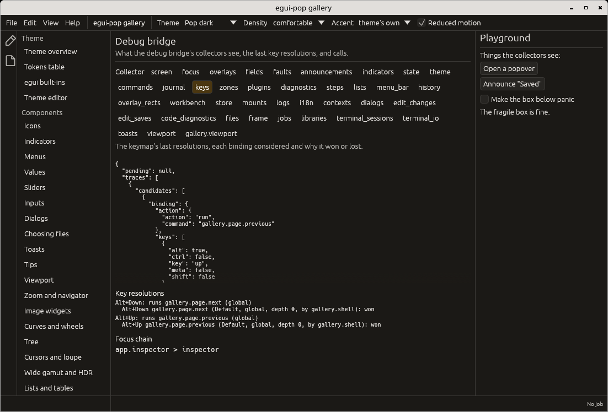

# egui-pop

An application framework and component library for
[egui](https://github.com/emilk/egui): themable, accessible, drivable by
agents, easy to debug. Not an official egui crate.


**Status: phase 2, the framework.** Design tokens and themes (phase 1);
plugins that own what they register, commands declared once, layered
keymaps resolved by focus, zones and blocks, overlays, a value store with
undo, persistence, a debug bridge and a test kit. Components come next.

## What is there

| Crate | Layer | What it holds |
|---|---|---|
| [`egui-pop-tokens`](crates/egui-pop-tokens) | L0 | DTCG token files: parser, resolver, themes, densities, accents, contrast checks. No egui. |
| [`egui-pop-model`](crates/egui-pop-model) | L1 | The logic without egui: typed ids, diagnostics, `when` clauses, commands, keymap (layers, chords, focus depth, traces), menus, panels, layouts, the value store, versioned documents, plugin ordering. |
| [`egui-pop-core`](crates/egui-pop-core) | L2 | The egui layer: theme, focus scopes, key dispatcher, overlay stack, placement, accessibility, strings, icons, persistence, fault boundaries, value binding, the debug bridge. |
| [`egui-pop-api`](crates/egui-pop-api) | L3 | The application API (its own semver): `Plugin`, `Ctx`, `AppBuilder` over eframe or headless, zones and blocks, hooks, services, stories. |
| [`egui-pop-test`](crates/egui-pop-test) | L4 | Test kit: harnesses, "every interactive node has a name", accessibility tree dump. |
| [`egui-pop`](crates/egui-pop) | L5 | The crate to depend on: re-exports the layers, `egui`, and a `prelude`. |
| [`egui-pop-gallery`](crates/egui-pop-gallery) | app | The catalogue, itself a plugin application (not published). |

Layers only depend downwards; a test reading `cargo metadata` keeps it so
([ADR 0001](docs/adr/0001-layering.md)). Decisions are in
[docs/adr](docs/adr), principles in [CREDO.md](CREDO.md).

## A theme

```rust
use egui_pop::egui;
use egui_pop::theme::{self, Density, ThemeSpec, Tokens};

fn setup(ctx: &egui::Context) {
    let tokens = theme::install(
        ctx,
        &ThemeSpec::new("pop-dark").density(Density::Compact).accent("blue"),
    );
    for problem in tokens.resolved().problems() {
        eprintln!("theme: {problem}");
    }
}

fn draw(ui: &mut egui::Ui) {
    // egui's widgets follow the theme; custom painting reads the tokens.
    let tokens = Tokens::of(ui.ctx());
    ui.colored_label(tokens.status.success, "Saved");
}

setup(&egui::Context::default());
```

| `pop-dark` | `pop-light` | `pop-high-contrast` |
|---|---|---|
|  |  |  |

Built-in themes: `pop-dark`, `pop-light` and `pop-high-contrast`;
densities `comfortable` and `compact`; accents `gold`, `blue`, `green`,
`amber` and `red`; reduced motion. See [docs/tokens.md](docs/tokens.md).

## A plugin application

A plugin registers through `Ctx`; whatever it registers is removed when
it is disconnected. A command is declared once: its key binding, menu
entry, palette entry and agent surface are derived from it.

```rust
use egui_pop::api::app::MENU_VIEW;
use egui_pop::egui;
use egui_pop::prelude::*;

struct Counter;

const COUNT: SettingId = SettingId::from_static("counter.count");

impl Plugin for Counter {
    fn id(&self) -> PluginId {
        PluginId::from_static("counter")
    }

    fn connect(&mut self, ctx: &mut Ctx<'_>) -> Result<(), PluginError> {
        ctx.setting(COUNT, Descriptor::int("Count", 0, 100, 0))?;
        ctx.command(
            CommandSpec::new(CommandId::from_static("counter.add"), "Add one", "Counter")
                .key("Ctrl+Up")
                .menu(MENU_VIEW, "5_counter", 0),
            |call| {
                let store = call.app.store();
                let mut store = store.lock().unwrap();
                let set = egui_pop::model::values::Set::new(
                    "settings/counter.count",
                    egui_pop::model::values::Change::Step(1),
                    call.origin.clone(),
                );
                store.set(set).map(|a| a.value.to_json()).map_err(|e| e.to_string())
            },
        )?;
        ctx.block(
            zones::MAIN,
            Block::add(BlockId::from_static("counter.view"), 0, |ui, app| {
                let store = app.store();
                let n: i64 = egui_pop::core::binding::read(&store, "settings/counter.count").unwrap_or(0);
                ui.heading(format!("Count: {n}"));
                if ui.button("Add one").clicked() {
                    app.run(CommandId::from_static("counter.add"), serde_json::Value::Null);
                }
            }),
        );
        Ok(())
    }
}

// Headless, as in tests; `.run_native("Counter", options)` opens a window.
let ctx = egui::Context::default();
let mut app = App::builder().plugin(Counter).build(&ctx).unwrap();
assert!(app.handle().diagnostics().is_empty());
let out = app.run(&CommandId::from_static("counter.add"), serde_json::Value::Null, Origin::User);
// Run by the default host, in-process: the result is there now.
assert_eq!(out.now(), Some(Ok(serde_json::json!(1))));
```

Zones and blocks let a plugin add to, replace, extend or wrap what
another drew ([ADR 0005](docs/adr/0005-zones-and-blocks.md)); what cannot
apply is reported, never silently dropped
([ADR 0003](docs/adr/0003-no-silent-no-op.md)). In the gallery, one
plugin replaces, extends and wraps another's blocks; switched off, the
card is back as its owner made it:

| Extender connected | Extender switched off (`pop-light`) |
|---|---|
|  |  |

Every command is in the palette (`Ctrl+Shift+P` or `F1`, a plugin in
`DefaultPlugins`), ranked by a fuzzy match with the recent ones first,
with the keys the keymap really binds; a command taking arguments asks
for them:


## Debugging

Every registry describes itself to the **debug bridge**: collectors for
commands, key resolution traces, focus, overlays, zones, plugins, the
store and diagnostics, each with a JSON snapshot and actions flagged
`mutates`; every call returns a feedback block. The gallery's Debug page
shows them, with the last key resolutions:



```rust
use egui_pop::egui;
use egui_pop::prelude::*;

let ctx = egui::Context::default();
let mut app = App::builder().plugins(DefaultPlugins).build(&ctx).unwrap();
let snapshot = app.handle().debug_snapshot();
assert!(snapshot["commands"]["commands"].is_array());
let feedback = app.debug_call("commands", "run", &serde_json::json!({ "id": "app.palette" }));
assert!(feedback.ok && feedback.mutates);
```

## The gallery

```sh
cargo run -p egui-pop-gallery -- --theme pop-light --page zones
cargo run -p egui-pop-gallery -- --help
```

Pages: theme overview, tokens, egui's built-ins, icons, menus, dialogs,
zones and blocks, settings, the debug bridge. It also builds for the web
(`wasm32-unknown-unknown`, with Trunk from `crates/egui-pop-gallery`), and
runs offscreen in a nested compositor for scripted runs
([tools/wbox](tools/wbox)).

## Versions

egui-pop has its own 0.x version; one egui-pop minor per egui minor,
released within days of it.

| egui-pop | egui | Rust |
|---|---|---|
| 0.0.x | 0.36 | 1.95 |

## Contributing

See [CONTRIBUTING.md](CONTRIBUTING.md), [AGENTS.md](AGENTS.md) and
[CHANGELOG.md](CHANGELOG.md).

## License

MIT, see [LICENSE](LICENSE).
