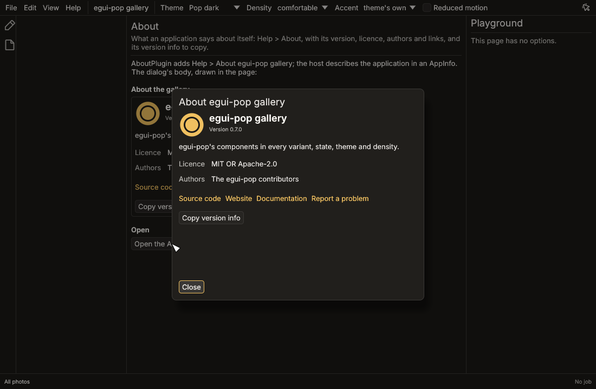

# About the application

Help > About *application*: a dialog with the application's name, icon,
version, one-line description, licences, authors and links, and a
"Copy version info" button for bug reports. The gallery's `about` page
shows it, and its Help menu has it.



## Turning it on

```rust
use egui_pop::api::about::{ABOUT, AboutPlugin, AppInfo};
use egui_pop::api::App;

let info = AppInfo::new("Darkroom", env!("CARGO_PKG_VERSION"))
    .description("A photo editor.")
    .licence("GPL-3.0-or-later")
    .author("The Darkroom contributors")
    .repository("https://example.org/darkroom")
    .website("https://example.org")
    .docs("https://example.org/darkroom/docs")
    .issues("https://example.org/darkroom/issues");
let app = App::builder()
    .name("Darkroom")
    .plugin(AboutPlugin::new(info))
    .build(&egui_pop::egui::Context::default())
    .unwrap();
assert_eq!(app.handle().service(&ABOUT).unwrap().info().name, "Darkroom");
```

`AboutPlugin` is opt-in. The host fills an `AppInfo`: the name (empty:
the application's, `AppBuilder::name`), the version (typically
`env!("CARGO_PKG_VERSION")`), a one-line description, licences (SPDX
expressions), authors, and the links it has: the repository, a website,
the docs, where to report issues. A link not given is not shown.

- `AppInfo::icon(|ui, side| …)` draws the application's icon at the
  top of the dialog, in a square of the side given.
- `AppInfo::renderer("wgpu: Vulkan, llvmpipe")` says what draws the
  interface, for the version info; the host knows it once the window
  is up, and may set it later through the service:
  `app.service(&ABOUT).unwrap().update(|i| i.renderer = Some(…))`.

Links open with egui's `Context::open_url`: a new tab on the web, the
system's browser on the desktop.

## Commands

| Command | What |
|---|---|
| `about` | Help > About *application* (the title says `{ $application }`, filled with the name) |
| `about.read` | For agents, kept out of the palette: everything as JSON (name, version, description, licences, authors, links, egui-pop's and egui's versions, the platform, the renderer, `version_info`) |
| `help.report` | Help > Report a problem, the palette, the inspect dialog's Report… button and the About dialog's link: a prefilled new issue in the browser. Declared only when `AppInfo::issues` is set |
| `help.suggest` | Help > Suggest an idea, the palette: a new issue for an idea in the browser, with the page shown. Declared only when `AppInfo::issues` is set |

`about::open(app)` opens the dialog from code; `about::show(ui, app,
copied)` draws its body anywhere (the gallery's page does).

## The version info

"Copy version info" copies plain text, the same as
`AppInfo::version_info()`:

```text
Darkroom 1.2.0
egui-pop 0.2.0
egui 0.37
Platform: linux x86_64
Renderer: wgpu: Vulkan, llvmpipe
```

With the clipboard plugin connected, it goes through the
`clipboard.copy` step from the `about.version` endpoint (hooks see it,
sanitisers run, a refusal shows in a toast); without it, straight to the
system clipboard.

## Reporting a problem

`AppInfo::issues(url)` says where issues go (the issue list,
`https://github.com/owner/repo/issues`) and turns `help.report` on;
`AppInfo::issue_form("bug.yml")` names the repository's issue form.
`AboutPlugin::page(|app| …)` says which page or view is shown, when the
application can:

```rust
use egui_pop::api::about::{AboutPlugin, AppInfo, CMD_REPORT};
use egui_pop::api::App;

let info = AppInfo::new("Darkroom", "1.2.0")
    .issues("https://github.com/example/darkroom/issues")
    .issue_form("bug.yml");
let app = App::builder()
    .plugin(AboutPlugin::new(info).page(|_app| Some("Develop".into())))
    .build(&egui_pop::egui::Context::default())
    .unwrap();
assert!(app.handle().command(&CMD_REPORT).is_some());
```

Without an issues URL the command is not declared at all: a library
cannot know where an application's bugs belong, and a menu entry, a
palette entry or an agent's command leading nowhere is noise. The About
dialog's "Report a problem" link runs the same command, so there is one
way to report.

The command opens `<issues>/new` through the links service (a new tab on
the web, the system's browser on the desktop; egui's `open_url` without
the links plugin), prefilled with GitHub's query parameters:

- `title`: `Problem in <page>`, or `Problem in <application>`;
- with an issue form, `template=bug.yml` and one parameter per field,
  named by its `id`: `version` (the version info without its platform
  line), `platform`, `page`, `pick` (the last inspect pick's text, when
  there is one); the reporter's own fields (what happened, expected,
  steps) stay empty;
- without a form, the same in `body`, a Markdown section each.

On the web the platform names the browser and its system, read from the
user agent (`web (wasm32), Firefox 132 on Linux`). Every value is
percent-encoded and the URL stays under 8000 bytes (`report::URL_LIMIT`;
GitHub refuses a little over 8 KB): the pick is cut first, then the page,
each ending `(trimmed)`. `about::report_url(app)` gives the URL without
opening it. egui-pop's own form is
[`.github/ISSUE_TEMPLATE/bug.yml`](../.github/ISSUE_TEMPLATE/bug.yml);
an application copies it, or keeps its field ids.

An idea is not a problem: Help > Suggest an idea (`help.suggest`) sits
beside Report a problem, so that the reporter chooses before the form
opens. It opens `<issues>/new` titled `Idea for <page>` (or `<application>`)
with the page alone (no version info, platform or pick), in the idea form
named by `AboutPlugin::idea_form("feature.yml")` (its `page` field), or in
the body without one. `about::idea_url(app)` gives the URL. egui-pop's form
is [`.github/ISSUE_TEMPLATE/feature.yml`](../.github/ISSUE_TEMPLATE/feature.yml).

## Translated

The dialog's text is in egui-pop's catalogues (`egui-pop-about-*`); the
command's title, `command-about.title`, says `{ $application }`
(`À propos de { $application }`), so one translation serves every
application. What the host gives (the description, the authors) is
shown as given.

## Survey (2026-10-28)

egui has no About dialog, and no crate was found offering one for egui
with translations, agents' access and a copy for bug reports: owned.

Not done yet: credits for third-party licences; a screenshot and a
panic's text in the report.
