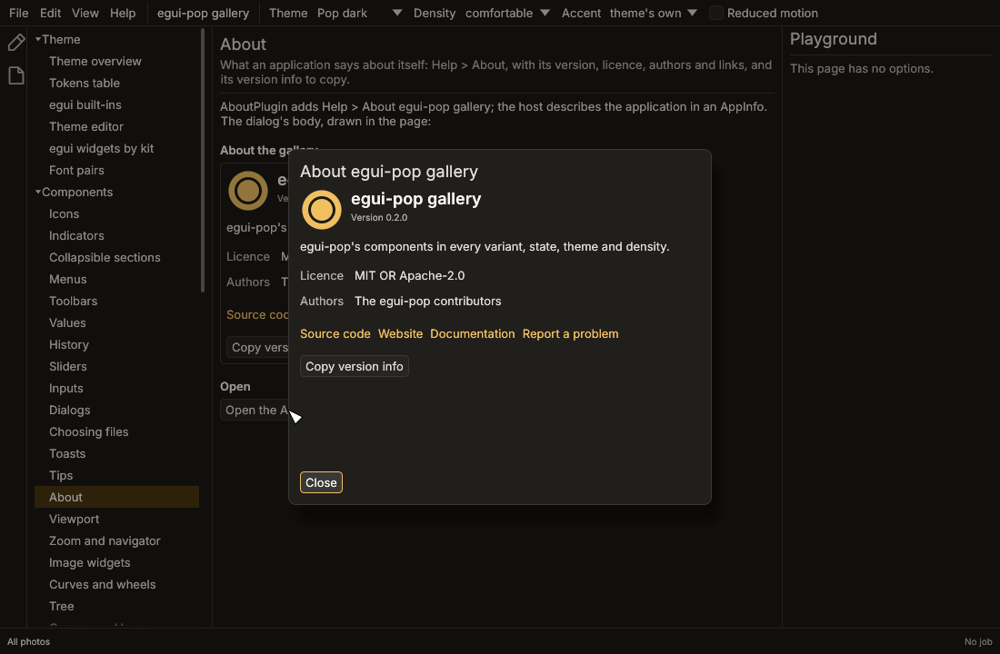

# About the application

Help > About *application*: a dialog with the application's name, icon,
version, one-line description, licences, authors and links, and a
"Copy version info" button for bug reports. The gallery's `about` page
shows it, and its Help menu has it.



## Turning it on

```rust
use egui_pop::api::about::{ABOUT, AboutPlugin, AppInfo};
use egui_pop::api::App;

let info = AppInfo::new("Darkroom", env!("CARGO_PKG_VERSION"))
    .description("A photo editor.")
    .licence("GPL-3.0-or-later")
    .author("The Darkroom contributors")
    .repository("https://example.org/darkroom")
    .website("https://example.org")
    .docs("https://example.org/darkroom/docs")
    .issues("https://example.org/darkroom/issues");
let app = App::builder()
    .name("Darkroom")
    .plugin(AboutPlugin::new(info))
    .build(&egui_pop::egui::Context::default())
    .unwrap();
assert_eq!(app.handle().service(&ABOUT).unwrap().info().name, "Darkroom");
```

`AboutPlugin` is opt-in. The host fills an `AppInfo`: the name (empty:
the application's, `AppBuilder::name`), the version (typically
`env!("CARGO_PKG_VERSION")`), a one-line description, licences (SPDX
expressions), authors, and the links it has: the repository, a website,
the docs, where to report issues. A link not given is not shown.

- `AppInfo::icon(|ui, side| …)` draws the application's icon at the
  top of the dialog, in a square of the side given.
- `AppInfo::renderer("wgpu: Vulkan, llvmpipe")` says what draws the
  interface, for the version info; the host knows it once the window
  is up, and may set it later through the service:
  `app.service(&ABOUT).unwrap().update(|i| i.renderer = Some(…))`.

Links open with egui's `Context::open_url`: a new tab on the web, the
system's browser on the desktop.

## Commands

| Command | What |
|---|---|
| `about` | Help > About *application* (the title says `{ $application }`, filled with the name) |
| `about.read` | For agents, kept out of the palette: everything as JSON (name, version, description, licences, authors, links, egui-pop's and egui's versions, the platform, the renderer, `version_info`) |

`about::open(app)` opens the dialog from code; `about::show(ui, app,
copied)` draws its body anywhere (the gallery's page does).

## The version info

"Copy version info" copies plain text, the same as
`AppInfo::version_info()`:

```text
Darkroom 1.2.0
egui-pop 0.2.0
egui 0.36
Platform: linux x86_64
Renderer: wgpu: Vulkan, llvmpipe
```

With the clipboard plugin connected, it goes through the
`clipboard.copy` step from the `about.version` endpoint (hooks see it,
sanitisers run, a refusal shows in a toast); without it, straight to the
system clipboard.

## Translated

The dialog's text is in egui-pop's catalogues (`egui-pop-about-*`); the
command's title, `command-about.title`, says `{ $application }`
(`À propos de { $application }`), so one translation serves every
application. What the host gives (the description, the authors) is
shown as given.

## Survey (2026-10-28)

egui has no About dialog, and no crate was found offering one for egui
with translations, agents' access and a copy for bug reports: owned.

Not done yet: links through an application-wide links service (one
place to open, log or refuse a URL), credits for third-party licences.
