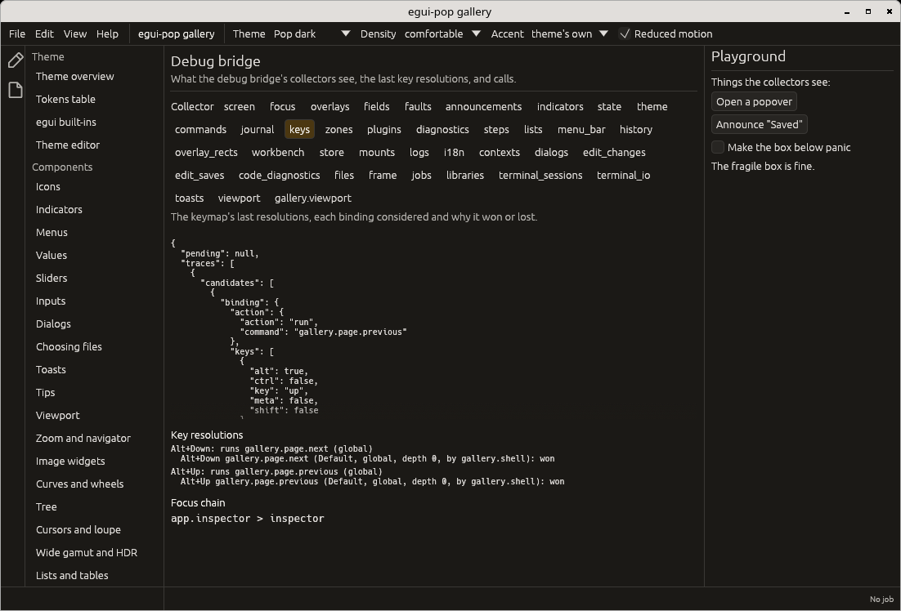

# Debugging

Every registry describes itself to the **debug bridge**: collectors for
commands, key resolution traces, focus, overlays, zones, plugins, steps,
the workbench, the store (each path's owner, writers and last writer,
and the writes refused to a scope that is not a writer), the journal,
diagnostics and the mount
contract (`mounts`: every component and host declared, what is mounted
where, `where_can` and `check`, see [hosts.md](hosts.md)), the fonts
(`fonts`: faces, fallback chains, sizes, and `check` for the chars a
family misses, see [fonts.md](fonts.md)), the settings window
(`settings_window`: open or not, the page shown, the search, the tree and
the custom pages), the pointer (`pointer`: the profile in force, the
hint, and the widgets that claim the secondary button, see
[pointer-gestures.md](pointer-gestures.md)), each with a JSON snapshot and
actions flagged `mutates` and `agent`; every call returns a feedback
block. A person reads it in the gallery, an agent or a test reads the
same data as JSON. The bridge's calls are the agent's: it may call the
actions that only read and `commands.run`, while those that write are
the user's (`debug_call_as` with `Origin::User`, as devtools does); every
call goes through the `debug.call` step a plugin may veto (see
[Agents](agents.md)).

```rust
use egui_pop::egui;
use egui_pop::prelude::*;

let ctx = egui::Context::default();
let mut app = App::builder().plugins(DefaultPlugins).build(&ctx).unwrap();
let snapshot = app.handle().debug_snapshot();
assert!(snapshot["commands"]["commands"].is_array());
let feedback = app.debug_call("commands", "run", &serde_json::json!({ "id": "app.palette" }));
assert!(feedback.ok && feedback.mutates);
```

The gallery's Debug page shows them, with the last key resolutions:



Run headless, the gallery prints the same snapshot on stdout before it
quits (`--dump-debug`, see [tools/wbox](../tools/wbox)). What cannot
apply (a hook on a step nobody declares, two plugins replacing the same
step) is reported as a diagnostic, never a silent no-op
([ADR 0003](adr/0003-no-silent-no-op.md)).

## State in egui's memory

egui-pop keeps its per-context state (tokens, fonts, the frame's
layout, focus, overlays, a slider's drag) in egui's temporary memory,
through typed slots (`egui_pop::core::state::Slot`). Every slot written
is listed by the `state` collector: its name, type, whether it holds one
value per context or one per instance (a widget, a window), how many
entries it holds now and a one-line summary of the first ones. A count
of instance entries that keeps growing while the interface does not is
a leak; the `slot` action lists every entry of one slot.

```rust
use egui_pop::core::debug::DebugBridge;
use egui_pop::core::state::Slot;
use egui_pop::egui;

// A component's own state, declared once.
const OPEN: Slot<bool> = Slot::new("my_plugin.open");

let ctx = egui::Context::default();
OPEN.keyed("first").set(&ctx, true);
let bridge = DebugBridge::with_core_collectors();
let state = bridge.snapshot_of(&ctx, "state").unwrap();
let open = state["slots"]
    .as_array()
    .unwrap()
    .iter()
    .find(|s| s["name"] == "my_plugin.open")
    .unwrap();
assert_eq!((open["scope"].as_str(), open["entries"].as_u64()), (Some("instance"), Some(1)));
```

egui locks its context while its memory is read or written: a slot
takes the lock itself, so build keys (`ctx.viewport_id()`, a widget's
id) and read other state before calling it. Only `update`'s closure
runs under the lock, and it must not touch the context; a slot touched
there panics with both names instead of deadlocking.

## Devtools

The same collectors inside the application: `DevtoolsPlugin` (opt-in)
adds a bottom panel, opened with `Shift+F12` once the `developer.devtools`
setting is on (off by default, so end users never meet it;
`DevtoolsPlugin::on_by_default(true)` turns it on in an application
shown to developers, as the gallery does). Its tabs
show the last key resolutions with each binding's verdict, the journal,
the steps with their hooks and last runs, the focus chain, overlays and
context keys, each window's scale (the `screen` collector), and every
collector as JSON with its actions. An action run from the panel goes
through the `devtools.call` step, which a plugin may veto (an action too
dangerous to offer in the panel), then, as the user's call, through the
bridge's `debug.call` step, whose veto (a kiosk build) covers the panel
and agents alike.

```rust
use egui_pop::api::devtools::{DevtoolsPlugin, PANEL_DEVTOOLS};
use egui_pop::egui;
use egui_pop::prelude::*;

let app = App::builder()
    .plugins(DefaultPlugins)
    .plugin(DevtoolsPlugin::default())
    .build(&egui::Context::default())
    .unwrap();
// Closed until asked for, and only once the setting allows it.
assert!(!app.handle().panel_visible(&PANEL_DEVTOOLS));
assert!(app.handle().debug_snapshot()["screen"]["windows"].is_array());
```

## Inspecting an element

When something on screen misbehaves, say exactly which element it is:
`devtools.inspect` (**Ctrl+Shift+F12**; View > Inspect an
element, the palette, the picker button at the end of the menu bar, or
the button at the start of the devtools panel) enters the inspect mode
once the `developer.devtools` setting is on. The menu bar's button
shows only then; its tooltip gives the command's key as the keymap
binds it, and it stays pressed while the mode is on (the `inspecting`
context key). While it is on:

- the pointer is a crosshair over the window (not over the inspect
  dialog), the widget under it outlined, with a small label (its role,
  name and size), and a hint sits at the top of the window;
- a click picks it and does not reach it (nothing is pressed);
- Tab, Shift+Tab and the arrows move between the interactive widgets
  instead, Enter picks the one outlined;
- Escape, Ctrl+Shift+F12 again, or the menu bar's button pressed again,
  leaves (that button is not picked);
- it works in every window, a detached panel's included.

A pick opens a dialog with what egui and egui-pop know: the element's
role, accessible name, value and description, the nearest named element
around it, its egui id, its rectangle, window and egui layer; the zone
and block or the panel drawing it and the plugin owning them; the
theme, its kit and density, and the kit part that painted its box with
the state it was in (fill, border, radius, text colours); whether it is
focused and enabled; and what the application adds
(`DevtoolsPlugin::describe`; the gallery adds its page and story).
**Copy** puts it on the clipboard as a readable text block, one
`Name: value` line each, with its JSON form
(`application/x-egui-pop.inspect+json`), through the clipboard's
`clipboard.copy` step; **Report…**, when the application says where
issues go (`help.report`, see [About](about.md#reporting-a-problem)),
opens a new issue prefilled with the pick, the version info, the
platform and the page; **Pick another** goes back to the mode. The last
pick is also the `inspect` collector's snapshot (`json` and `text`).

```rust
use egui_pop::api::devtools::{DevtoolsPlugin, inspect};
use egui_pop::egui;
use egui_pop::prelude::*;

let app = App::builder()
    .plugins(DefaultPlugins)
    .plugin(DevtoolsPlugin::default().describe(|_app, pick| {
        vec![("Document".into(), format!("picked by {}", pick.how))]
    }))
    .build(&egui::Context::default())
    .unwrap();
// Off with the setting.
assert!(inspect::start(app.handle()).is_err());
assert!(app.handle().debug_snapshot()["inspect"]["last"].is_null());
```

How an element is found, and the limits:

- **The hit test** reads the widget rectangles of the pass just drawn
  (egui's `ViewportState::this_pass.widgets`, public in egui 0.36): the
  top-most layer holding a rectangle under the point, then the
  smallest rectangle, the one drawn last on a tie. Tooltips are passed
  over. Every egui `Ui` registers a rectangle, so a custom-painted
  element with no rectangle of its own (a cell painted by its row, a
  mark on a canvas) is **named by its nearest container**: the dialog
  says `(container)`, and *Within* gives the nearest named element.
- **Names and roles** come from the AccessKit tree of the same pass,
  switched on while the mode is (and off again after, unless a screen
  reader had it on). A widget that names itself nowhere shows its id,
  its rectangle and what it senses.
- **Zones, blocks and panels** are recorded around each block and
  panel drawn, only while the mode is on.
- **The kit part** is known for parts painted through a kit
  component's handler (`Component::paint`, `Component::show`). egui's
  own widgets drawn with a kit's scoped visuals show none.
- **The keys**: not F12 nor Ctrl+Shift+C, the browsers' own: a web
  build never sees them, the browser opens its developer tools or its
  element picker first. Nor Ctrl+Shift+I, J, K, E, M, Z (Firefox's and
  Chrome's tools; Cmd+Option on a Mac), Shift+F5, F7, F9 (Firefox),
  Shift+F5, F6, F10 and Ctrl+F4, F5, F6 (Chrome), or Ctrl+Alt+a letter
  (AltGr types a character with it on many Windows layouts). Shift+F12
  and Ctrl+Shift+F12 are taken by none of Firefox, Chrome and Safari,
  on Linux, Windows and macOS (on a Mac laptop, with Fn).
- **Ctrl+Shift+C, rebound**: egui-winit turns it into a copy event and
  swallows the key. While the devtools setting is on and the mode is
  bound to it, egui-pop gives that event back as the key, so the
  binding works; a focused terminal then loses Ctrl+Shift+C as its
  copy.

### How other toolkits do it

| Tool | Entered | Shows | Left |
|---|---|---|---|
| [Browser devtools' element picker](https://developer.chrome.com/docs/devtools/open#elements) ([Firefox](https://firefox-source-docs.mozilla.org/devtools-user/page_inspector/how_to/select_an_element/index.html)) | Ctrl+Shift+C (Cmd+Shift+C on macOS) or the picker button | while hovering, the element's box (content, padding, margin) and a tooltip: tag, classes, size, colours, accessible name and role; a click selects it in the Elements panel | after a pick, Escape, or the chord again |
| [GTK Inspector](https://developer.gnome.org/documentation/tools/inspector.html) | Ctrl+Shift+I or Ctrl+Shift+D once enabled (`GTK_DEBUG=interactive`), then its picker button | the object tree, properties, CSS nodes and style classes, size and allocation, accessibility | after a pick |
| [GammaRay](https://github.com/KDAB/GammaRay) (Qt) | injected into the process; Ctrl+Shift+click on a widget in the application | the object tree, properties, geometry, a layout overlay, signals and slots | the next click is the application's |
| [Flutter's widget inspector](https://docs.flutter.dev/tools/devtools/inspector) | the *Select widget mode* toggle in DevTools | the widget tree, the widget's properties, its render object and the layout explorer; a tap selects | the toggle |
| [egui's `debug_on_hover`](https://docs.rs/egui/0.36.2/egui/style/struct.DebugOptions.html) | a style flag (debug builds) | the hovered widget's and its `Ui`'s rectangles and layout; `show_interactive_widgets` outlines every interactive rectangle | the flag |

What egui-pop takes: the browsers' chord, outline and label, the mode
ending with the pick or Escape, and keyboard picking (Tab and Enter);
a dialog instead of a side panel, so that one pick is one copyable
report. **Adopt, wrap or own**: nothing to adopt (no crate picks
elements in egui, and `debug_on_hover` shows layout, not who drew
what, in debug builds only); egui's widget rectangles and AccessKit
tree are wrapped as they are; the mode, its dialog and what egui-pop
adds (zones, blocks, panels, plugins, the kit) are its own, in
`egui_pop::core::inspect` and `egui_pop::api::devtools::inspect`.
