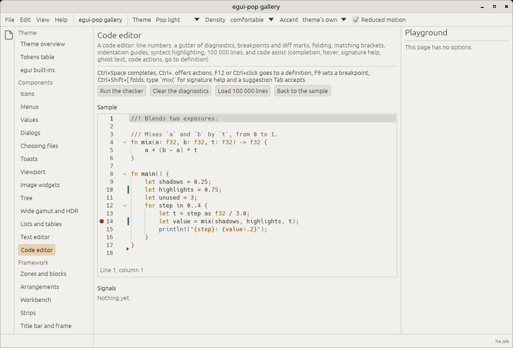

# Text and code editors

`egui-pop-editors` (the facade's `editors` feature, re-exported as
`egui_pop::editors`) has two editors over one state:

```sh
cargo add egui-pop --features editors
```

- [`TextSurface`](#the-text-surface): a multi-line text editor in the
  theme's body font;
- [`CodeEditor`](#the-code-editor): the same surface for code, with a
  gutter, highlighting, folding and code assist;
- `EditorState`: the text, the selection, the history, the marks, the
  search, as a handle the application, the widget and the commands an
  agent runs share.
- [`Terminal`](#the-terminal): a terminal over a `TerminalState`, fed
  by a program in a pseudo-terminal or by a read-only console of logs.

Both are **virtualised** (only the lines in view are laid out: 100 000
lines cost a screenful), take their colours from the theme
(`editor.*`, `syntax.*` tokens), behave as text inputs for egui-pop's
focus rules, and run every edit as a step
([ADR 0011](adr/0011-lifecycle-steps.md)).



## Survey: adopt, wrap or own

Checked on 2026-10-13 against egui 0.36.

| Crate | Licence | What it is | Decision |
|---|---|---|---|
| `egui_extras::syntax_highlighting` | MIT OR Apache-2.0 | Highlights a whole text into one `LayoutJob` (syntect or a tiny built-in highlighter), cached by the text's hash | **Not used**: every edit lays out and highlights the whole text again; no incremental state, no tokens |
| `egui_code_editor` 0.4 | MIT | A code editor on `egui::TextEdit`: line numbers, a keyword-list highlighter, completion | **Not used**: one galley for the whole text (no virtualisation), no gutter markers, no folding, its own colours; reference for its API only |
| `syntect` 5.3 | MIT | Sublime Text grammars and their bundled syntaxes; a line-by-line parser with a state per line | **Wrapped** as the default highlighter, with the `regex-fancy` engine (pure Rust: the gallery builds for the web); its scopes map to egui-pop's token kinds, never to its themes |
| `tree-sitter` / `tree-sitter-highlight` 0.27 | MIT | Incremental parsers (grammars in C) and highlight queries | **Wrapped** behind the `tree-sitter` feature (off: it compiles C, and the application brings the grammar crate) |
| `ropey` 2 (beta) | MIT OR Apache-2.0 | A rope | **Not used**: a vector of lines is enough for the sizes targeted (an edit touches the lines it changes) and keeps line access trivial |
| `egui_term` 0.1 | MIT | A terminal widget for egui over alacritty_terminal, with its own PTY backend | **Not used**: one release, pinned to egui 0.31 (egui-pop is on 0.36), its own colour scheme rather than tokens, no source trait (the PTY is the only backend), no steps; reference for its key bindings only |
| `alacritty_terminal` 0.26 | Apache-2.0 | Alacritty's emulator: grid, scrollback, selection, search, its own PTY and event loop | **Not used**: its PTY layer and event loop (polling, signal-hook, rustix) come along and do not build for the web, where the gallery and a log console must run; more than the widget needs |
| `vt100` 0.16 | MIT (its parser `vte`: Apache-2.0 OR MIT) | A parser and a screen: cells with colours and attributes, scrollback, the modes programs set (application cursor, bracketed paste, alternate screen, mouse) | **Wrapped** as the emulator: pure Rust, builds for the web; selection, links, drawing and keys are egui-pop's |
| `portable-pty` 0.9 | MIT | WezTerm's pseudo-terminals: Unix PTYs and Windows ConPTY, spawn, resize | **Wrapped** as `PtySource`, behind the `pty` feature (`editors-pty` on the facade): not for the web |

For the terminal, egui-pop **owns** the widget (drawing from tokens,
key routing and encoding, selection, links, steps) and the source
trait, and **wraps** `vt100` and `portable-pty`.

So egui-pop **owns** the editing surface (input, selection, drawing,
gutter, folding, search) and **wraps** the highlighters behind its own
`Highlighter` trait. `regex` (MIT OR Apache-2.0) does search and replace.

## The state

```rust
use egui_pop::editors::EditorState;
use egui_pop::editors::buffer::Pos;
use egui_pop::editors::selection::Selection;

let notes = EditorState::new("notes", "Shopping\n- bread");
notes.set_selection(Selection::caret(Pos::new(1, 7)));
notes
    .insert(None, "\n- milk", egui_pop::editors::history::EditKind::Paste, "user")
    .unwrap();
assert_eq!(notes.text(), "Shopping\n- bread\n- milk");
assert!(notes.is_dirty());
notes.undo(None, "user").unwrap();
assert_eq!(notes.line_count(), 2);
```

A position is a line and a column counted in characters, from 0. A
`Change` replaces the text between two positions; a list of changes is
applied in order, as one undo step. `EditorState::load` replaces the text
without a step or a history entry (a file opened); `mark_saved` says the
text is clean.

## The text surface

```rust
use egui_pop::editors::{EditorState, Signal, TextSurface};

fn ui(ui: &mut egui_pop::egui::Ui, app: &egui_pop::api::AppHandle, notes: &EditorState) {
    let out = TextSurface::new().label("Notes").app(app).status(true).show(ui, notes);
    for s in out.signals {
        if let Signal::Changed { version, .. } = s {
            let _ = version;
        }
    }
}
```

| Key | What it does |
|---|---|
| Letters, Enter, Tab, Backspace, Delete (Ctrl: a word) | Edit; Tab indents (several lines selected: each), Shift+Tab outdents |
| Arrows (Ctrl or Alt: a word), Home (the indentation, then the line's start), End, Page Up, Page Down, Ctrl+Home, Ctrl+End | Move; with Shift, select |
| Ctrl+A, Ctrl+C, Ctrl+X, Ctrl+V | Select all; copy, cut (the line when nothing is selected), paste |
| Ctrl+Z, Ctrl+Shift+Z, Ctrl+Y | Undo, redo the editor's own history |
| Ctrl+F, Ctrl+H, F3, Shift+F3, Ctrl+G, Ctrl+S | Find, replace, next and previous match, go to line, save (commands, see below) |
| Escape | Leaves the editor (then Tab moves on); first closes a popup |

The pointer places the cursor, selects by dragging, selects a word with a
double click and a line with a triple click.

**Focus.** The editor is a text input for egui and egui-pop: keys that
type stay with it while it has the focus (`textInputFocus`), the first
Escape leaves it (the focus stays in its surface), and it draws inside
the `editor` focus scope (`editorFocus`, `editorKind` = `text` or
`code`).

**Keymap scopes.** Its shortcuts are commands bound on the `editor`
surface, so a binding there wins over a global one while an editor has
the focus (Ctrl+S saves the editor, not the application), and the user
rebinds them in the shortcuts editor. An editor shown without an
application handles the same keys itself.

**Undo.** The application's histories are its kernel's
(`Host::history`, ADR 0014); the editor keeps its **own** history:
typing coalesces until a pause, a space or a move; every other edit is
one entry. Ctrl+Z in a focused editor undoes it (as in any text input,
the application's `edit.undo` is `!textInputFocus`); each undo and redo
reaches the application as an `edit.change` with `kind` `undo` or
`redo`. An application wanting one history calls `EditorState::undo`
from its own `History` owner.

**Search and replace.** Ctrl+F opens the bar above the text (the
selection becomes the query), Ctrl+H with the replacement field: match
case, whole word, regular expression (`$1` in the replacement), the
current match among all, Enter for the next one, Shift+Enter for the
previous, Replace and Replace all (one undo step). A match never spans a
line break. Ctrl+G opens a go-to-line field.

## The code editor

```rust
use egui_pop::editors::markers::{Diagnostic, Diff, Severity};
use egui_pop::editors::{CodeEditor, EditorState};

let code = EditorState::new("main.rs", "fn main() {\n    let x = 1;\n}").language("rs");
code.set_diagnostics(
    None,
    vec![Diagnostic::new(1, Severity::Warning, "unused variable `x`").columns(8, 9).source("rustc")],
)
.unwrap();
code.toggle_breakpoint(1);
code.set_diff(vec![(1, Diff::Modified)]);
assert_eq!(code.highlighter_name(), "syntect: Rust");

fn ui(ui: &mut egui_pop::egui::Ui, code: &EditorState) {
    CodeEditor::new().label("main.rs").height(400.0).show(ui, code);
}
```

- **The gutter**: breakpoints (a click sets or clears one; F9), line
  numbers (a click selects the line), diagnostics (the worst on the
  line, its message on hover; with columns, the text is underlined),
  fold arrows, and diff bars (added, modified, lines removed after).
  Marks follow the text: a line inserted above moves them, a deleted
  line drops them.
- **The cursor's line** is highlighted, the **bracket** at the cursor and
  its match are outlined, **indentation guides** are drawn at each level
  (a blank line takes the next line's).
- **Folding** by indentation: a line folds the lines under it indented
  further (Ctrl+Shift+[ folds the block at the cursor, Ctrl+Shift+]
  unfolds, a click on the arrow toggles, a click on the `⋯` after a
  folded line opens it). The cursor never hides in a fold.
- **Highlighting** through a `Highlighter`:

  ```rust
  use egui_pop::editors::highlight::{Highlighter, Kind, Run, Runs};
  use egui_pop::editors::buffer::Buffer;

  /// Colours every line that starts with `#` as a comment.
  struct Hashes;

  impl Highlighter for Hashes {
      fn name(&self) -> String { "hashes".into() }
      fn edited(&mut self, _line: usize) {}
      fn highlight(&mut self, buffer: &Buffer, lines: std::ops::Range<usize>, _budget: usize) -> Vec<Option<Runs>> {
          lines
              .map(|i| {
                  let l = buffer.line(i);
                  let kind = if l.starts_with('#') { Kind::Comment } else { Kind::Plain };
                  Some(std::sync::Arc::from(vec![Run { bytes: 0..l.len(), kind }]))
              })
              .collect()
      }
  }

  let state = egui_pop::editors::EditorState::new("config", "# a comment\nkey = 1")
      .highlighter(Box::new(Hashes));
  assert_eq!(state.highlighter_name(), "hashes");
  ```

  A highlighter gives the lines in view their runs (byte ranges and a
  `Kind`: keyword, string, number, comment, function, type...); the
  editor colours each kind from its `syntax.<kind>` token. It is told
  from which line the text changed, and parses at most `budget` lines a
  pass (`CodeEditor::highlight_budget`, 500 by default) to reach the
  lines in view: a jump to the end of a long file draws plain text for a
  few passes, never a frozen frame. `EditorState::language` picks
  syntect's grammar by name, extension or file name (plain text when
  syntect knows none). `TreeSitterHighlighter` (feature
  `editors-tree-sitter`) takes a `HighlightConfiguration` the
  application builds from its grammar crate; it highlights the whole
  text again after a change.

## Code assist

An `AssistProvider` (a language server client, an AI assistant, a word
list) answers requests modelled on the Language Server Protocol; every
method has a default answering nothing.

| Request | When | Surface |
|---|---|---|
| `complete` | a word character typed (`complete_while_typing`), a trigger character (`trigger_characters`), Ctrl+Space | the completion list under the cursor, filtered as you type; Up, Down, Page Up, Page Down, Enter or Tab inserts, Escape closes |
| `hover` | the pointer resting on code; Ctrl+K Ctrl+I | the hover card |
| `signature_help` | a signature character typed (`(`, `,` by default) | the signature card above the cursor, the current parameter underlined; closed by `)`, Escape, or leaving the line |
| `code_actions` | Ctrl+. | the actions list; Enter applies one (its changes as one undo step) |
| `definition` | F12, Ctrl+click | the cursor goes there in this editor; elsewhere, `Signal::Definition` for the application to open |
| `inline_suggestion` | after typing (`suggests_inline`) | ghost text after the cursor (its first line, `…` when there is more); Tab accepts, Escape or any other key dismisses |

Diagnostics are not requested: the application pushes them
(`EditorState::set_diagnostics`, the `code.diagnostics` step).

Every request is **asynchronous**: the provider gets a `Request` (its
`RequestId`, the editor's state to read and its version, the position,
the trigger) and a `Reply` it answers now or later from any thread
(`Reply::deliver` wakes the interface). A newer request of the same kind
cancels the older one (`Reply::is_cancelled`, `AssistProvider::cancel`);
an answer for a text that moved on is dropped (completion keeps its
answer while the word is only being extended). A provider calls another
with `assist::reply_here`. A code editor with no provider completes with
the text's words (`WordCompletion`); `CodeEditor::assist(false)` turns
assist off.

```rust
use egui_pop::editors::assist::{AssistProvider, CompletionItem, ItemKind, Reply, Request};
use egui_pop::editors::EditorState;

/// Completes colour names, answering from a thread as a server would.
struct Colours;

impl AssistProvider for Colours {
    fn name(&self) -> String { "colours".into() }
    fn complete(&mut self, _request: &Request, reply: Reply<Vec<CompletionItem>>) {
        std::thread::spawn(move || {
            reply.deliver(vec![
                CompletionItem::new("crimson").kind(ItemKind::Constant).detail("#dc143c"),
                CompletionItem::new("cyan").kind(ItemKind::Constant).detail("#00ffff"),
            ]);
        });
    }
}

let style = EditorState::new("style.css", "a { color: c }").language("css").assist(Box::new(Colours));
assert_eq!(style.assist_name().as_deref(), Some("colours"));
```

The completion list, the cards and ghost text are the editor's own,
drawn from the theme (overlay surface, strong border, the accent for the
current parameter, muted italics for ghost text).

## Steps, events and collectors

Connect `EditorsPlugin` and give the editor the application
(`.app(&app)`): its moments become steps, it registers for the
commands, and its keys go through the keymap.

| Step | Arguments | Default |
|---|---|---|
| `edit.change` | `editor`, `kind` (`typing`, `deletion`, `paste`, `cut`, `indentation`, `replace`, `completion`, `edit`, `undo`, `redo`), `origin`, `version`, `changes` (`[{from, to, text}]`), `selection` | applies the changes |
| `edit.save` | `editor`, `version`, `lines`, `language`, `origin` | nothing to write; once the step succeeds the text is clean |
| `code.diagnostics` | `editor`, `version`, `diagnostics` | replaces the diagnostics |
| `code.insert_completion` | `editor`, `item`, `from`, `to`, `text` | replaces `from..to` with `text` (an `edit.change`) |
| `code.accept_suggestion` | `editor`, `at`, `text` | inserts the ghost text (an `edit.change`) |

A before-hook on `edit.change` refuses an edit (a read-only region) or
rewrites it; the application writes the file in a run-hook (or an
after-hook) of `edit.save`:

```rust
use egui_pop::prelude::*;
use egui_pop::editors::EditorsPlugin;
use egui_pop::editors::steps::{EDIT_CHANGE, EDIT_SAVE};

struct Files;

impl Plugin for Files {
    fn id(&self) -> PluginId {
        PluginId::from_static("files_demo")
    }

    fn connect(&mut self, ctx: &mut Ctx<'_>) -> Result<(), PluginError> {
        // The licence header (line 0) stays as it is.
        ctx.before(EDIT_CHANGE, |_, args| {
            let touches_header = args["changes"]
                .as_array()
                .is_some_and(|c| c.iter().any(|c| c["from"]["line"] == 0));
            if touches_header { Before::Veto("the header is generated".into()) } else { Before::Go }
        });
        ctx.replace(EDIT_SAVE, |_, args| {
            // Write the editor's text (EditorState::text) where it belongs.
            Ok(serde_json::json!({ "written": args["editor"] }))
        });
        Ok(())
    }
}

let app = App::builder()
    .plugin(EditorsPlugin)
    .plugin(Files)
    .build(&egui_pop::egui::Context::default())
    .unwrap();
let state = egui_pop::editors::EditorState::new("lib.rs", "// header\nfn f() {}");
let refused = state.set_text(Some(app.handle()), "", "user");
assert_eq!(refused, Err("the header is generated".into()));
state.save(Some(app.handle()), "user").unwrap();
assert!(!state.is_dirty());
```

Events on the journal, from code editors shown with an application:
`code.cursor_moved` (`editor`, `line`, `col`), `code.selection_changed`
(`editor`, `anchor`, `head`), `code.completion_requested` (`editor`,
`id`, `trigger`, `at`) and `code.completion_accepted` (`editor`,
`label`, `text`); each change is the `edit.change` step's own signal,
with its ranges.

Collectors on the debug bridge: `edit_changes` (the open editors, with
their lines, version, selection, highlighter, history, assist and
completion list, and the last changes), `edit_saves` (the last saves
and their results) and `code_diagnostics` (each editor's diagnostics).

## Driving an editor (agents)

The buffer is read and written through commands, offered to agents
(`editor` names one; without it, the editor that last had the focus):

| Command | Arguments | Result |
|---|---|---|
| `editor.read` | `editor`, `from_line`, `to_line` | `text`, `version`, `selection`, `dirty`, `lines`... |
| `editor.write` | `editor`, and `text` (all of it), or `from`, `to`, `text`, or `changes` | `version` (through `edit.change`: hooks apply) |
| `editor.select` | `editor`, `anchor`, `head` | the selection |
| `editor.find` | `editor`, `query`, `case_sensitive`, `whole_word`, `regex` | `matches`, `current`, the first matches |
| `editor.replace` | `editor`, `query`, `replacement`, `all` | `replaced` |
| `editor.find_next`, `editor.find_previous`, `editor.goto_line`, `editor.save`, `editor.undo`, `editor.redo` | `editor` (`line` from 1 for go to line) | |
| `code.fold`, `code.unfold`, `code.unfold_all`, `code.toggle_breakpoint` | `editor`, `line` | |
| `code.set_diagnostics` | `editor`, `diagnostics` | `diagnostics` (their count) |
| `code.complete`, `code.actions`, `code.definition`, `code.hover` | `editor` | the request is made; its answer shows at a later pass |

```rust
use egui_pop::prelude::*;
use egui_pop::editors::EditorsPlugin;
use egui_pop::editors::steps::{CMD_READ, CMD_WRITE, EDITORS};
use egui_pop::model::commands::Origin;

let mut app = App::builder()
    .plugin(EditorsPlugin)
    .build(&egui_pop::egui::Context::default())
    .unwrap();
// An editor registers itself when drawn with `.app(...)`; here by hand.
let notes = egui_pop::editors::EditorState::new("notes", "hello");
app.handle().service(&EDITORS).unwrap().attach(&notes);
let agent = || Origin::Agent("session-1".into());
app.run(&CMD_WRITE, serde_json::json!({ "editor": "notes", "from": { "line": 0, "col": 5 }, "text": " world" }), agent());
let read = app.run(&CMD_READ, serde_json::json!({ "editor": "notes" }), agent()).now().unwrap().unwrap();
assert_eq!(read["text"], "hello world");
```

## The terminal

`Terminal` draws a `TerminalState`: an emulator (vt100's screen, its
scrollback, the modes the program sets) fed by a `TerminalSource` the
**application picks**, and owns:

- `PtySource` (feature `pty`, `editors-pty` on the facade): a program in
  a pseudo-terminal, the user's shell by default; ConPTY on Windows,
  not for the web. Dropping it, or closing the session, kills the
  program;
- `Console`: a **read-only** source the application writes to from any
  thread: build logs, a job's output, an agent's transcript (a later
  jobs console reuses it). What is written before a terminal starts it
  is kept and shown then; a lone `\n` becomes `\r\n`; `finish` ends it;
- its own: a source starts (giving its output to a `Sink`, from any
  thread), takes input, is resized and stopped. An application whose
  kernel runs programs elsewhere replaces `terminal.spawn` and
  `terminal.input` (below) and feeds the output with
  `TerminalState::feed`, the end with `TerminalState::finished`.

```rust
use egui_pop::editors::terminal::{Console, Terminal, TerminalState};

let log = Console::new();
log.line("\x1b[1;32mCompiling\x1b[0m demo v0.1.0");
let term = TerminalState::new("build-log", log.clone());

fn ui(ui: &mut egui_pop::egui::Ui, app: &egui_pop::api::AppHandle, term: &TerminalState) {
    Terminal::new().label("Build log").app(app).height(240.0).show(ui, term);
}

// From any thread, while the build runs:
log.line("\x1b[1;33mwarning\x1b[0m: unused variable");
log.finish(Some(0));
# let _ = term;
```

```rust,ignore
// Feature `editors-pty`: a shell, or a program.
use egui_pop::editors::terminal::{CommandLine, PtySource, TerminalState};

let shell = TerminalState::new("shell", PtySource::shell());
let tests = TerminalState::new(
    "tests",
    PtySource::new(CommandLine::new("cargo").arg("test").cwd("/path/to/project")),
);
```

**Drawing.** The 16 ANSI colours are the theme's `terminal.ansi.0` to
`terminal.ansi.15` (0 the colour furthest from the text, 7 the text's,
1 to 6 the status roles and the accent, a bold 0 to 7 their stronger
form); the 256-colour cube and RGB colours are the program's own.
Bold, dim, italics, underline and inverse are drawn; the cursor is a
block while focused, an outline otherwise (none for a read-only source).
The terminal fills the width it is given and the height asked
(`height`), and tells the source its rows and columns as they change
(a PTY tells the program: `SIGWINCH`).

**Scrollback.** 10 000 lines by default (`TerminalState::scrollback`);
the wheel and Shift+Page Up, Shift+Page Down scroll back, typing comes
back to the screen. Output keeps the view where it is while scrolled
back.

**Selection, copy and links.** Dragging selects (a double click a word,
paths and addresses included; a triple click a line); Ctrl+Shift+C, or
Ctrl+C while something is selected, copies (soft-wrapped lines joined).
`http://`, `https://` and `file://` addresses are links: underlined
under the pointer, opened by Ctrl+click through the links service
([links](links.md)) as content found in a program's output: a web page
asks first while its host is not trusted, a `file://` link is a
confirmed open (never a browser's), a program is refused.

**Keys and focus (decided 2026-10-13).** A program in a terminal needs
Escape (vi, less, readline) and Tab (completion), so the terminal does
not follow the text inputs' rule that Escape leaves:

| Key | Goes to |
|---|---|
| Every key, Escape and Tab included, Ctrl and Alt chords | the program, encoded as xterm does (application cursor mode honoured; Alt sends Escape first) |
| **Shift+Escape** | leaves the terminal: the focus stays in its surface (`terminalFocus`), as for a text input after Escape; then Tab moves on |
| Ctrl+Shift chords (but Ctrl+Shift+C), Command chords on macOS | the application's keymap: a terminal cannot tell Ctrl+Shift+K from Ctrl+K, so nothing is lost. `terminal.clear` is bound to Ctrl+Shift+K on the `terminal` surface |
| Ctrl+C | copies when text is selected, else interrupts the program |
| Ctrl+Shift+C | copies the selection; with nothing selected, does nothing |
| Ctrl+V (Command+V on macOS), the Paste key; Shift+Insert on Windows only (egui-winit's mapping) | pastes (bracketed when the program asked) |
| Shift+Page Up, Shift+Page Down | scroll back |

The keys are taken before the application's key dispatcher reads them
(an input hook), so global shortcuts do not fire while a terminal has
the focus; the application's own escape hatch is a Ctrl+Shift chord.

### Steps, collectors and commands

Connect `TerminalPlugin` and give the terminal the application
(`.app(&app)`): its moments become steps, it registers for the
commands, and a program that ends runs `terminal.exit` even in a
terminal not drawn.

| Step | Arguments | Default |
|---|---|---|
| `terminal.spawn` | `terminal`, `source`, `command` (`{program, args, cwd, env}` or `null`), `rows`, `cols`, `origin` | starts the source with `command` |
| `terminal.input` | `terminal`, `text`, `kind` (`keys`, `paste`, `agent`), `origin` | writes `text` to the source |
| `terminal.exit` | `terminal`, `reason` (`exited`: the program ended; `close`: asked), `code`, `origin`, `notice`, `restart` | `close` stops the source; both write `notice` dimmed, and start again when `restart` |

A before-hook on `terminal.spawn` refuses a program (the terminal shows
why) or redirects its `command`; on `terminal.input` it refuses input
or rewrites `text`; on `terminal.exit` it keeps a session open (`close`)
or, for `exited`, changes the notice or sets `restart`. A run-hook does
the step its own way (the application's kernel runs the program).

```rust
use egui_pop::prelude::*;
use egui_pop::editors::TerminalPlugin;
use egui_pop::editors::terminal::steps::{TERMINAL_INPUT, TERMINAL_SPAWN};

struct Policy;

impl Plugin for Policy {
    fn id(&self) -> PluginId {
        PluginId::from_static("terminal_policy")
    }

    fn connect(&mut self, ctx: &mut Ctx<'_>) -> Result<(), PluginError> {
        // Shells only in the "dev" terminal.
        ctx.before(TERMINAL_SPAWN, |_, args| {
            if args["source"] == "pty" && args["terminal"] != "dev" {
                Before::Veto("shells run in the dev terminal".into())
            } else {
                Before::Go
            }
        });
        // An agent's commands are logged before they run.
        ctx.after(TERMINAL_INPUT, |_, args, _| {
            if args["kind"] == "agent" {
                let _ = &args["text"];
            }
        });
        Ok(())
    }
}

let app = App::builder()
    .plugin(TerminalPlugin)
    .plugin(Policy)
    .build(&egui_pop::egui::Context::default())
    .unwrap();
# let _ = app;
```

Collectors on the debug bridge: `terminal_sessions` (each terminal: its
source, size, session, cursor, scrollback, title, modes, and its last 20
lines) and `terminal_io` (the last runs of the three steps).

**Driving a terminal (agents).** `terminal` names one; without it, the
terminal that last had the focus:

| Command | Arguments | Result |
|---|---|---|
| `terminal.read` | `terminal`, `from_line`, `to_line` (from 0, end excluded), or `screen` | `text` (scrollback then screen, one line per row), `lines`, `cursor`, `rows`, `cols`, `running`, `exit_code`... |
| `terminal.send` | `terminal`, `text`, `enter` | `bytes` (through `terminal.input`, `kind` `agent`: hooks apply) |
| `terminal.clear` | `terminal` | clears the screen and the scrollback (Ctrl+Shift+K) |
| `terminal.copy` | `terminal` | `copied`: the selection, put on the clipboard |
| `terminal.close`, `terminal.restart` | `terminal` | the state (through `terminal.exit`, `terminal.spawn`) |

The same from code: `TerminalState::text`, `lines`, `screen_text`,
`send`, `clear`, `close`, `restart`, `describe`.

## Gaps

- **No language server client yet**: the assist traits are shaped for
  one (requests with ids, cancellation, late answers); the client itself
  is a follow-up.
- One cursor and one selection (no multiple cursors, no column
  selection).
- No soft wrap: long lines scroll horizontally, and a single very long
  line is laid out whole.
- The IME's composition (preedit) is not drawn; committed text is
  inserted.
- Highlighting runs on the interface thread within its budget (a
  background parse is a follow-up); the tree-sitter highlighter
  re-highlights the whole text after a change and is not covered by the
  workspace's tests (no grammar crate is a dependency).
- Folding is by indentation only (no grammar folds, no persisted folds);
  bracket matching ignores strings and comments.
- Search matches stay within a line.
- The cursor does not blink (steady, as with reduced motion).
- Edit > Undo in the menus undoes the application's history, not the
  focused editor's (the editor's Ctrl+Z does).
- The terminal does not report the mouse to programs (mouse modes are
  read but not sent: vim and htop see no clicks; in the alternate
  screen the wheel does nothing), has no hyperlinks set by programs
  (OSC 8) nor images (sixel, kitty), and draws no IME composition. Its
  selection is anchored to lines and drifts once the scrollback is full
  and drops its oldest lines. Alt is always Meta (on macOS, Option does
  not compose characters in a terminal). The leave chord is fixed
  (Shift+Escape). No screenshots of the terminal page in
  `docs/screenshots/` yet.
