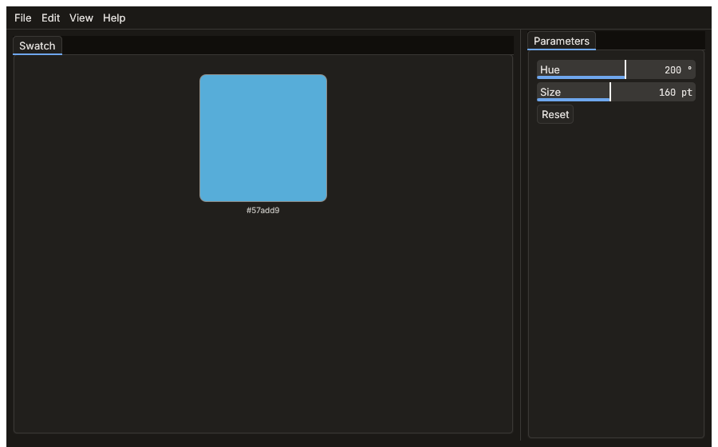

# Your first application

From an empty crate to an application with a command, panels, a
setting, a theme of its own, undo, an agent surface and tests, in eight
short steps. You do not need to know egui-pop to follow it, only Rust
and a little egui.

The steps follow the path a real application took:
[Helios](https://github.com/quazardous/helios), a photo editor built on
egui-pop. The code here is general; each step ends with **where Helios
goes further**, a link to the file of Helios doing the same thing at
full size.

The application built here is a **colour swatch**: a square whose hue
and size are two parameters. Its end state is the application template:

```sh
cargo generate --git https://github.com/quazardous/egui-pop templates/app
cd my-app && cargo run
```



Every block on this page is compiled and run with egui-pop's guides
(`cargo test -p consumer-smoke --doc`), and the template is built and
tested by the same CI, so neither falls behind the API.

## 1. A window

An application is an `App`, built by `App::builder()` from plugins.
`DefaultPlugins` is the paved road: the command palette, dialogs,
toasts, the settings window, the window's place and saved layouts.
`persist` names the folder where the settings, the layout and the
window's place are kept between runs.

```rust,no_run
use egui_pop::eframe;
use egui_pop::prelude::*;

fn main() -> eframe::Result {
    App::builder()
        .name("Swatch")
        .plugins(DefaultPlugins)
        .persist(std::env::temp_dir().join("swatch"))
        .run_native("Swatch", eframe::NativeOptions::default())
}
```

`cargo add egui-pop serde_json` is all it needs. Tests (and the rest of
this page) build the same application headless, on a context of their
own, with `.build(&egui::Context::default())` instead of `run_native`.

**Where Helios goes further.** Its
[`main.rs`](https://github.com/quazardous/helios/blob/main/crates/helios-gui/src/main.rs)
sets the window's options (its own frame, a minimum size, the GPU
device opened while the window comes up) and finishes setting up on the
window's context with `run_native_with`; its
[`shell.rs`](https://github.com/quazardous/helios/blob/main/crates/helios-gui/src/shell.rs)
lists every plugin it adds to `DefaultPlugins`, each with a comment.

## 2. A command, its key and its menu entry

Everything an application adds goes through a **plugin**: an id and a
`connect` method registering through `Ctx`. A command is declared once,
with a `CommandSpec`; its key binding, its menu entry, its palette
entry and its agent surface all come from it.

```rust
use egui_pop::api::app::MENU_EDIT;
use egui_pop::api::palette;
use egui_pop::egui;
use egui_pop::prelude::*;

const RESET: CommandId = CommandId::from_static("swatch.reset");

struct Swatch;

impl Plugin for Swatch {
    fn id(&self) -> PluginId {
        PluginId::from_static("swatch")
    }

    fn connect(&mut self, ctx: &mut Ctx<'_>) -> Result<(), PluginError> {
        ctx.command(
            CommandSpec::new(RESET, "Reset the swatch", "Swatch")
                .key("Ctrl+Shift+R")
                .menu(MENU_EDIT, "5_swatch", 0),
            |_call| Ok(serde_json::Value::Null),
        )?;
        Ok(())
    }
}

let mut app = App::builder().plugins(DefaultPlugins).plugin(Swatch)
    .build(&egui::Context::default()).unwrap();
// The palette (Ctrl+Shift+P or F1) finds it from a few letters.
let found = palette::rank(&app.handle().palette(), "reset sw", &[], |_| true);
assert_eq!(found[0].label, "Swatch: Reset the swatch");
// The key, the menu, the palette and code run the same thing.
let out = app.run(&RESET, serde_json::Value::Null, Origin::User);
assert_eq!(out.now(), Some(Ok(serde_json::Value::Null)));
```

Whatever a plugin registers is its own and goes away when it is
disconnected. The settings window's Keyboard shortcuts page rebinds the
key; a `when` clause (`.when("...")`) says when the command applies.
More in [Plugins, commands and steps](plugins.md).

**Where Helios goes further.** Its commands run in its own kernel, not
in closures: it declares them without a handler (`Ctx::declare`) in
[`plugins.rs`](https://github.com/quazardous/helios/blob/main/crates/helios-gui/src/plugins.rs),
and gives egui-pop a host that runs them
([`host.rs`](https://github.com/quazardous/helios/blob/main/crates/helios-gui/src/host.rs),
`AppBuilder::host`).

## 3. Panels in the workbench

A panel has an id, a title and a default area: the centre, the start or
end side bar, or the bottom. The workbench places it there; the user
drags it elsewhere, splits, tabs, closes or detaches it, and the layout
is saved with the settings (`persist`) and repaired at the next start.

```rust
use egui_pop::egui;
use egui_pop::model::panels::{Area, PanelSpec};
use egui_pop::prelude::*;

const VIEW: PanelId = PanelId::from_static("swatch.view");
const PARAMETERS: PanelId = PanelId::from_static("swatch.parameters");

struct Swatch;

impl Plugin for Swatch {
    fn id(&self) -> PluginId {
        PluginId::from_static("swatch")
    }

    fn connect(&mut self, ctx: &mut Ctx<'_>) -> Result<(), PluginError> {
        ctx.panel(PanelSpec::new(VIEW, "Swatch", Area::Center), |ui, _app| {
            ui.heading("The swatch");
        })?;
        let parameters = PanelSpec::new(PARAMETERS, "Parameters", Area::EndSide);
        ctx.panel(parameters, |ui, _app| {
            ui.label("Its parameters");
        })?;
        Ok(())
    }
}

let app = App::builder().plugins(DefaultPlugins).plugin(Swatch)
    .build(&egui::Context::default()).unwrap();
let layout = app.handle().layout();
assert_eq!(layout.area_of(&VIEW), Some(Area::Center));
assert_eq!(layout.area_of(&PARAMETERS), Some(Area::EndSide));
```

A panel's body is egui code: anything egui draws works there. The
closure gets the `AppHandle`, to read state and run commands
(`app.run(RESET, args)`, queued for the next frame). `PanelSpec` also
takes sizes, the areas a panel may go to (`only_in`), whether it
detaches into a window of its own, and whether it starts closed.
`AppBuilder::layout` gives a starting layout other than "every panel in
its area". More in [The workbench](workbench.md).

**Where Helios goes further.**
[`workbench.rs`](https://github.com/quazardous/helios/blob/main/crates/helios-gui/src/workbench.rs)
declares a dozen panels with their rules and offers its layouts as
arrangements (`Ctx::arrangement`) the user switches between.

## 4. A setting

A setting is a value with a descriptor: its type, label, range and
default. `Ctx::setting` puts it in the settings window (`Ctrl+,`),
under the plugin's title, with a reset and a search; it is saved with
the rest. The application reads it from the value store, where it lives
at `settings/<id>`, wherever it needs it: here, while drawing.

```rust
use egui_pop::core::binding;
use egui_pop::egui;
use egui_pop::model::values::{Change, Set, Value};
use egui_pop::prelude::*;

const SHOW_CODE: SettingId = SettingId::from_static("swatch.show_code");
const SHOW_CODE_PATH: &str = "settings/swatch.show_code";

struct Swatch;

impl Plugin for Swatch {
    fn id(&self) -> PluginId {
        PluginId::from_static("swatch")
    }

    fn connect(&mut self, ctx: &mut Ctx<'_>) -> Result<(), PluginError> {
        let show = Descriptor::bool("Show the colour's code", true)
            .description("Writes the colour's hexadecimal code under the swatch.");
        ctx.setting(SHOW_CODE, show)?;
        Ok(())
    }
}

let app = App::builder().plugins(DefaultPlugins).plugin(Swatch)
    .build(&egui::Context::default()).unwrap();
let store = app.handle().store();
// In a panel: `binding::read(&app.store(), SHOW_CODE_PATH)`.
assert_eq!(binding::read::<bool>(&store, SHOW_CODE_PATH), Some(true));
// The settings window writes it as the user does here.
let off = Set::new(SHOW_CODE_PATH, Change::To(Value::Bool(false)), Origin::User);
egui_pop::core::lock(&store).set(off).unwrap();
assert_eq!(binding::read::<bool>(&store, SHOW_CODE_PATH), Some(false));
```

A page laid out by hand, in place of the generated one, is a
`Ctx::settings_page` ([Plugins](plugins.md#settings-pages)).

**Where Helios goes further.**
[`display.rs`](https://github.com/quazardous/helios/blob/main/crates/helios-gui/src/display.rs)
declares a setting that changes what the window asks of the screen,
and [`theme_editor.rs`](https://github.com/quazardous/helios/blob/main/crates/helios-gui/src/theme_editor.rs)
mounts a whole page in the settings window.

## 5. A theme, then a kit of your own

Pick a built-in theme by name (`pop-dark`, `pop-light`,
`pop-high-contrast`, `gruvbox-dark`, `catppuccin-mocha` and
[more](themes.md#the-built-in-themes)); its light or dark counterpart
follows the system's preference, and the View menu toggles it. To look
like your product, add a **kit**: a token file over a built-in theme,
changing only what differs. Custom painting reads the theme's tokens,
never literal colours, so it follows every theme.

```rust
use egui_pop::egui;
use egui_pop::prelude::*;
use egui_pop::tokens::kit::{self, KitData};

// A built-in theme...
let _builder = App::builder().theme(ThemeSpec::new("gruvbox-dark"));

// ...or a kit: a blue accent and underlined tabs over pop-dark.
let ours = KitData::from_text("swatch", r#"
$extends: "pop-dark"
accent:
  $type: "color"
  default: {$value: "{blue.9}"}
tab:
  shape: {$type: "string", $value: "underline"}
"#);
assert!(kit::check(&ours).is_empty(), "{:?}", kit::check(&ours));
let ctx = egui::Context::default();
let _app = App::builder().kit(ours).theme(ThemeSpec::new("swatch"))
    .build(&ctx).unwrap();

// While drawing: the theme's colours and sizes.
let tokens = Tokens::of(&ctx);
let _frame = egui::Stroke::new(1.0, tokens.border.strong);
```

The template keeps its kit in a folder, `kit/kit.yaml`, built into the
binary with `egui_pop::tokens::kit!("../kit")`, and checks it in a
test. More in [Themes](themes.md), [Kits as packages](kit-packages.md)
and [Design tokens](tokens.md).

**Where Helios goes further.**
[`theme.rs`](https://github.com/quazardous/helios/blob/main/crates/helios-gui/src/theme.rs)
ships five themes as token files
([`themes/`](https://github.com/quazardous/helios/tree/main/crates/helios-gui/themes))
extending egui-pop's, and adds tokens of its own (the neutral grey
behind a photo) with a fallback for themes that lack them.

## 6. Undo

egui-pop's undo is the application's history; Ctrl+Z, the Edit menu
and the History panel route to it. Without a history of its own, the
application's state lives in the **value store**: each change is an
undo step with a label and an origin. Declare the values the plugin
owns, write them as the user or the command's caller, and group the
writes of one action into one step.

```rust
use egui_pop::api::app::CMD_UNDO;
use egui_pop::core::{binding, lock};
use egui_pop::egui;
use egui_pop::model::values::{Change, Set, Value};
use egui_pop::prelude::*;

const HUE: &str = "swatch/hue";
const RESET: CommandId = CommandId::from_static("swatch.reset");
# struct Swatch;
# impl Plugin for Swatch {
#     fn id(&self) -> PluginId { PluginId::from_static("swatch") }
#     fn connect(&mut self, ctx: &mut Ctx<'_>) -> Result<(), PluginError> {
// In `connect`: the value, owned by the plugin.
let hue = Descriptor::float("Hue", 0.0, 360.0, 200.0).unit("°");
lock(&ctx.app().store())
    .declare(ctx.owner(), HUE, hue)
    .map_err(|e| PluginError::Failed(e.to_string()))?;
ctx.command(CommandSpec::new(RESET, "Reset the swatch", "Swatch"), |call| {
    let store = call.app.store();
    let mut s = lock(&store);
    // Every write until `end` is one step, named, with the caller's origin.
    let group = s.begin_group(call.origin.clone(), "Reset the swatch");
    let done = s.set(Set::new(HUE, Change::Reset, call.origin.clone()).gesture(group));
    s.end(group);
    done.map(|_| serde_json::Value::Null).map_err(|e| e.to_string())
})?;
#         Ok(())
#     }
# }

let mut app = App::builder().plugins(DefaultPlugins).plugin(Swatch)
    .build(&egui::Context::default()).unwrap();
let store = app.handle().store();
lock(&store).set(Set::new(HUE, Change::To(Value::Float(30.0)), Origin::User)).unwrap();
app.run(&RESET, serde_json::Value::Null, Origin::User);
assert_eq!(binding::read::<f64>(&store, HUE), Some(200.0));
app.run(&CMD_UNDO, serde_json::Value::Null, Origin::User); // Ctrl+Z
assert_eq!(binding::read::<f64>(&store, HUE), Some(30.0));
```

In a panel, a widget bound to the value writes it the same way, one
step per drag: `param::param(ui, &descriptor, Mode::Bound(&store, HUE))`
draws the slider, check box or field its descriptor calls for
(`egui_pop::core::param`). `HistoryPlugin` (`egui_pop::api::history_view`)
adds the History panel: every step, a click to go back to one,
snapshots. More in [History](history.md) and
[State or event](state-or-event.md).

**Where Helios goes further.** Its kernel keeps the history (each
image's edits, saved as versions);
[`history.rs`](https://github.com/quazardous/helios/blob/main/crates/helios-gui/src/history.rs)
shows it to egui-pop through the `History` contract, with the hover
preview, and
[`edit_snapshots.rs`](https://github.com/quazardous/helios/blob/main/crates/helios-gui/src/edit_snapshots.rs)
adds named snapshots.

## 7. The agent bridge

Every command is offered to agents unless it says otherwise: an agent
(a test, a script, an assistant behind a transport you write) holds the
`App`, reads what it offers as JSON and runs commands as
`Origin::Agent`. Describe a command's arguments with an example; keep a
command off that surface with `.no_agent()`; the whole bridge can be
read-only or off (`AppBuilder::debug_bridge`).

```rust
use egui_pop::egui;
use egui_pop::prelude::*;
use serde_json::json;

struct Swatch;

impl Plugin for Swatch {
    fn id(&self) -> PluginId {
        PluginId::from_static("swatch")
    }

    fn connect(&mut self, ctx: &mut Ctx<'_>) -> Result<(), PluginError> {
        let set = CommandSpec::new(CommandId::from_static("swatch.set"), "Set the swatch", "Swatch")
            .description("Sets the hue (`hue`, 0 to 360).")
            .args(json!({ "hue": 30.0 }))
            .hidden(); // out of the palette, still offered to agents
        ctx.command(set, |call| Ok(json!({ "hue": call.args["hue"], "by": call.origin })))?;
        Ok(())
    }
}

let mut app = App::builder().plugins(DefaultPlugins).plugin(Swatch)
    .build(&egui::Context::default()).unwrap();
// What the bridge holds (collectors, actions), and every collector's state.
assert!(app.handle().debug_describe().as_array().is_some_and(|c| !c.is_empty()));
let snapshot = app.handle().debug_snapshot();
let commands = snapshot["commands"]["commands"].as_array().unwrap();
let set = commands.iter().find(|c| c["id"] == "swatch.set").unwrap();
assert_eq!((&set["agent"], &set["args"]), (&json!(true), &json!({ "hue": 30.0 })));
// Run it as an agent: the run, and every step it writes, is the agent's.
let f = app.debug_call("commands", "run", &json!({ "id": "swatch.set", "args": { "hue": 90.0 } }));
assert!(f.ok, "{}", f.message);
let agent = json!({ "kind": "agent", "id": "debug-bridge" });
assert_eq!(f.data, json!({ "hue": 90.0, "by": agent }));
```

The History panel names the steps an agent made ("Set the swatch
(agent:debug-bridge)"), and a before-hook on a step may refuse what an
agent asks for. What the bridge can and cannot do, and its trust model,
are in [Agents and the debug bridge](agents.md).

**Where Helios goes further.** Agents drive Helios's kernel, not only
its window: an MCP server
([`mcp.rs`](https://github.com/quazardous/helios/blob/main/crates/helios-node/src/mcp.rs))
maps tools onto the same commands scripts use, and the window's host
([`host.rs`](https://github.com/quazardous/helios/blob/main/crates/helios-gui/src/host.rs))
carries each origin into the kernel and back.

## 8. Tests

egui-pop's test kit (`egui-pop-test`) builds the whole application in
an [egui_kittest](https://github.com/emilk/egui/tree/main/crates/egui_kittest)
harness, headless: widgets are found by role and label, keys are
pressed for real, and checks catch a key bound twice, a widget without
a name, or a write to a value nobody declared. Add them as
dev-dependencies: `cargo add --dev egui_kittest egui-pop-test`.

```rust
use egui_kittest::kittest::Queryable as _;
use egui_pop::api::app::MENU_EDIT;
use egui_pop::egui;
use egui_pop::model::panels::{Area, PanelSpec};
use egui_pop::prelude::*;

const RESET: CommandId = CommandId::from_static("swatch.reset");
# struct Swatch;
# impl Plugin for Swatch {
#     fn id(&self) -> PluginId { PluginId::from_static("swatch") }
#     fn connect(&mut self, ctx: &mut Ctx<'_>) -> Result<(), PluginError> {
#         let spec = CommandSpec::new(RESET, "Reset the swatch", "Swatch").key("Ctrl+Shift+R").menu(MENU_EDIT, "5_swatch", 0);
#         ctx.command(spec, |_| Ok(serde_json::Value::Null))?;
#         let view = PanelSpec::new(PanelId::from_static("swatch.view"), "Swatch", Area::Center);
#         ctx.panel(view, |ui, app| if ui.button("Reset").clicked() { app.run(RESET, serde_json::Value::Null); })?;
#         Ok(())
#     }
# }

let builder = App::builder().plugins(DefaultPlugins).plugin(Swatch);
let mut h = egui_pop_test::app(builder, egui::vec2(800.0, 500.0));
h.run();
h.get_by_label("Reset").click();
h.run();
h.key_press_modifiers(egui::Modifiers::COMMAND | egui::Modifiers::SHIFT, egui::Key::R);
h.run();
let runs = h.state().handle().history();
assert_eq!(runs.iter().filter(|r| r.id == RESET).count(), 2, "the button and the key");
egui_pop_test::assert_keymap_clean(h.state());
egui_pop_test::assert_all_named(&h);
```

A picture of the window is a snapshot test. It renders with wgpu
(`egui-pop-test`'s `wgpu` feature, `egui_kittest`'s `wgpu` and
`snapshot`), writes the picture with `UPDATE_SNAPSHOTS=1 cargo test`,
and compares with it afterwards, within the tolerances of a
`kittest.toml` next to the manifest:

```rust,ignore
#[test]
fn the_window_looks_as_it_did() {
    let mut h = egui_pop_test::app_wgpu(builder(), egui::vec2(900.0, 560.0));
    h.run();
    h.snapshot("swatch"); // tests/snapshots/swatch.png
}
```

The template's `src/tests.rs` has both, and the agent's run of step 7.
More in [Testing](testing.md).

**Where Helios goes further.** Its
[`tests/`](https://github.com/quazardous/helios/tree/main/crates/helios-gui/tests)
drive the whole shell headless, one binary per feature (layouts, keys,
the palette, detached panels, history), and
[`snapshot.rs`](https://github.com/quazardous/helios/blob/main/crates/helios-gui/src/snapshot.rs)
takes pictures of a named widget, a panel or the window, headless or
from a real window.

## What next

The template (`templates/app`) is these eight steps in one crate, with
a `README.md` saying where each one is. From there:

- [Getting started](getting-started.md#the-paved-road): what
  `DefaultPlugins` brings, and laying out by role;
- [Plugins, commands and steps](plugins.md): steps others may veto,
  replace or follow; zones and blocks;
- [Hosts and components](hosts.md): an application with a kernel of
  its own, as Helios;
- [Translations](i18n.md), [Jobs and progress](progress.md),
  [Choosing files](files.md): what a real tool needs next;
- [The gallery](gallery.md): every component, running.
