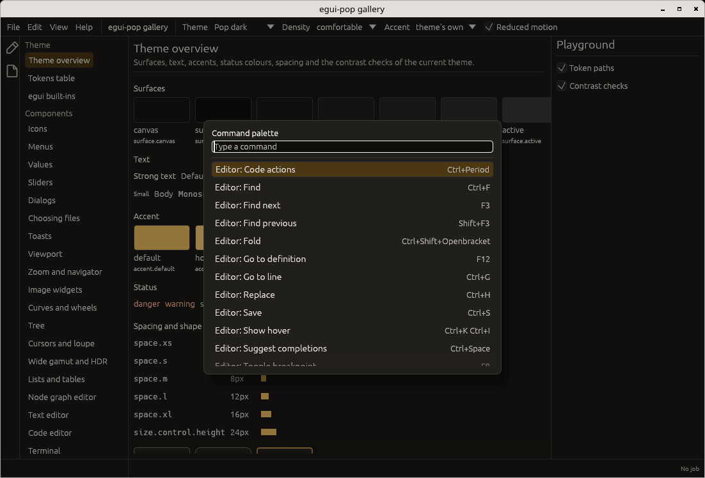
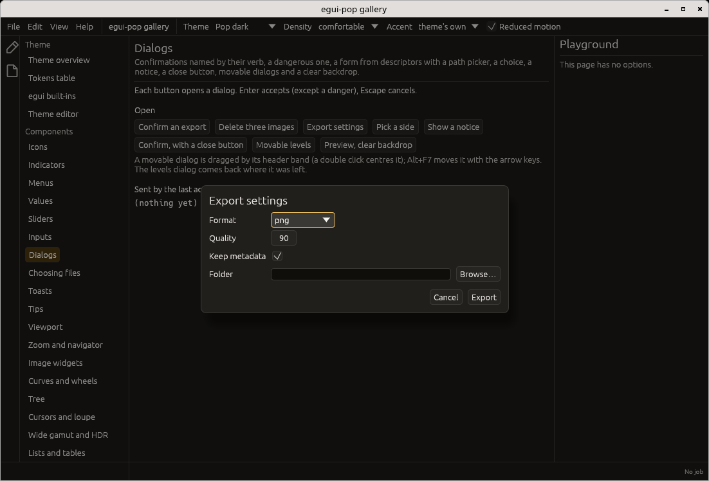
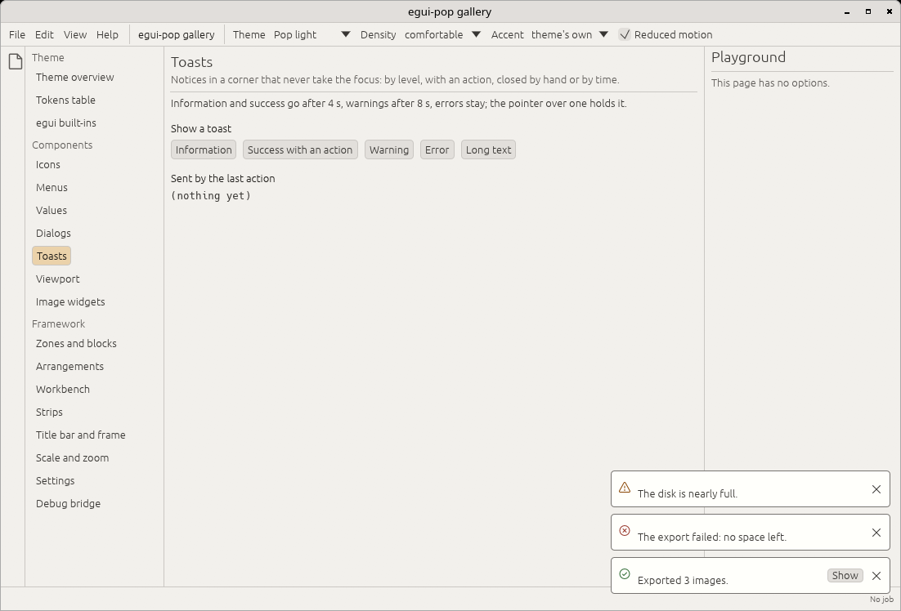
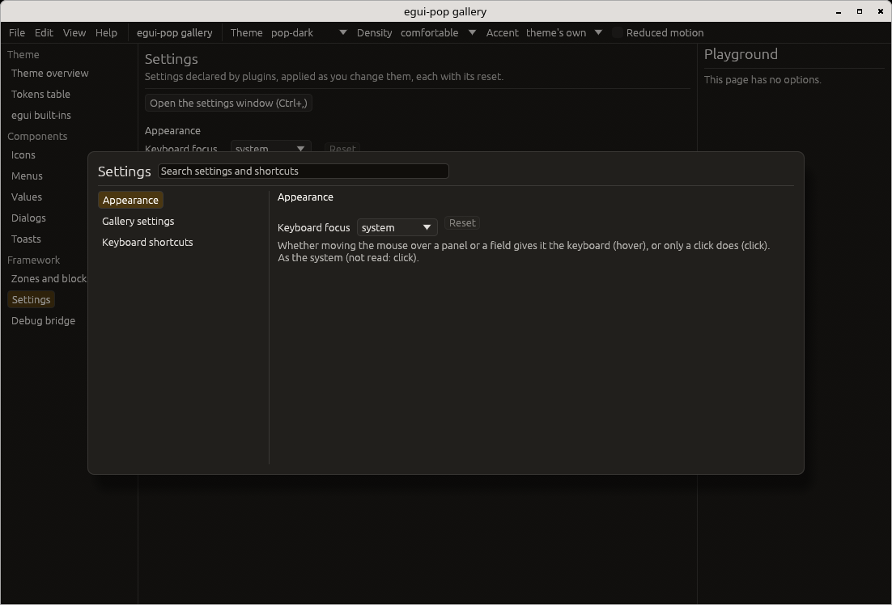
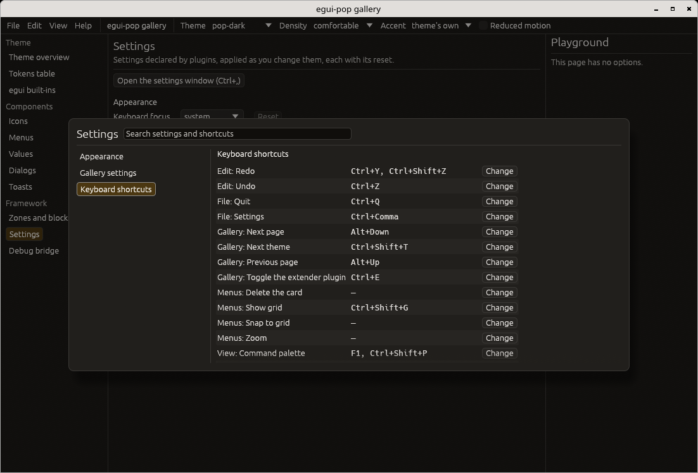
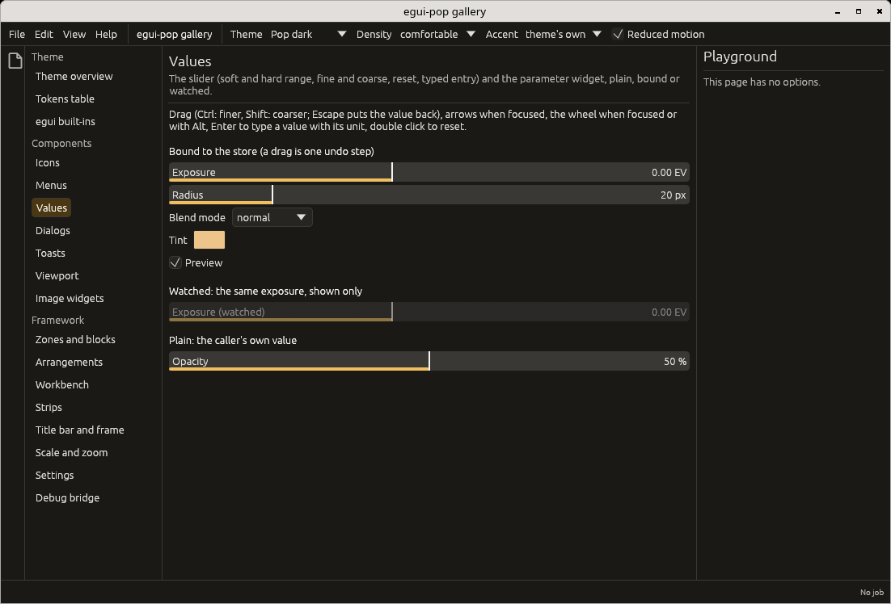

# Getting started

How to start an egui-pop application, and what a plugin application
looks like.

## Start an application

A [cargo-generate](https://github.com/cargo-generate/cargo-generate)
template makes a new application: one plugin with a panel, a setting and
a command, over `DefaultPlugins`.

```sh
cargo generate --git https://github.com/quazardous/egui-pop template
```

It is the `minimal` example (`cargo run -p egui-pop --example minimal`),
kept identical to it by a test.

To add egui-pop to an existing crate instead:

```sh
cargo add egui-pop
cargo add egui-pop --features viewport   # with the image viewport
```

## A plugin application

Everything an application adds goes through a plugin. A plugin registers
through `Ctx`; whatever it registers is removed when it is disconnected.
A command is declared once: its key binding, menu entry, palette entry
and agent surface are derived from it.

```rust
use egui_pop::api::app::MENU_VIEW;
use egui_pop::egui;
use egui_pop::prelude::*;

struct Counter;

const COUNT: SettingId = SettingId::from_static("counter.count");

impl Plugin for Counter {
    fn id(&self) -> PluginId {
        PluginId::from_static("counter")
    }

    fn connect(&mut self, ctx: &mut Ctx<'_>) -> Result<(), PluginError> {
        ctx.setting(COUNT, Descriptor::int("Count", 0, 100, 0))?;
        ctx.command(
            CommandSpec::new(CommandId::from_static("counter.add"), "Add one", "Counter")
                .key("Ctrl+Up")
                .menu(MENU_VIEW, "5_counter", 0),
            |call| {
                let store = call.app.store();
                let mut store = store.lock().unwrap();
                let set = egui_pop::model::values::Set::new(
                    "settings/counter.count",
                    egui_pop::model::values::Change::Step(1),
                    call.origin.clone(),
                );
                store.set(set).map(|a| a.value.to_json()).map_err(|e| e.to_string())
            },
        )?;
        ctx.block(
            zones::MAIN,
            Block::add(BlockId::from_static("counter.view"), 0, |ui, app| {
                let store = app.store();
                let n: i64 = egui_pop::core::binding::read(&store, "settings/counter.count").unwrap_or(0);
                ui.heading(format!("Count: {n}"));
                if ui.button("Add one").clicked() {
                    app.run(CommandId::from_static("counter.add"), serde_json::Value::Null);
                }
            }),
        );
        Ok(())
    }
}

// Headless, as in tests; `.run_native("Counter", options)` opens a window.
let ctx = egui::Context::default();
let mut app = App::builder().plugin(Counter).build(&ctx).unwrap();
assert!(app.handle().diagnostics().is_empty());
let out = app.run(&CommandId::from_static("counter.add"), serde_json::Value::Null, Origin::User);
// Run by the default host, in-process: the result is there now.
assert_eq!(out.now(), Some(Ok(serde_json::json!(1))));
```

Plugins can also change what other plugins drew (zones and blocks) and
take part in each step of a feature's life: see
[Plugins, commands and steps](plugins.md).

## The command palette

Every command is in the palette (`Ctrl+Shift+P` or `F1`, a plugin in
`DefaultPlugins`), ranked by a fuzzy match with the recent ones first,
with the keys the keymap really binds; a command taking arguments asks
for them:



## The paved road

The components of the paved road, each a plugin in `DefaultPlugins`:
dialogs (here a form from value descriptors), toasts with actions, the
settings window with its shortcuts editor, and the parameter widgets:

| Dialogs | Toasts (`pop-light`) |
|---|---|
|  |  |

| Settings | Shortcuts |
|---|---|
|  |  |



## Laying out by role

An application's own layout code says what a piece of text is and why
there is space, not which size or how many points: the `UiPop` helpers
on egui's `Ui` (in the prelude) draw from the theme's text roles,
spacing by intent and kit ([design tokens](tokens.md#spacing-and-text-by-intent)).

```rust
use egui_pop::egui;
use egui_pop::prelude::*;

fn export_panel(ui: &mut egui::Ui) {
    ui.section_title("Export");
    ui.muted("Writes a copy next to the original.");
    ui.space_role(Space::Group);
    ui.card(Tone::Neutral, |ui| {
        ui.label("IMG_0001.raw");
        ui.meta("24 MB, 12 October");
    });
    ui.space_role(Space::Section);
    ui.horizontal(|ui| {
        if ui.button_tone(Tone::Accent, "Export").clicked() {
            // ...
        }
        if ui.button_tone(Tone::Danger, "Delete").clicked() {
            // ...
        }
    });
}

let ctx = egui::Context::default();
egui_pop::theme::install(&ctx, &ThemeSpec::new("pop-dark"));
let mut out = ctx.run_ui(Default::default(), export_panel);
out.textures_delta.clear();
```

| Helper | Draws |
|---|---|
| `section_title`, `muted`, `meta`, `text_role(TextRole, ..)` | a label in a text role (`text-role.*`); `role_text` gives the `RichText` for other widgets |
| `space_role(Space)` | `space.inline`, `group`, `section` or `page` (egui's `add_space` takes points) |
| `card(Tone, ..)` | the kit's `card`, by tone |
| `button_tone(Tone, ..)` | egui's button in a tone of the kit's `button` |

## Next

- [Themes](themes.md) and [design tokens](tokens.md): the look.
- [The image viewport](viewport.md): showing an image the application
  computes.
- [Debugging](debugging.md): what every registry says about itself.
- [The gallery](gallery.md): every component, running.
