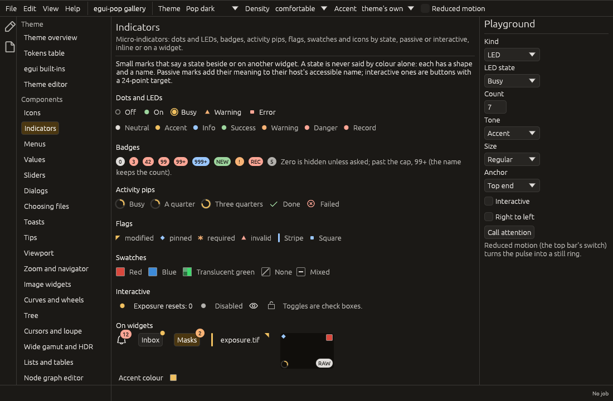

# Micro-indicators

Small marks that say a state in very little space, beside or on another
widget: a dot or an LED, a count badge, an activity pip, a flag, a
colour swatch, an icon that follows a state. They live in
`egui_pop::core::indicator`; the design note behind them, with the
survey and the owner's decisions, is
[design/indicators.md](design/indicators.md).



## The kinds

| Kind | Built with | States, content | Shape cues |
|---|---|---|---|
| Dot | `Indicator::dot(tone)` | one tone | a filled circle; give it a `name` |
| LED | `Indicator::led(Led::…)` | `Off`, `On`, `Busy`, `Warning`, `Error` | hollow, filled, pulsing, a triangle, a square |
| Badge | `Indicator::count(n)`, `Indicator::text("NEW")` | a count capped at `99+` (`cap`), hidden at zero (`show_zero`); a short text | a pill at least as wide as it is high |
| Activity pip | `Indicator::pip(Pip::…)` | `Busy`, `Progress(f)`, `Done`, `Failed`; `delayed` follows `motion::Busy` | a turning arc, a ring, a tick, a cross |
| Flag | `Indicator::flag(Flag::…)`, `Indicator::flag_shape(shape)` | `Modified`, `Pinned`, `Required`, `Invalid`, or the application's | a corner triangle, a diamond, an asterisk, a triangle; a stripe, a square |
| Swatch | `Indicator::swatch(color)`, `Indicator::swatch_of(Swatch::None \| Mixed)` | a colour (egui's checkerboard under alpha), none, mixed | an outlined square; a slash; a dash |
| Icon | `Indicator::icon(icon)`, `Indicator::toggle(on, when_on, when_off)` | a built-in `Icon`, or one of two by a state | the glyph |

Every state has a shape, a glyph or a text, and a name: colour is never
the only carrier. The tone (`tone(Tone::…)`) is the shared
[`Tone`](../crates/egui-pop-core/src/tone.rs): `Neutral`, `Muted`,
`Strong`, `Accent`, `OnAccent`, `Info`, `Success`, `Warning`, `Danger`
and `Record` (recording, the danger colour unless a theme tells them
apart). Sizes come in steps (`Size::Small`, `Regular`, `Large`), never
points.

Icons by name from a registry (a plugin's own icons, a command's "on"
icon) come later; today the icon kind takes the built-in `Icon` roles.

## Passive or interactive

A mark is **passive** by default: no click, no focus, no node of its
own.

- On a widget (`response.with_indicator(ui, indicator, anchor)`, or
  `indicator.on(ui, &response, anchor)`), its meaning joins that
  widget's accessible name: a button "Notifications" with a count badge
  of 3 reads "Notifications, 3". A capped badge still says the real
  count.
- Inline (`ui.add(indicator)`), it is read as an image whose name is
  its meaning.
- Its tooltip says the meaning (or `tooltip(..)`).

The meaning is the `name(..)` given, else the kind's: an LED's state, a
flag, a pip ("Busy", "42%"), a swatch's colour (`#3d8bd9`), a count. A
plain dot has none until it is given one. `indicator::annotate` adds a
meaning to any widget by hand (a mark drawn inside a button's own
layout).

`interactive(action)` makes it a button with egui-pop's button rules:

- a target of at least `indicator.target` (24 points, WCAG 2.5.8)
  around the mark;
- in the tab order, with the theme's focus ring; Space and Enter
  activate it;
- a tooltip (the action, or `tooltip(..)`);
- an AccessKit node of its own: a button named by the action, the mark's
  meaning as its description; a toggle is a check box with its state;
- `disabled(reason)`: greyed, no click, the reason on hover;
- `command(id)`: an activation asks for the command, which an egui-pop
  `App` runs before the next frame, so it is a step agents can reach
  (`indicator::take_commands` hands them to any other host).

## Anchoring

`Anchor::TopStart`, `TopEnd`, `BottomStart`, `BottomEnd`, `Start`, `End`
(centred vertically) and `Center`. Start and end follow the direction
(`indicator::set_direction`, left to right by default; egui has no
direction of its own yet).

- Badges and dots **overhang** a corner by half their height (a dot is
  centred on the corner) and are drawn on a layer of their own just
  above the host's, never clipped, so a badge at a panel's edge is
  never cut. `overhang(false)` keeps one inside.
- The other kinds sit inside, `indicator.offset` in from the edges; a
  corner flag is flush with its corner, a stripe on `Start` or `End`
  takes the host's height.
- A mark never changes its host's size or layout.

## Motion

A busy LED pulses; `attention(since)` makes any mark pulse
`indicator.pulse.count` times from `since` (motion clock seconds), then
stay still. The pulse runs on the motion clock, so a frozen clock gives
the same frame on every run; under reduced motion it is a still ring
around the mark, so the state is not lost.

## Tokens

`indicator.dot.size`, `indicator.led.ring`, `indicator.led.off`,
`indicator.record`, `indicator.badge.{height, padding, font, text}`,
`indicator.outline`, `indicator.flag.size`,
`indicator.swatch.{size, radius, border}`, `indicator.target`,
`indicator.offset`, `indicator.pulse.{period, count}`. Badge text is
`surface.panel` on every tone's fill: the tones are legible as text on
the panel, so the panel is legible on them. The contrast pairs (badge
text on each tone, the record tone and an LED that is off on the panel
and menus, the outline) are checked in every built-in theme
([tokens](tokens.md#contrast)).

## Agents and tests

Marks with an `id(..)` are recorded each pass. `indicator::drawn(ctx)`
(and `find(ctx, id)`) lists them, the debug bridge's `indicators`
collector shows them as JSON, and the test kit has
`egui_pop_test::indicators(&harness)` and
`assert_indicator(&harness, id, state)`:

```json
{ "id": "unread", "kind": "badge", "state": "count", "value": 120.0,
  "text": "99+", "tone": "danger", "name": "120", "host": "Notifications",
  "interactive": false, "enabled": true, "shown": true, "pulsing": false }
```

## Example

```rust
use egui_pop::core::icon::Icon;
use egui_pop::core::indicator::{Anchor, Flag, Indicator, IndicatorExt as _, Led, Pip, Tone};

fn status(ui: &mut egui_pop::egui::Ui, unread: u64, rendering: bool, visible: &mut bool) {
    // Passive, inline: read as "On".
    ui.add(Indicator::led(Led::On).id("node").tooltip("The render node's link"));
    if rendering {
        ui.add(Indicator::pip(Pip::Busy).name("Rendering"));
    }
    // On a button's corner: the button reads "Notifications, 3".
    ui.add(Icon::Notification.label("Notifications").sense_click())
        .with_indicator(ui, Indicator::count(unread).tone(Tone::Danger).id("unread"), Anchor::TopEnd);
    // A flag in a tile's corner.
    let tile = ui.button("IMG_0042");
    Indicator::flag(Flag::Modified).on(ui, &tile, Anchor::TopStart);
    // Interactive: a button of its own, then a check box.
    if ui
        .add(Indicator::dot(Tone::Accent).name("Changed").interactive("Reset exposure"))
        .clicked()
    { /* reset */ }
    if ui
        .add(Indicator::toggle(*visible, Icon::Visible, Icon::Hidden).interactive("Mask visible"))
        .clicked()
    {
        *visible = !*visible;
    }
}
```

## Not yet

- The status bar's `strips::Indicator` becomes `StatusItem` and is drawn
  with these kinds once the mount contract lands; only status bar items
  will be mutable by the user.
- The library's badges and the tree's row marks move onto these kinds.
- Workbench tabs get the modified dot that turns into the close button
  on hover: it needs a modified state on panels and room in `egui_dock`'s
  tab (`egui_dock` has no decoration slot for a tab).
- Dynamic icons by name, from the icon registry.

The gallery's `indicators` page shows every kind in its states, marks on
an icon button, a tab, a row, a tile and a menu entry, a pretend status
bar, and a playground.
