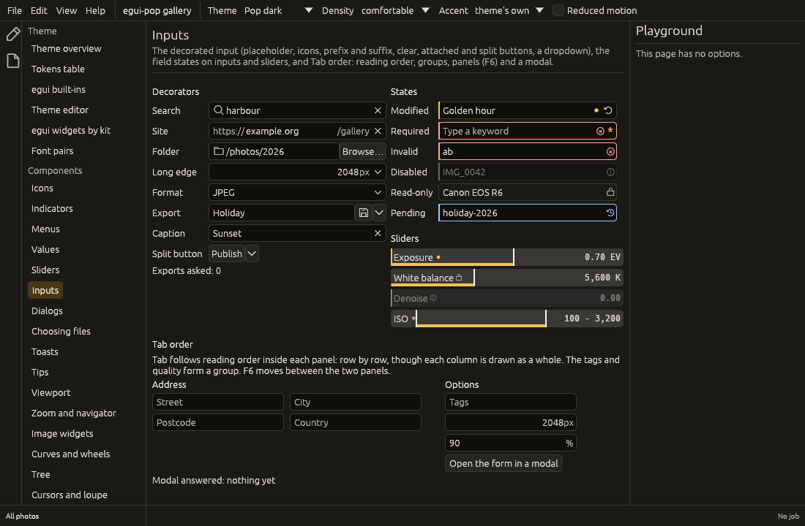

# Inputs, field states and Tab order

egui-pop's inputs are one component, the **decorated input**
(`egui_pop_core::input`), around a text, number, path or search field;
one **field state** model (`egui_pop_model::field`) that every input
shows the same way, the sliders included; and a **Tab order** decided
per focus scope (`egui_pop_core::tab`), with F6 between the window's regions.



## The decorated input

```rust
use egui_pop::egui;
use egui_pop::core::icon::Icon;
use egui_pop::core::input::{Attached, Input};
use egui_pop::model::field::FieldState;

fn export_row(ui: &mut egui::Ui, folder: &mut String, size: &mut f64, name: &mut String) {
    let out = Input::path(folder, "Folder")
        .leading_icon(Icon::Folder)
        .button(Attached::text("Browse…", "Browse for a folder"))
        .state(FieldState::new().required())
        .show(ui);
    if out.button == Some(0) { /* open the file chooser */ }

    Input::number(size, "Long edge")      // a number or an expression
        .unit("px")
        .choices(["1024", "2048", "4096"]) // a dropdown chevron
        .show(ui);

    let out = Input::text(name, "Export name")
        .placeholder("File name")
        .clearable(true)
        .button(Attached::icon(Icon::Save, "Export").menu(["Export as…", "Export settings…"]))
        .show(ui);
    if let Some((_, item)) = out.menu { let _ = item; /* a split button's item */ }
}
```

| Decorator | How | What it does |
|---|---|---|
| Placeholder | `.placeholder(text)` | Shown while the field is empty, in `field.tone.muted.text`; assistive technologies read it as the placeholder |
| Leading, trailing slots | `.leading_icon`, `.prefix`, `.suffix`, `.unit`, `.trailing_icon` | Icons and texts inside the field, before or after the value, never edited |
| Clear ✕ | `.clearable(true)` (on for `Input::search`) | Shown while there is a value and the field can be edited; Tab reaches it, Enter or Space presses it, the focus goes back to the field. One change: one undo step when the field is bound to a store, one step in the field's own Ctrl+Z history |
| Reset | from the state | Shown while the [state](#field-states) offers "reset to default"; puts back `.default_value(text)` |
| Attached buttons | `.button(Attached::text(..))`, `Attached::icon(..)` | Joined to the field's end, each a button of its own; its click is `InputOutput::button` |
| Split button | `Attached::..(..).menu(items)` | The action and a chevron opening a menu (`InputOutput::menu`); `input::split_button` draws one on its own |
| Dropdown chevron | `.choices(items)` | Opens a list of values; choosing one sets the field (`InputOutput::choice`) |

The field is egui's `TextEdit`, so it follows the focus rules of every
text input: while it has the focus, Escape and Enter are its own
(Escape leaves the field, Enter commits it) and no key binding fires on
them. A number field (`Input::number`) reads what is typed as a slider's
typed entry does (`+ - * / ^`, parentheses, either decimal separator,
a unit ignored) and commits it when it loses the focus: Enter, Tab, a
click elsewhere. Escape leaves it with nothing: what was typed is
dropped and the value stays.

Every part has an accessible name: the field its label, the ✕ "Clear
*label*", the reset "Reset *label* to default", the chevron "*label*,
choices" (a list box popup, expanded or not), a split button's chevron
"*label*, more" (a menu popup).

## Field states

```rust
use egui_pop::model::field::{Baseline, FieldState};

let saved = "Sunset".to_string();
let title = "Golden hour".to_string();
let state = FieldState::new()
    .compare(&title, Some(&saved), &"Untitled".to_string()) // modified against saved
    .required()
    .validated(None);                                      // or Some(message)
assert!(state.is_editable());

let off = FieldState::new().disabled("Needs an open image");
assert!(!off.is_focusable());
```

| State | Builder | Edge | Marker | Assistive technologies |
|---|---|---|---|---|
| Disabled | `.disabled(reason)` | muted | an "i"; the **reason** is the tooltip | disabled, the reason as the description |
| Invalid | `.invalid(message)`, `.validated(Option)` | `field.tone.danger.border-color`, and an outline | a crossed circle; the message is the tooltip | invalid, the message as the description |
| Pending | `.pending()` | `field.tone.info.border-color`, and an outline | a clock | busy |
| Modified | `.modified(Baseline::Saved / Default)`, `.compare(value, saved, default)` | `field.tone.accent.border-color` | a dot; a reset arrow when it differs from its default | "changed since saved" or "from the default" in the description |
| Required | `.required()` | none | an asterisk (`field.tone.warning.border-color`) | required |
| Read-only | `.read_only()` | none, and the `field.tone.muted.fill` fill | a lock | read-only |

The edge is a strip along the field's leading side in the colour of its
first state, in that order of precedence; every state also has its
marker, so none rests on colour alone. A disabled field cannot take the
focus and is greyed; a **read-only** field takes the focus, its text can
be selected and copied, never changed. The colours are the `field.*`
component tokens, each an alias of a system role (`danger`, `info`,
`accent.default`, `warning`), checked for contrast over the field.

**Sliders** take the same states: `Slider::new(..).state(state)` and
`RangeSlider::new(..).state(state)` draw the edge on the bar and the
markers after the label, and give the state to assistive technologies.
A read-only slider takes the focus and refuses every change (drag,
keys, wheel, typed entry, reset); a disabled one is greyed, skipped by
Tab and says its reason on hover. Without a state, a slider is drawn as
before.

**Agents** read every field drawn in the last pass through the debug
bridge's `fields` collector (and `egui_pop_core::field::describe`): its
label, kind (`text`, `number`, `path`, `search`, `slider`, `range`), its
marks, whether it can be focused and edited, the disabled reason and the
invalid message. The same snapshot lists the Tab scopes and their
stops.

Any widget can show a state: `field::paint_edge`,
`field::paint_markers`, `field::hover` (the tooltips), `field::access`
and `field::record`.

## Tab order

```rust
use egui_pop::egui;
use egui_pop::core::input::Input;
use egui_pop::core::tab::{self, ScopeKind, TabStop};

fn options(ui: &mut egui::Ui, tags: &mut String, quality: &mut String) {
    tab::scope(ui, "export-options", ScopeKind::Panel, |ui| {
        Input::text(tags, "Tags").tab(TabStop::new().group("export")).show(ui);
        Input::text(quality, "Quality").tab(TabStop::new().group("export")).show(ui);
        let r = ui.button("Export");
        tab::stop(ui, &r, TabStop::new()); // any widget joins the order
    });
}
```

- **Reading order** by default inside a scope: rows from top to bottom,
  in a row from left to right, whatever order the widgets were drawn in
  (two columns drawn one after the other still read row by row).
- **Explicit order**: stops with `TabStop::index(n)` come first, by
  index; **groups** (`TabStop::group(name)`) keep their stops together,
  at the place of the group's first stop. The parts of one input (the
  field, its ✕, its buttons) are a group of their own.
- **Disabled fields are skipped**, read-only ones are not.
- **Focus scopes**: in a `ScopeKind::Modal` scope Tab cycles (after the
  last stop comes the first); in a `ScopeKind::Panel` scope, Tab past
  its ends goes on in egui's order. **F6** and Shift+F6 move to the next
  or previous panel scope, to the stop focused there last (its first
  the first time); F6 does nothing while a modal is open. In an
  application, F6 goes through [the window's regions](#f6-through-the-regions),
  and a region's panel scopes take its turn.

| Key | What it does |
|---|---|
| Tab, Shift+Tab | The next or previous stop of the scope |
| F6, Shift+F6 | The next or previous panel, or [region](#f6-through-the-regions) |
| Enter, Space on a ✕ or a button | Presses it |

The order is computed from the stops drawn in the previous pass
(`egui_pop_model::tab::order`, pure and tested), and egui-pop moves the
focus before anything is drawn. The focus on a widget that is not a
stop is left to egui, whose Tab order is the order of drawing; a
focused widget that takes the keys itself (a terminal) keeps Tab and
F6.

### F6 through the regions

In an application, `workbench.next_region` (F6) and
`workbench.previous_region` (Shift+F6) go through the parts of the window: the
activity bar, the start side area, the end side area, the bottom area, the
centre, each palette, an open flyout, the status bar. Tab stays as it is: a
region is a focus scope (`focus::region`), not a Tab scope. They are commands
like others, in the palette's list and rebindable.

- **Where it lands**: the widget focused there last; else the one named with
  `focus::prefer`; else the first focusable widget of what the region holds (a
  panel before its dock's tab, a palette's field before its band); else, in an
  area, the panel itself, as [`workbench.focus`](workbench.md#the-focused-panel)
  does; else whatever else there can take the focus. A region with nothing to
  land on is passed over.
- **From nothing**: the first region, or the last with Shift. After Escape or a
  press, from the region the user was in, which the focus chain still names.
- **A panel `tab::scope`** takes its region's turn, one stop of the round each,
  and F6 goes on out of them. What lies around them in the region is reached by
  Tab.
- **It does nothing** behind a modal, with a menu or a popover open (Escape comes
  first: F6 would leave it open behind the focus), and for an agent while someone
  is typing. A flyout stays open as F6 leaves it, like a palette.
- **A focused terminal keeps F6**, like every key, for its program; Shift+Escape
  leaves it.
- **Hidden palettes are no region.** Where palettes float and nothing has the
  focus, Tab still hides them: F6 is the way in, and Tab moves from there.
- **Each window has its own**: a detached panel's window draws no region, so F6
  stays there, for the panel scopes it may have.
- **Without an application**, `focus::region` draws a region and
  `regions::next` says where F6 goes; a window with no region keeps
  `tab::scope`'s F6.

### What is no stop

A widget that would show nothing focused and answers no key senses without
`FOCUSABLE`: `Sense::CLICK | Sense::DRAG` or `Sense::DRAG` rather than
`Sense::click_and_drag()` or `Sense::drag()`. egui-pop's window caption and its
flyout's edge do so. With the focus plugin, Tab passes over the frame
of a popup (a menu, a context menu, a combo box's list), which egui 0.36 makes a
stop. A side area's resize line is still one, as egui draws it.

### The focus keeps its place

With the focus plugin (`focus::install`; an application has it), the focus
remembers the widget it was last on and that widget's rectangle.

- **Escape, then Tab or Shift+Tab**: goes on from that widget. Escape itself still
  leaves nothing focused. So does a widget disabled while focused.
- **The focused widget is removed**: the focus goes to the stop nearest to where
  it was, in the innermost scope around it that still holds one, else in its
  layer: the row taking its place, the row before if it was the last, the next
  tab. A button opening or closing panels may be rebuilt under a new id; it keeps
  the focus if it stands in the same place.
- **The focused widget scrolled away, or removed by the pointer**: the focus goes
  to nothing and stays out of the way of the wheel, and Tab goes to the visible
  stop nearest to the place. If the widget is back by then, Tab goes on from it.
- **A key binding on Tab goes first**: nothing is focused, so the palettes' toggle
  still takes Tab after Escape, and the place waits.
- **Inside a `tab::scope`**, going on from the place follows the order of drawing,
  not the scope's reading order.
- **Forgotten**: a press on nothing forgets the place; a place under a modal or in
  a layer now gone (a closed menu) is not used. Tab then does what egui does, from
  the window's first stop or its last.

### The focus comes into view

With the focus plugin (`focus::install`; an application has it), a widget
the keyboard focuses comes into view in the scroll areas around it, nested
ones included, whatever panel it lies in. A widget has nothing to do for it.

- **By anything but the pointer**: Tab, an arrow, a command, a screen reader.
  A click on a half-visible row does not make it jump, in click mode or as the
  pointer hands the focus over in hover mode.
- **Once per move**: the wheel can then take the focused widget away.
- **By the least that shows it**, with the item spacing around it. A widget
  longer than the view stays where it is.
- **Never animated**, whatever the motion setting: a key held down has no moving
  target to chase, and reduced motion asks for nothing more.
- **Windowed rows** (`show_rows`): a row not drawn is no stop. Each row reached
  scrolls the next one into the drawn window, so Tab goes through them all, one
  by one, both ways. A list, a tree or a grid from `egui-pop-views` is one stop
  and scrolls to its own cursor.
- **Not found**: an area with `ScrollBarVisibility::AlwaysHidden` shows no bar
  to read its reach from: what it holds calls `Response::scroll_to_me` on
  gaining the focus, as the stack of sections does.

How it finds the areas, and why a widget's own `scroll_to_me` would not do, is
in [the upstream register](upstream.md#egui-a-scroll-target-stops-at-the-innermost-scroll-area).

## Not yet

- A **formal form layout** (labels in a column, sections, help text,
  inline errors and an error summary, built from value descriptors) and
  the `Form` dialog on it come next, with the decision on how
  components are mounted in hosts.
- The application shell's own panels are not Tab scopes: an application
  wraps a panel's content in `tab::scope` for reading order inside it.
## Why its own

egui's `TextEdit` is the field (with its hint text); nothing in the
egui ecosystem draws decorated inputs from tokens, carries a shared
field state, or orders Tab per scope. See
[the survey](widgets.md#inputs-and-forms-what-was-checked-2026-10-14).
