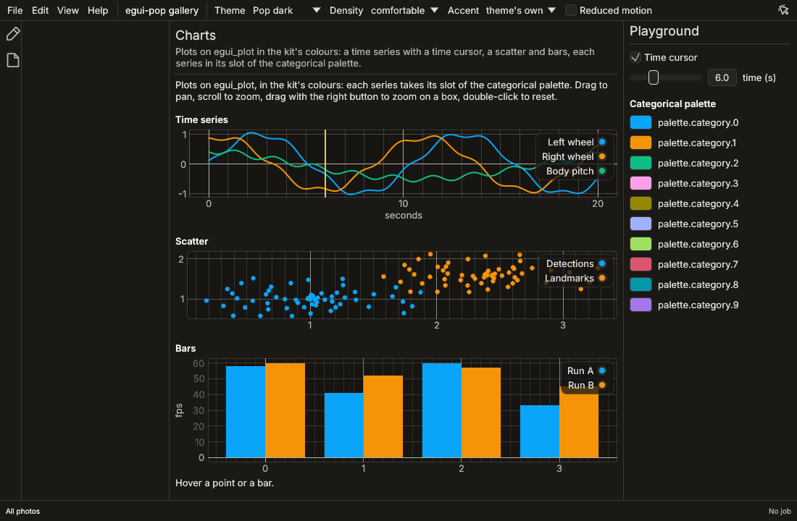
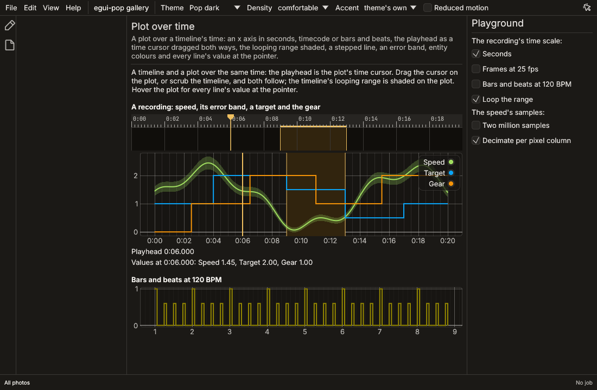

# Charts

`egui_pop::views::plot` draws time series, scatters and bars. It wraps
[egui_plot](https://github.com/emilk/egui_plot) (MIT OR Apache-2.0),
which draws the axes, the grid, the legend and the series, and takes the
pan, the zoom and the box zoom; egui-pop adds its look, an accessible
summary, the point under the pointer, time (an axis in a timeline's
scale, a time cursor dragged both ways with a timeline, its range),
stepped lines, error bands, the values at the pointer and a collector for
agents.

```sh
cargo add egui-pop --features views
```

```rust
use egui_pop::egui;
use egui_pop::views::plot::{Plot, Series};

fn ui(ui: &mut egui::Ui, now: f64) {
    let series = [
        Series::line("Left wheel", (0..200).map(|i| [i as f64 / 10.0, (i as f64 / 20.0).sin()])),
        Series::points("Samples", [[2.0, 0.4], [7.5, -0.6]]),
        Series::bars("Errors", [[5.0, 0.3], [12.0, 0.8]]),
    ];
    let out = Plot::new("wheels", &series)
        .label("Wheel speeds")
        .x_label("seconds")
        .time_cursor(Some(now))
        .height(200.0)
        .show(ui);
    if let Some(h) = out.hovered {
        // The point under the pointer: `h.series`, `h.index`, `h.x`, `h.y`.
        let _ = (h.name, h.x, h.y);
    }
}
```



## Series

A `Series` has a name (the legend's, the summary's and the collector's),
a kind (`Kind::Line`, `Kind::Points`, `Kind::Bars`, `Kind::Steps`) and
its points, `[x, y]`. A stepped line (`Series::steps`) holds each value
until the next point's x: a state, a gear, a count that changes at
instants. Bars stand from 0 to each y at their x; several bar series
stand side by side, sharing `Plot::bar_width` (0.8 of the space between
two x values by default).

Each series takes its slot of the categorical palette
(`palette.category.*`, [tokens](tokens.md#the-categorical-palette)): by
default its place among the plot's series, or `Series::slot(n)`. Give
an entity the same slot in every plot, so its colour follows it;
`Series::entity(path)` does it for you: the slot is a stable hash of the
path (FNV-1a, `entity_slot`), the same in every plot, run and platform,
after Rerun's automatic colour by entity path (two paths may share a
slot: give one its own). `Series::color` sets a colour of its own.

An error band (`Band::new(series, [[x, min, max], ...])`, given with
`Plot::bands`) fills between a minimum and a maximum in a quarter of its
series' colour, under the lines. The legend shows with two
series or more (`Plot::legend` to choose).

## The look

The plot area is the kit's `plot` component ([kit.md](kit.md)): its
background and frame, its axis text and crosshair in `text` (`hover`
while the pointer is over it), its grid in `grid-color`, the denser lines
fainter by `grid-fade` (0: as strong as the sparsest, 1: much fainter;
egui_plot's `grid_fade`). The time cursor is the `plot-cursor`
component, a line across the area (`width` thick, in `fill`, `hover`'s
under the pointer and while dragged) with a `head` at its top (`none`, or
a `triangle` pointing down, `head-size` wide). The default kit draws the
area on `surface.canvas` in `border.default`, the axis text and the grid
muted (fade 0.5), and the cursor in the accent without a head; the
Rerun-like kit gives the grid Rerun's colour and fade (0.3) and the
cursor its triangle, turning to the strong text under the pointer.
`GridLook::of(ctx)` and `CursorLook::of(ctx)` read them.

## Time

```rust
use egui_pop::egui;
use egui_pop::views::plot::{Plot, Series};
use egui_pop::views::timeline::{Timeline, TimelineState};

fn ui(ui: &mut egui::Ui, recording: &mut TimelineState, series: &[Series]) {
    Timeline::new(recording).id("recording").show(ui);
    // The playhead is the cursor; dragging the cursor moves the playhead.
    Plot::new("speeds", series).timeline(recording).show(ui);
}
```

`Plot::time_scale(TimeScale)` puts the x axis in a timeline's scale:
x values are seconds, and the ticks and labels are the timeline ruler's
for the span in view and the plot's width (`0:05`, `00:00:02:10`, `17.2`),
the finer ones as grid lines.

`Plot::time_cursor(Option<f64>)` draws a vertical line at an x value the
application gives at every pass; `None` draws none. With
`Plot::drag_cursor(true)` it follows the pointer when dragged, and
`PlotOutput::cursor_dragged` says where it went (on the scale's units:
whole frames on frames); `cursor_hovered` says the pointer is on it.

`Plot::timeline(&mut TimelineState)` does all of it for a timeline: its
scale on the axis, its playhead as the cursor, dragging the cursor
moves the playhead (inside the bounds), and its range shaded under the
series in the timeline's `timeline.range.*` colours (the edges in
`range.edge` while it loops, `range.idle` otherwise). Draw the timeline
in the same pass, before or after the plot: each shows what the other
did. `Plot::highlight_range` shades a range without a timeline.

`Plot::link_cursor(group)` shows the pointer's x in the other plots
of a group, and `Plot::link_x(group)` zooms and pans their x axes
together (egui_plot's linked cursors and axes).

## The pointer

`PlotOutput::hovered` is the point nearest the pointer within
`HOVER_RADIUS` (16 points on screen), or the bar under it: its series,
its index and its values. It is marked with a ring on the plot.
`PlotOutput::pointer` is the pointer in the plot's values, and
`PlotOutput::bounds` what is in view. `Plot::interactive(false)` leaves
the pan and the zoom out (a plot in a scroll area that should scroll).

`PlotOutput::values` is every line's and stepped line's value at the
pointer's x while it is over the plot, else at the time cursor
(`values_at`): a line's between its two points around x, a stepped
line's the last point's at or before it, none outside a series' x
range. With `Plot::values_tooltip(true)` (the default with a time scale
or a timeline) a tooltip beside the pointer lists them under the time,
each by its series' colour, and dots mark them on the lines.
`Plot::emphasize(Some(index))` draws a series thicker (the one selected
or hovered elsewhere).

## Accessibility

A plot is one node, a figure named by `Plot::label` ("Chart" by
default), described by its series: each one's name, kind, point count
and x and y ranges, then the time cursor, as in "Left wheel (line):
200 points, x from 0 to 19.9, y from -1 to 1. Time cursor at 4" (the
time in the scale's text with a time scale, "Time cursor at 0:06.000").
A draggable cursor is a slider named "Time cursor", its value the time.
The legend's entries are egui_plot's checkboxes, which hide a series.

## For agents

`PlotPlugin` declares the `plots` collector: every plot drawn in the
last two passes, by id, with its label and summary, its series (name,
kind, point count, ranges, colour), the bounds in view, the hovered
point, the time cursor, the time scale (`seconds`, `frames`, `beats`)
and the x axis' labels, the highlighted range and the values at the
pointer or the cursor (`Plots::of(ctx).describe()`).

## The gallery

The **Charts** page shows a time series with a time cursor, a scatter and
bars. The **Plot over time** page puts a timeline and a plot on one
`TimelineState`: twenty seconds of a robot's speed (an entity colour and
its error band), a stepped target and a stepped gear, the looping range
shaded, the playhead the plot's cursor; then kicks on a bars and beats
axis. Its playground switches the recording to frames or bars and beats.



## Why egui_plot

The survey ([widgets.md](widgets.md)) found egui_plot on egui 0.37
(0.38.0, 2026-10-19), maintained in egui's organisation, under MIT OR
Apache-2.0: lines, points, bars, box plots, a legend that hides series,
axes with formatters, linked axes and cursors, pan, zoom and box zoom.
It has no accessible description of a plot, no theme beyond egui's
visuals and no notion of a time given from outside: those are egui-pop's
part above, and nothing of egui_plot is redone.
