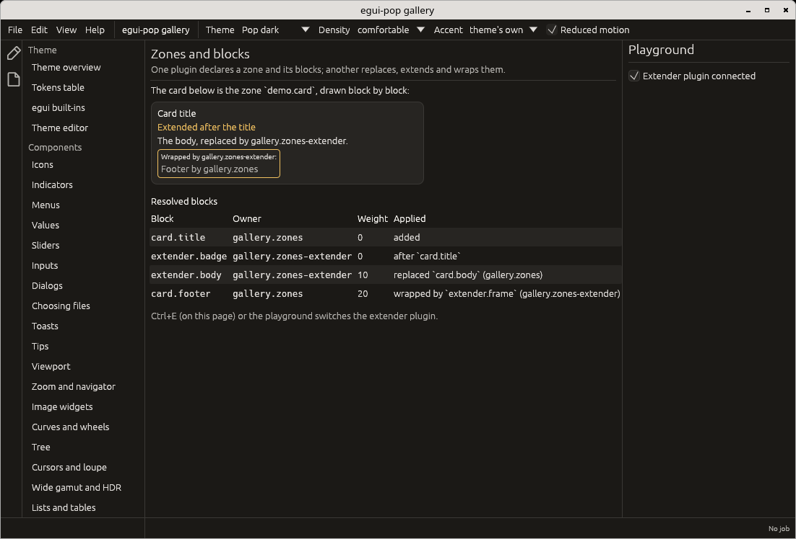
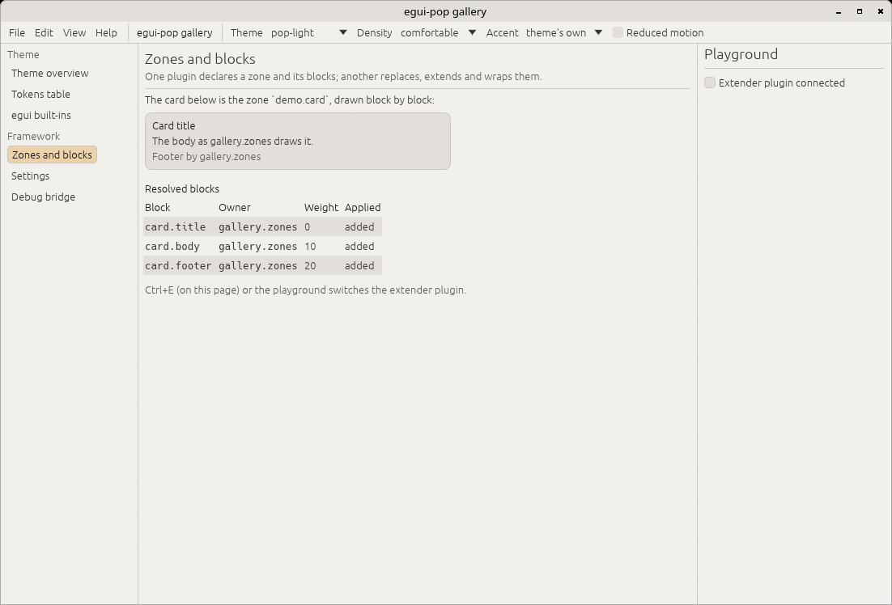

# Plugins, commands and steps

An egui-pop application is a set of plugins. This page covers what a
plugin registers, how commands work, how one plugin changes what another
drew, and how a plugin takes part in the life of egui-pop's features.

## Plugins

A plugin has an id and a `connect` method. It registers through `Ctx`:
commands, settings, panels, blocks in zones, menus, services, steps and
hooks. Whatever it registers is owned by it and removed when it is
disconnected ([ADR 0004](adr/0004-plugins.md)). Plugins are sorted by
what they require before they connect.

`DefaultPlugins` is the paved road: the command palette, dialogs,
toasts, the settings window, the window's place and saved arrangements.
`MinimalPlugins` is the bare shell. Both are plugin groups for
`AppBuilder::plugins`.

A complete plugin application is in
[Getting started](getting-started.md#a-plugin-application).

Which of these a plugin uses to share data with others (the value
store, a command, a step, the context stack, a service) is in
[State or event: what to use](state-or-event.md).

A plugin writes the values it owns, and those whose owner named it a
writer: what it writes while connecting, in its command handlers and in
its lifecycle hooks is written as it, and `Ctx::writer` writes as it
from a panel or a thread
([who writes a value](state-or-event.md#who-writes-a-value)).

## Commands

A command is declared once, with a `CommandSpec`: its id, title,
category, keys, `when` clause, menu entries and arguments. Its key
binding, menu entry, palette entry and agent surface are derived from
it.

```rust
use egui_pop::api::app::MENU_VIEW;
use egui_pop::egui;
use egui_pop::prelude::*;

struct Greeter;

impl Plugin for Greeter {
    fn id(&self) -> PluginId {
        PluginId::from_static("greeter")
    }

    fn connect(&mut self, ctx: &mut Ctx<'_>) -> Result<(), PluginError> {
        ctx.command(
            CommandSpec::new(CommandId::from_static("greeter.greet"), "Greet", "Greeter")
                .key("Ctrl+G")
                .menu(MENU_VIEW, "5_greeter", 0),
            |_call| Ok(serde_json::json!("hello")),
        )?;
        Ok(())
    }
}

let mut app = App::builder().plugin(Greeter).build(&egui::Context::default()).unwrap();
let out = app.run(&CommandId::from_static("greeter.greet"), serde_json::Value::Null, Origin::User);
assert_eq!(out.now(), Some(Ok(serde_json::json!("hello"))));
```

Keys are resolved by focus: layered keymaps, chords, the deepest focused
scope first, with a trace of each resolution
([ADR 0007](adr/0007-key-resolution.md)). The settings window's
shortcuts editor rebinds them.

### Who runs a command: the host

egui-pop wraps the application's kernel through a host
([ADR 0010](adr/0010-host.md)). The default, `LocalHost`, runs the
handlers given to `Ctx::command` in-process, so `App::run` returns a
`Reply` whose result is there now (`Reply::now()`). An application with
its own kernel implements `egui_pop::api::host::Host`, declares its
commands without a handler (`Ctx::declare`) and gives the host to
`AppBuilder::host`; a command may then answer later, from any thread,
and the frame never waits.

## Zones and blocks

Zones and blocks let a plugin add to, replace, extend or wrap what
another drew ([ADR 0005](adr/0005-zones-and-blocks.md)); what cannot
apply is reported, never silently dropped
([ADR 0003](adr/0003-no-silent-no-op.md)). In the gallery, one plugin
replaces, extends and wraps another's blocks; switched off, the card is
back as its owner made it:

| Extender connected | Extender switched off (`pop-light`) |
|---|---|
|  |  |

## Alter hooks

Alter hooks (`egui_pop::prelude::Hook`) change lists of declarations: a
menu's items, the palette's entries, the settings form's entries. They
run when the application is built or a plugin comes or goes, never per
frame, in priority order and after the hooks they name.

## Steps: observe, veto, replace, extend

A feature names the moments of its life as **steps**: `frame.close`,
`workbench.detach`, `arrangement.switch`, `dialog.show`, `menu.open`,
`edit.undo`... ([ADR 0011](adr/0011-lifecycle-steps.md)). Each module's
documentation lists its steps, their arguments and their default. At
each step a plugin may, each optional:

- **observe**: the step publishes a signal on the host's journal, named
  after it, with its arguments and result (`<step>.vetoed` when
  stopped);
- **veto or redirect**: a before-hook (`Ctx::before`) returns
  `Before::Go`, `Before::Veto(reason)` or `Before::Redirect(args)`;
- **replace**: a run-hook (`Ctx::replace`) does the step instead of the
  default (the last plugin to replace a step wins; two are reported);
- **extend**: an after-hook (`Ctx::after`) gets the arguments and the
  result.

A plugin declares its own steps with `Ctx::step` and runs them with
`AppHandle::step(step, args, default)`:

```rust
use egui_pop::egui;
use egui_pop::prelude::*;

const SAVE: StepId = StepId::from_static("demo.save");

struct Guard;

impl Plugin for Guard {
    fn id(&self) -> PluginId {
        PluginId::from_static("guard")
    }

    fn connect(&mut self, ctx: &mut Ctx<'_>) -> Result<(), PluginError> {
        ctx.step(StepSpec::new(SAVE, "Saves the demo."))?;
        ctx.before(SAVE, |_, args| {
            if args["name"] == "" { Before::Veto("no name".into()) } else { Before::Go }
        });
        Ok(())
    }
}

let app = App::builder().plugin(Guard).build(&egui::Context::default()).unwrap();
let h = app.handle();
let out = h.step(&SAVE, serde_json::json!({ "name": "" }), |_, _| Ok(serde_json::json!("saved")));
assert_eq!(out.vetoed(), Some("no name"));
let out = h.step(&SAVE, serde_json::json!({ "name": "a" }), |_, _| Ok(serde_json::json!("saved")));
assert_eq!(out.result(), Some(&Ok(serde_json::json!("saved"))));
```

Hooks are owned like everything else. Every run is traced (who
redirected, vetoed, ran and followed); the debug bridge's `steps`
collector lists the declared steps, their hooks and the last runs. A
hook on a step nobody declares is reported.
