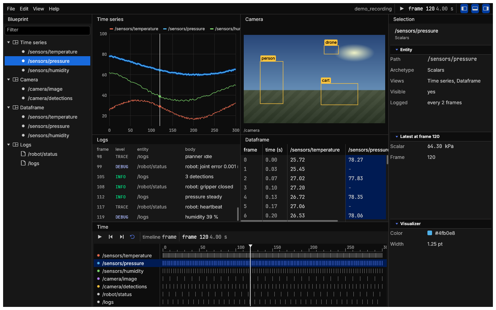
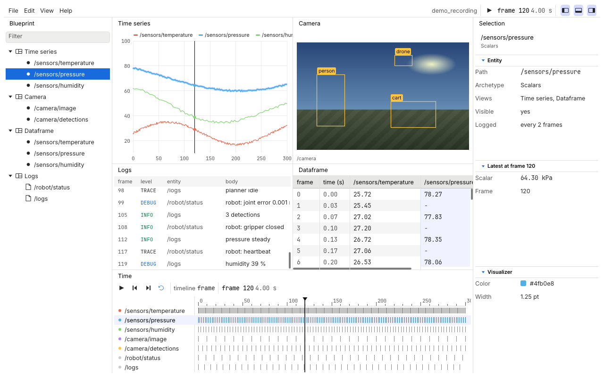

# A Rerun-like viewer

A stress test of egui-pop's application model: the
[Rerun](https://rerun.io) viewer's look and layout, rebuilt from
egui-pop's workbench, kit and components over generated data. It is
not pixel-perfect and holds no Rerun code: the look is a kit made from
the token values of Rerun's `re_ui` crate (MIT OR Apache-2.0, see
[NOTICE](../NOTICE)). What it could not do with egui-pop alone is
listed, ranked, in [the gaps](#the-gaps).

```sh
cargo run -p egui-pop-gallery --example rerun_like
```

| Rerun-like Dark | Rerun-like Light |
|---|---|
|  |  |

The code is the gallery crate's `rerun_like` module
(`crates/egui-pop-gallery/src/rerun_like/`), started by
`examples/rerun_like.rs`; its tests are `tests/rerun_like.rs`.

## What it shows

- **The top bar**: the menus (View holds the playback commands), the
  recording's name, play and pause, the time readout, and the panel
  toggles at the bar's end (the workbench's area toggles, as commands of
  `MENU_BAR_END`).
- **The Blueprint**, on the left: the views and their entities in a
  tree with its filter field; an eye on a hovered row hides the entity
  from the views.
- **The viewport**, in the centre: four views, each a panel, as
  egui_stack splits two by two: a time series (three scalars drawn as
  lines), a camera image with moving detection boxes, a dataframe (the
  views crate's `DataTable`, a row per frame) and a text log.
- **The Selection**, on the right: the selected entity (its path,
  archetype, latest values at the time cursor, visualizer) or view (its
  class and entities), in collapsible sections of property rows.
- **The time panel**, at the bottom: play, step, loop, the timeline's
  name and the time, a ruler with a cursor to drag, and a row per
  entity with a tick where it has data.

Selecting an entity anywhere (the tree, a line or a legend entry of the
plot, a box or the image, a log line, a row of the time panel) selects
it everywhere: the tree follows, the views outline it, the dataframe
tints its column, the log and the time panel tint its rows, and the
Selection panel shows it. Hovering an entity highlights it in every
view and in the tree. A click on a view's background selects the view.
A row of the dataframe moves the time cursor to its frame.

### Keys and commands

| Key | Command | Rerun's |
|---|---|---|
| Space | Toggle play/pause (`rerun.playback.toggle`) | Space |
| Left, Right | Step back, forward one frame (the time panel focused) | Left, Right |
| Home | Restart (the time panel focused) | |
| Ctrl+P | The command palette (`app.palette`; Ctrl+Shift+P and F1 stay) | Cmd/Ctrl+P |
| Ctrl+Shift+B, Ctrl+Shift+S, Ctrl+Shift+T | Toggle the blueprint, the selection, the time panel (the workbench's area toggles; Ctrl+B, Ctrl+Alt+B and Ctrl+J stay) | the same |
| Ctrl+Shift+R | Reset viewer: the layout, the selection, the time | the same |
| Ctrl+, | Settings (light, dark or the system's) | the same |

Every command is in the palette: the five playback commands, Clear
selection, Reset viewer, and the panels' own focus and toggle commands.

## The theme: Rerun-like Dark and Light

Two kits, `examples/kits/rerun-like-dark` and
`examples/kits/rerun-like-light`, each naming the other as its
counterpart (`org.egui-pop.variant-of`), so the viewer starts with
`ThemeSpec::pair("rerun-like-dark", "rerun-like-light")` and the View
menu's light and dark toggle (and the settings' light, dark or
system choice) switches between them. The settings have no theme
picker: another theme is picked in code (`ThemeService::kits` lists the
kits for an application's own picker). Data only; each
records its source (repository, files, commit, licence) in
`org.egui-pop.source`.

What was taken from `re_ui` (`dark_theme.ron`, `light_theme.ron`,
`color_table.ron`, `design_tokens.rs`), token values only:

| egui-pop token | Dark | Light | From |
|---|---|---|---|
| `gray.0` to `gray.12` | Rerun's Gray.0, 50, 100, 150, 200, 250, the divider, 350, 400, 500, 600, 725, 1000 | the same scale the other way | `color_table.ron`, the aliases below |
| `surface.panel`, `surface.canvas` | Gray.100 `#0d0d0d` | Gray.1000 `#ffffff` | `panel_bg_color`, `viewport_background` |
| `surface.raised`, list rows under the pointer | Gray.150 `#171717` | Gray.950 `#f5f5f5` | `card_fill`, `list_item_hovered_bg` |
| `surface.hover` | Gray.250 `#272626` | Gray.850 `#e6e6e5` | `widget_hovered_color` |
| `border.default` | `#353434` | Gray.800 `#e0dfdf` | `divider_stroke` (light: Gray.700 at half a point; a full point of it would not set the accent apart on a slider's track) |
| `text.default`, `text.strong` | Gray.725 `#cccccc`, Gray.1000 | Gray.250 `#272626`, Gray.0 | `text_default`, `text_strong` |
| `text.muted` | Gray.600 `#9f9f9f` | Gray.375 `#555555` | the tab's text (dark: Rerun's `text_subdued`, Gray.375, fails egui-pop's contrast checks there) |
| `accent.*` | Blue.550 `#5a81ff`, hover Blue.575, pressed Blue.525, dark text on it | Blue.500 `#186add`, hover Blue.475, pressed Blue.450, white text | `button_blue`; Rerun's Blue.500 cannot both read as text on its near-black panel and carry white text, as egui-pop's contrast checks ask, so the dark kit's accent is a step lighter |
| selected rows (`list-row.selected`) | Blue.500 `#186add`, white text | the same | `selection_bg_fill` |
| `selection` (text selected, the palette's row) | Blue.350 | Blue.800 | ordinary text must read on it |
| `focus.ring` | the accent | Blue.500 | `focus_outline_stroke` (Blue.400 is too dark on the dark panel) |
| `success`, `info`, `warning`, `danger` | Green.700, Blue.700, `#ff7a0c`, Red.600 | Green.300, Blue.300, `#b35000`, Red.400 | `success_text_color`, `info_text_color`, `warn_fg_color`; the reds lifted from `error_fg_color` for contrast |
| `radius.widget`, `radius.window` | 4, 10 | 4, 10 | `small_corner_radius`, `window_corner_radius` |
| `size.control.height` (and so the rows) | 22 | 22 | `large_button_size` (Rerun's list items are 20 or 24) |
| `size.icon.inline`, `size.title-bar.height` | 14, 24 | 14, 24 | `small_icon_size`, `title_bar_height` |
| `font.size.xs` to `xl` | 10.5, 11, 12.5, 13, 16 | the same | Typography Small, Eyebrow, Body, Heading 4, Heading 3 |
| `space.*` | 2, 4, 8, 12, 16: egui-pop's own, already Rerun's 4-point grid | | `view_padding` 12, `item_spacing` 8 |

The kit's components: buttons without an outline (`button_secondary`),
tabs and the tab bar on the panel's colour with the tab's three text
greys and no border, rows selected in the solid accent with the
accent's text, section bands 24 high on the panel's colour. Inter and
JetBrains Mono, Rerun's fonts, are egui-pop's bundled ones already.

## The gaps

Ranked by how much each stands in the way of an application like
Rerun's viewer: first what had to be built by hand, then what was
worked around, then the small things.

1. **No timeline.** The time panel is all hand-painted: the ruler, the
   cursor and its drag, the rows of data ticks, play, step and loop.
   There is no time model either (a cursor, a range, a speed, a loop, a
   choice of timelines), no zoom or pan of the ruler, and no transport
   icons (play, pause, step) in the icon set; the video widget's play
   button is private to it. A timeline component is planned.
2. **No application-wide selection.** The tree, the four views, the
   time panel and the selection panel share an `Rc<RefCell<Model>>`
   and each copies the selection in or out by hand (the tree's
   selection is compared each pass to notice a change; the views set
   it back with `TreeState::set_selection`). Hover across views needs
   a two-pass trick (what was hovered in the last pass is drawn in
   this one). There is no selection history (Rerun's back and
   forward), no selection in the debug bridge or the undo history, and
   no way for a view to say what it shows as selected. A selection
   service is planned.
3. **Binary splits only.** The workbench's layout (`layout::Node`) is
   tabs or a split in two, so the viewport's two by two grid is three
   nested splits, and Rerun's containers (a grid of n views, a row or
   column of n) cannot be said: a third view in a column moves the
   others' shares. Panels are declared when a plugin connects, so a
   view cannot be added while the application runs, as Rerun adds
   views to its blueprint. N-ary containers and a grid are planned.
4. **Rows tied to controls.** The tree's and the list's rows are as
   high as `size.control.height` (egui's interact size), so the rows
   cannot be denser than the buttons; there is no property row (a name
   and a value, Rerun's `list_item` property content): the selection
   panel uses egui's `Grid`. The tree does not say which row is under
   the pointer, and cannot be asked to highlight a row from outside:
   both are done from `TreeView::row_widgets`, whose child `Ui` spans
   the row (the eye shows only on a hovered row the same way). Dense
   list items and property rows are planned.
5. **No starting layout in the builder.** The shell's three zone
   panels (side bar, main, inspector) are always declared, and an
   application that does not use them hides them through a whole
   layout put in after `build` (`App::handle().set_layout`, from
   `run_native_with`); `Ctx::arrangement` names the same layout so
   that resetting goes back to it. An `AppBuilder::layout` (or a way to
   leave the shell's panels out) would say it once.
6. **No plot.** The time series is painted by hand (axes, grid, lines,
   the nearest line under the pointer, a value tag); egui-pop has no
   chart component and no categorical data palette among its tokens:
   the entities' colours are the example's own.
7. **A kit is one variant.** A kit package holds one theme: the light
   and dark pair is two kit folders naming each other. A token file
   can carry its counterpart (`org.egui-pop.counterpart`), a kit
   cannot.
8. **The top bar's zone is after the menus only.** Its blocks keep the
   width they took, after the menus; content at the bar's end goes
   through `MENU_BAR_END`, as commands only. Rerun centres nothing
   there either, but its recording and its toggles sit at the end.
9. **The data table's cells paint their own highlight.** A column
   cannot be highlighted as a whole, and a header neither selects nor
   reports the pointer: the selected entity's column is tinted cell by
   cell.
10. **Side areas are framed.** `AppBuilder::main_edge_to_edge` draws
    the centre's panels without a margin; the side and bottom areas keep
    theirs and a rounded frame, where Rerun's panels run to the window's
    edges and its views are separated by a line only.
11. **Contrast.** Rerun's subdued text (`#555555` on `#0d0d0d`), its
    error red (`#ab0116`), its focus outline and its accent under white
    text fail egui-pop's AA contrast checks (`contrast::check`, which the
    example's test runs on both kits); the kits lift them, so the dark
    kit's muted text and accent are lighter than Rerun's.
