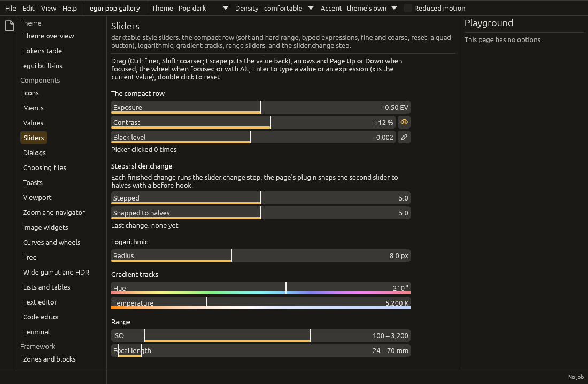

# Sliders

egui-pop's sliders (`egui_pop_core::slider`) follow darktable's bauhaus
sliders: one compact row with the label and the value inside the bar,
built for panels of many parameters edited with precision.



## The compact row

```rust
use egui_pop::egui;
use egui_pop::core::icon::Icon;
use egui_pop::core::slider::Slider;

fn exposure(ui: &mut egui::Ui, ev: &mut f64, on: &mut bool) {
    ui.add(
        Slider::new(ev, "Exposure", -3.0..=4.0) // the soft range: what the bar spans
            .hard(-18.0..=18.0)                 // what a typed value may reach
            .step(0.01)                         // arrows and the wheel; sets the precision
            .unit("EV")
            .signed()                           // "+1.50 EV"
            .default(0.0)                       // a double click goes back to it
            .quad_toggle(Icon::Visible, "Exposure on", on),
    );
}
```

| Gesture | What it does |
|---|---|
| Drag anywhere on the bar | The value follows the pointer's motion over the soft range; a click never makes it jump. One gesture: one undo step when bound to the store |
| Ctrl (Cmd) / Shift held | Ten times finer / coarser, for drags, arrows and the wheel |
| Escape during a drag | Puts the value back, with no trace |
| Arrows, Page Up, Page Down | One step, one coarse step (when focused) |
| Home, End | The soft range's ends |
| Enter | The typed entry: a number or an expression, then Enter or a click elsewhere commits it (Escape leaves it with nothing). While open it owns Escape and Enter: key bindings never see them. Only a real blur commits it (a click elsewhere, Tab, the focus taken by another widget), not a frame where the panel is redrawn and nobody holds the focus |
| Wheel | Scrolls the panel; steps the slider only when it has the focus or Alt is held over it |
| Double click | Back to the default |

The keys are data (`slider::Gestures`, `slider::set_gestures`), for input
profiles.

**Hosts with a key dispatcher of their own.** egui-pop's dispatcher
leaves Escape and Enter to a text input that owns the keyboard. A host
that reads keys before its widgets are drawn asks
`egui_pop_core::focus::text_input_owns_keyboard(ctx)` first: it is true
while a text field has the focus and while a typed entry is open (the
entry claims the keyboard each frame, and egui lets go of the focus on
Escape before the frame is drawn, so the claim is what still holds on
that frame).

**Typed values.** A number or an expression: `+ - * /`, `^`,
parentheses, a sign, and `x`, the current value (`x * 2`, `x - 0.5`).
The decimal separator is a point or a comma; when a text has both, the
last one is the decimal separator (`1.234,5`, `1,234.5`). A unit after
the expression is ignored (`1,5 EV`). A value past the soft range is
kept up to the hard one, and shown in the warning colour.

**Values in the interface's language.** The value is written by
`egui_pop_core::strings::number`, which asks the installed strings
provider: with the `egui-pop-i18n` plugin, French reads `1,50 EV` and
`1 234 K`. The space before the unit is the language's too
(`egui_pop_core::strings::quantity`): a narrow no-break space (U+202F)
in French, a plain space in English. The typed entry starts from the
number and reads it back.

**The quad button.** `quad(icon, label)` adds a square button at the
bar's end (a colour picker: `Icon::Picker`), whose click is in
`SliderOutput::quad_clicked`; `quad_toggle(icon, label, &mut on)` turns
it into a toggle, lit when on. Either is named for assistive
technologies by its label.

## Variants

- **Logarithmic**: `.logarithmic()` gives equal ratios equal lengths
  (ISO, a radius); arrows and the wheel step by a hundredth of the bar.
  It needs a soft range above zero; otherwise the bar stays linear.
- **Gradient track**: `.gradient(Gradient::hue())`,
  `.gradient(Gradient::temperature(2000.0, 12000.0))` (the illuminant's
  colour; `.reversed()` shows the correction instead), or any
  `Gradient::new` or `Gradient::sampled`. The colours are a strip along
  the bottom of the bar, so the label and the value keep their contrast.
- **Range**: `RangeSlider::new(&mut low, &mut high, "ISO", 50.0..=25600.0)`
  has two thumbs that never cross. Each thumb is its own widget: it takes
  the focus (Tab goes from one to the other), steps, opens the typed
  entry, and is named "ISO, minimum" and "ISO, maximum". A press takes
  the nearer thumb. A double click resets both.

Both slider types share the builder methods (`hard`, `step`, `coarse`,
`unit`, `precision`, `display_scale`, `integer`, `signed`,
`logarithmic`, `gradient`). `Slider::from_descriptor` reads a value
descriptor, and the parameter widget (`egui_pop_core::param`) uses it.

## Hooks and the `slider.change` step

`on_change` sees every change before it is written: a `Change` (the
thumb, `from`, `to`, the cause, and whether the gesture is done), and
answers `Verdict::Go`, `Verdict::Veto` or `Verdict::Redirect(value)`. A
drag's frames come with `done: false`. Its end comes once more, from the
value before the drag, with `done: true`, and a veto then puts the value
back. `show(ui)` returns a `SliderOutput` with the changes written in
the frame.

In an application, `egui_pop_api::sliders::hook(app, "exposure")` makes
each finished change run the `slider.change` step (ADR 0011):

| Step | Arguments | Default |
|---|---|---|
| `slider.change` | `slider`, `thumb` (`value`, `low`, `high`), `from`, `to`, `cause` (`drag`, `key`, `wheel`, `typed`, `reset`, `access`) | writes `to` |

A before-hook vetoes the change or redirects it (snap, clamp), a
run-hook gives the value to write, an after-hook follows it, and every
run publishes `slider.change` on the journal. The gallery's sliders page
snaps one slider to halves this way.

```rust
use egui_pop::egui;
use egui_pop::api::sliders;
use egui_pop::core::slider::Slider;

fn stepped(ui: &mut egui::Ui, app: &egui_pop::api::AppHandle, v: &mut f64) {
    ui.add(Slider::new(v, "Radius", 0.0..=10.0).on_change(sliders::hook(app, "radius")));
}
```

## Accessibility

Each bar (each thumb of a range) is an AccessKit slider named by its
label, with its numeric value, its value text (unit included), its
range and step, and the increment, decrement and set-value actions;
the actions go through the hook like any change (cause `access`).

## Why its own

egui's `Slider` and `DragValue` have no soft and hard range, no label
inside the bar, no fine adjustment, no reset, no quad button, no
gradient and no range; the crates checked have no more. See
[the survey](widgets.md#sliders-what-was-checked-2026-10-13).
