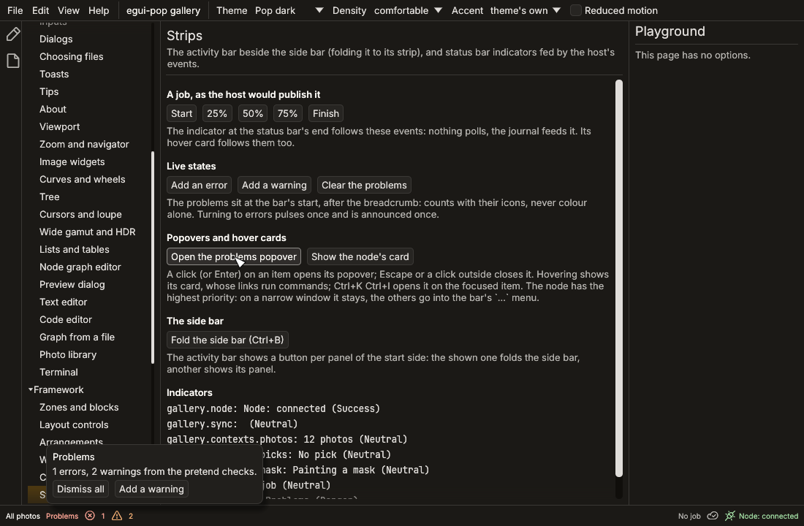
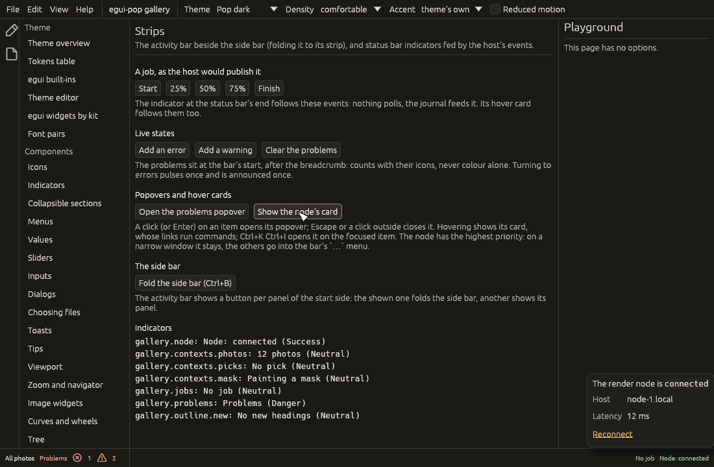

# The status bar

The status bar is the window's bottom line: where the user is (the
context stack's breadcrumb and mode chips, see
[status and context](status-and-context.md)), then **status items**
declared by plugins, each a small reducer over the host's events
(`strips::Indicator`, drawn by `StripsPlugin`; the basics are in
[the workbench](workbench.md#slim-strips)). This page covers what an
item can do beyond its text: where it sits, what gives way on a narrow
window, its live states, a popover per item, and a rich hover card.


## Where an item sits

| Builder | What |
|---|---|
| `align(Alignment::Start)` | after the breadcrumb and the chips, lightest first |
| `align(Alignment::End)` (default) | at the bar's end, the lightest nearest the end |
| `weight(n)` | the order within its group |
| `priority(n)` | what stays on a narrow bar: the higher, the longer (0 by default) |
| `when(clause)`, `during(&frame)` | where it shows ([status and context](status-and-context.md#3-status-items-that-follow-the-context)) |

On a narrow window the breadcrumb's middle crumbs collapse first; then
items give way, the lowest priority first and, among equals, the
heaviest. They are not clipped: they go into the bar's `…` menu ("More
status items"), whose entries act as a click on the item (a popover
then opens next to `…`). Mode chips never give way.

The user hides items and moves them within their group from an item's
context menu; agents use `status.item.hide` and `status.item.move`.

## Live states

An item's state (`IndicatorState`) is what its reducer makes of the
events:

| Field | Shown as |
|---|---|
| `text`, `tone` | the item's text, in the kit's `status-indicator` tone |
| `icon` | an icon before the text, in the same colour (`Indicator::icon`, by name); with an empty text, the icon alone, named by the item's label |
| `count` | `text (n)` |
| `busy` | a spinner before the text, after `motion.spinner.delay` |
| `progress` | a thin line under the text |
| `errors` | the error icon and the count, in the danger tone |
| `warnings` | the warning icon and the count, in the warning tone |
| `detail` | the tooltip, when the item has no hover card |

Colour never carries a state alone: the counts come with their icons,
named for screen readers ("Errors: 2"), and the item's accessible
description gives its counts, its progress and its card (or tooltip).
When an item turns to errors (from none), its error icon pulses a few
times (a still ring under reduced motion) and a screen reader
announces it once, politely ("Problems: Errors: 2"); more errors do not
announce again.

An item's icon (`Indicator::icon("phosphor:plugs-connected")`, or
`IndicatorState::icon` from its reducer) sits before its text, inside
the same button, in the item's colour. An item without an icon of its
own that runs a command (`Indicator::command`) shows the command's
(`CommandSpec::icon`, its `icon_on` while the command's `checked`
clause holds). Most items are short texts and need none; one shown by
its icon alone (a connection, a sync) keeps its label as its
accessible name. The names are checked with the other declarations
(`unknown-icon`), an unknown one drawn as the placeholder.

## Popovers

`popover(|ui, app| …)` gives an item a small layout opened by a click:
a list with actions, a picker, a connection form. It is a popover host
of the [mount contract](hosts.md): transient, sized by its content (give
a list a `ScrollArea` with a maximum height), on egui-pop's overlay
stack.

- A click on the item, or Enter when it has the focus, opens it above
  the item; a second click closes it. The item's `command`, when it
  has one, is no longer run by the click: the popover can run it.
- Tab goes from the item into the popover and [stays there](inputs.md#a-popover-keeps-tab),
  coming back to the first stop after the last; Escape or a click outside
  closes it, and the focus goes back to the item.
- `status.item.open` (`{ "id", "open" }`) opens or closes it for an
  agent; `strips::open_popover` and `strips::open_item` in code.

## Hover cards

`hover(|state, app| Card)` replaces the item's tooltip with a rich
card, as VS Code's hovers: the tier between a tooltip and a popover.
The card is `egui_pop::core::hover_card::Card`, a shared component any
widget can use (a toolbar button, a row, a node graph port) with
`HoverCard::new(id).show(ui, &response, &card)`:

- **Content:** formatted text (`**bold**`, `` `code` ``, lines starting
  with `- ` as list items), rows of key and value, a progress line,
  separators, and command links. The owner builds it from the state
  each time it shows, so live values (a job's progress) follow.
- **Links** run their command with its arguments (`app.run`), with the
  same `when` and steps as anywhere else; the card then closes.
- **Behaviour:** it opens after the hover delay (egui's
  `tooltip_delay`), stays while the pointer moves onto it so links can
  be clicked, and closes once the pointer has left both for a short
  grace, on Escape, or on a click elsewhere. A click on the item closes
  it until the pointer leaves. It never shows over the item's open
  popover.
- **Keyboard:** `Ctrl+K Ctrl+I` while the status bar has the focus
  (`status.item.hover`, the focused item by default) opens it with the
  focus on its first link; Tab moves through the links, Escape closes
  it and gives the focus back.
- **Accessibility:** the card's text is the item's accessible
  description; links are buttons.
- **Agents** read it without hovering: each item's `card` in
  `strips::status`, the `strips` collector and `context.read`, as data
  (`blocks` of `text`, `rows`, `progress`, `separator`, `links`).

```rust
use egui_pop::api::strips::{Alignment, Indicator, Tone};
use egui_pop::core::hover_card::Card;
use egui_pop::model::ids::CommandId;
use serde_json::Value as Json;

const CLEAR: CommandId = CommandId::from_static("checks.clear");

let problems = Indicator::new("checks", "No problem", "check.")
    .align(Alignment::Start)
    .priority(5)
    .reduce(|state, event| {
        match event.name.as_str() {
            "check.error" => state.errors += 1,
            "check.warning" => state.warnings += 1,
            "check.clear" => (state.errors, state.warnings) = (0, 0),
            _ => {}
        }
        state.tone = if state.errors > 0 { Tone::Danger } else { Tone::Neutral };
    })
    .popover(|ui, app| {
        ui.label("What the checks found");
        if ui.button("Dismiss all").clicked() {
            app.run(CLEAR, Json::Null);
        }
    })
    .hover(|state, _| {
        Card::new()
            .text("**Checks** of the catalogue")
            .row("Errors", state.errors.to_string())
            .row("Warnings", state.warnings.to_string())
            .link("Clear them", CLEAR, Json::Null)
    });
# let _ = problems;
```

## What agents read

Each entry of `strips::status` (the `strips` collector's `items`, and
`context.read`'s `status` for the visible ones) gives the item's `id`,
`text`, `tone`, `icon` (the name shown, when any), `count`, `progress`,
`align`, `priority` (when not 0),
`busy`, `errors` and `warnings` (when not 0), `popover` (it has one),
`open` (it is open), its `card`, and `hidden_by` (`when`, `user`, or
`narrow`) for a hidden one. The collector also gives the item whose
popover is `open`.

| Command | Arguments | What |
|---|---|---|
| `status.item.open` | `{ "id", "open": true }` | opens (or closes) an item's popover |
| `status.item.hover` | `{ "id" }` (the focused item by default) | opens an item's hover card; `Ctrl+K Ctrl+I` in the bar |
| `status.item.hide` | `{ "id", "hidden": true }` | hides an item where the user is, or shows it |
| `status.item.move` | `{ "id", "toward": "start" \| "end" }` | moves an item one step in its group |

The gallery's `strips` page shows each: the problems at the bar's start
with their counts and popover, the node item of high priority with its
icon, card and a small connection form, a sync shown by its icon alone,
and the job's live card.




## Not yet

- Built-in items over the services (the notifications' counts by
  severity, connection indicators with a reconnect action); the jobs
  centre keeps its own status block and popover.
- The bar's own height token, and separators between groups.
- The jobs item's width is not counted when the items are fitted, so on
  a very narrow bar with jobs running the end group can run under it.
