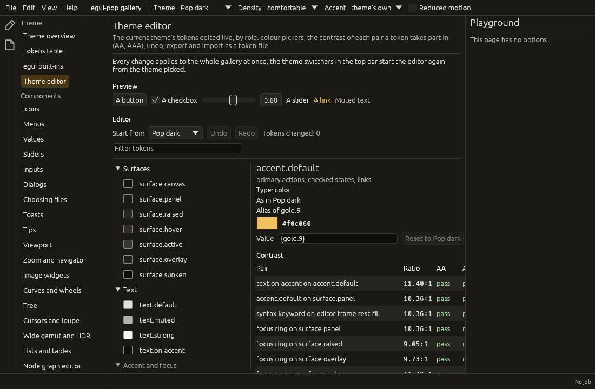

# The theme editor

A theme's tokens edited live, in any `Ui` of an application: grouped by
role, each colour with its picker, the contrast of every pair a token
takes part in, undo and redo, export and import as a token file. The
gallery's `theme-editor` page shows it over the gallery's own theme.



## In an application

```rust
use egui_pop::api::App;
use egui_pop::api::theme_editor::{self, ThemeEditorPlugin};

// The plugin: the editor's state, its steps and agent commands.
let app = App::builder()
    .plugin(ThemeEditorPlugin)
    .build(&egui_pop::egui::Context::default())
    .unwrap();

// The view, wherever the application wants it: a panel, a window, a
// page of its settings.
fn appearance(ui: &mut egui_pop::egui::Ui, app: &egui_pop::api::AppHandle) {
    theme_editor::show(ui, app);
}
# let _ = (app, appearance);
```

The editor works on the application's theme (the theme service): each
change becomes the spec's base and overrides, installed before the next
frame, so every widget follows at once. When the theme changes elsewhere
(a theme switcher, `AppHandle::theme().set`), the editor starts again
from it, its history emptied.

The model is `egui_pop_tokens::ThemeDraft`, with no egui in it: a base
theme, the tokens changed over it (raw DTCG values, aliases kept as
aliases) and their history. Applications that want their own view use
it directly, or the service (`THEME_EDITOR`: `set`, `undo`, `redo`,
`start`, `export`, `import`, `read`).

## What it shows

- **Start from**: any built-in theme; the draft starts again from it.
- **Undo** and **Redo**, naming the token they would change.
- **The tokens, by role**: surfaces, text, accent and focus, states,
  borders, shape, space, type and motion (the system tier), the
  components' tokens, then the palette (the reference tier). A filter
  narrows them; changed tokens are in bold, marked "changed".
- **The token picked**: its description and type, whether it is changed
  here or as in the base theme, what it aliases; its value with the
  widget of its type (egui's colour picker with alpha, a number field
  for dimensions, numbers and durations) and a text field taking a
  value or an alias (`{gray.3}`, checked: same type, no loop); reset to
  the base theme's value.
- **Contrast**: every pair of `contrast::PAIRS` the token takes part in,
  itself or through the tokens aliasing it, with its ratio, AA (4.5:1
  for text, 3:1 for interface parts), AAA (7:1 for text; interface parts
  have no AAA) and what the theme needs: AAA text for a high-contrast
  theme (7:1), AA otherwise.
- **Export and import**: the draft as a `.tokens.json` file, or a file
  pasted and loaded. Tokens the base theme does not have, or whose value
  is not of their type, are left out and listed.
- **Problems**: what the theme's resolution reports.

## The file

A draft is saved as an ordinary token file (see [Design tokens](tokens.md)):
`$extends` names the base theme, the file gives only the tokens changed,
each with its `$type`, and the root's `$extensions` carries the editor's
stamp, `"org.egui-pop.theme-editor": { "version": 1 }`, for migrations
to come (a file stamped by a newer editor is refused). Any such file
loads as a theme (`Themes::add_text`) and imports back as a draft. The
editor writes DTCG JSON, the exchange format; a YAML file imports too.

```json
{
  "$description": "Edited from pop-light",
  "$extends": "pop-light",
  "$extensions": { "org.egui-pop.theme-editor": { "version": 1 } },
  "accent": { "default": { "$type": "color", "$value": "#2060c0" } },
  "button": { "rest": { "border-color": { "$type": "color", "$value": "{border.strong}" } } }
}
```

## Steps and commands

| Step | Arguments | Default |
|---|---|---|
| `theme.token` | `path`, `from`, `to` (raw DTCG values, `null` for the base theme's), `cause` (`edit`, `reset`, `undo`, `redo`, `agent`) | writes `to` |
| `theme.load` | `base`, `overrides`, `cause` (`start`, `import`) | loads them, the history emptied |

A before-hook vetoes a change (the token keeps `from`) or redirects it
(another `to`, checked again); a run-hook's result is the value written.
Undo and redo go through `theme.token` too, so a plugin can keep a token
from moving whichever way it is asked. A colour dragged in its picker is
shown live and becomes one change when the pointer is released; a
number moved with the keys, or a value typed in, becomes one when its
field lets the focus go.

Commands for agents (hidden from the palette): `theme.read` (the draft:
base, overrides, history, failing pairs and problems; with `path`, one
token, its value, alias and contrast readouts), `theme.set` (`path`,
`value`, `null` for the base theme's), `theme.undo`, `theme.redo`,
`theme.start` (`base`), `theme.export` (`name`, the file's text back)
and `theme.import` (`text`, the tokens left out back).

## Keyboard and screen readers

Every control is reached with Tab and used with Enter or Space: the
theme picker, undo and redo, the filter, each group and token, the
value fields, reset, export and import. egui's colour picker is drawn
for the pointer; its keyboard path is the value field beside it (a hex
colour or an alias). The colour button is a colour well named "Adjust
`<token>`", the field "Value of `<token>`"; the contrast table is text.

## Survey (2026-10-13)

| Crate | Licence | What it is | Decision |
|---|---|---|---|
| egui's `color_picker` (`color_edit_button_srgba`) | MIT OR Apache-2.0 | An HSV picker with alpha in a popup | **Adopt**: the colour widget |
| egui_colors 0.13 | MIT | 12-step palettes generated from a seed colour (Radix-like), with a clamped picker; "for exploring styling options" | Not used: palettes to start a theme from are not decided |
| egui_thematic | MIT | A theme editor over egui's `Visuals`, with presets and JSON save | **Own**: it edits egui's style, not DTCG tokens in tiers with aliases and contrast pairs |
| egui-themes, zeus-theme | MIT | Ready-made egui styles | Not relevant: egui-pop's themes are token files |

Not done yet: generated palettes as a starting point, a preview strip of
every kind of component in the editor itself (the gallery page puts a
few widgets beside it), renaming a theme and adding it to the themes the
application offers (the editor works as overrides over a known base),
reading a file from disk (the application passes its text).
