# Themes

How to pick a theme, adjust it, and read it when painting. How tokens
are written, resolved and checked is in [Design tokens](tokens.md).

## A theme

```rust
use egui_pop::egui;
use egui_pop::theme::{self, Density, ThemeSpec, Tokens};

fn setup(ctx: &egui::Context) {
    let tokens = theme::install(
        ctx,
        &ThemeSpec::new("pop-dark").density(Density::Compact).accent("blue"),
    );
    for problem in tokens.resolved().problems() {
        eprintln!("theme: {problem}");
    }
}

fn draw(ui: &mut egui::Ui) {
    // egui's widgets follow the theme; custom painting reads the tokens.
    let tokens = Tokens::of(ui.ctx());
    ui.colored_label(tokens.status.success, "Saved");
}

setup(&egui::Context::default());
```

In an application, give the spec to `AppBuilder::theme`; the theme
service (`AppHandle::theme`) switches it while running, installed before
the next frame:

```rust
use egui_pop::egui;
use egui_pop::prelude::*;

let app = App::builder()
    .theme(ThemeSpec::new("pop-light").reduced_motion(true))
    .build(&egui::Context::default())
    .unwrap();
app.handle().theme().set(ThemeSpec::new("gruvbox-dark").accent("amber"));
```

## What can be chosen

- **Themes**: `pop-dark`, `pop-light` and `pop-high-contrast`, and twelve
  editor-inspired ones (GitHub, Catppuccin, One, Solarized and Gruvbox
  families, light and dark, and GitHub's high-contrast pair; sources and
  licences in [NOTICE](../NOTICE)).
- **Densities**: `comfortable` and `compact`.
- **Accents**: `gold`, `blue`, `green`, `amber` and `red`.
- **Reduced motion**.
- **Any token**, overridden by its path (`override_token`).

See [Design tokens](tokens.md) for the order a theme is resolved in and
how to write a theme of your own, and [the theme editor](theme-editor.md)
to edit one live and export it.

Every built-in theme is shown at full size [below](#the-built-in-themes).

## The built-in themes

Each one as the gallery's overview page shows it, at full size (a
1280x800 window, one pixel per point); click an image to open it alone.

### `pop-dark`

<a href="screenshots/themes/pop-dark.png">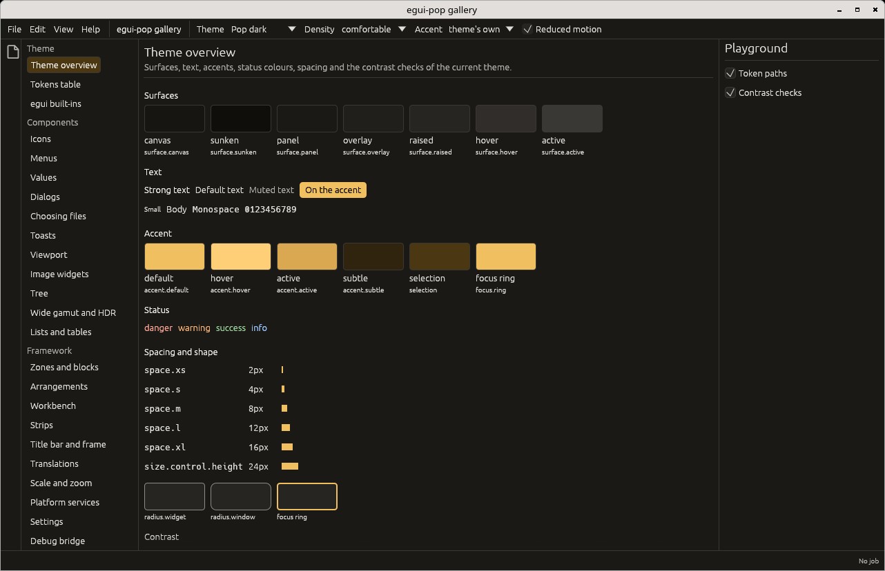</a>

### `pop-light`

<a href="screenshots/themes/pop-light.png">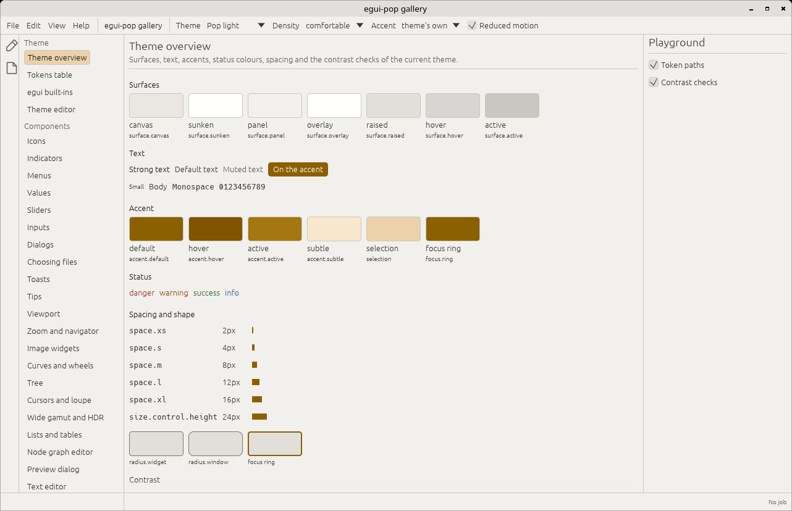</a>

### `pop-high-contrast`

<a href="screenshots/themes/pop-high-contrast.png">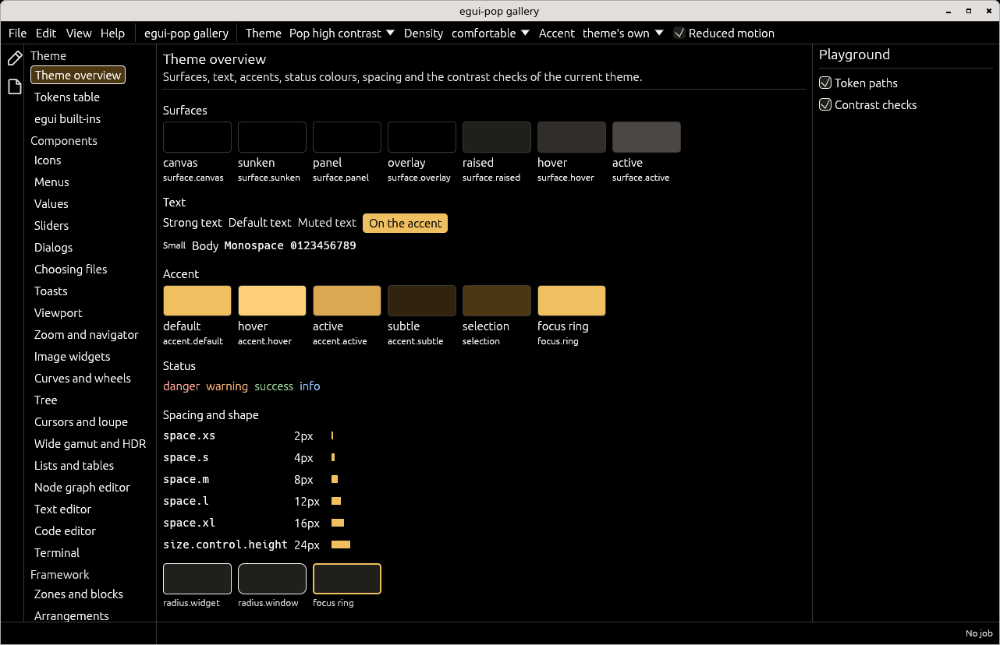</a>

### `github-light`

<a href="screenshots/themes/github-light.png">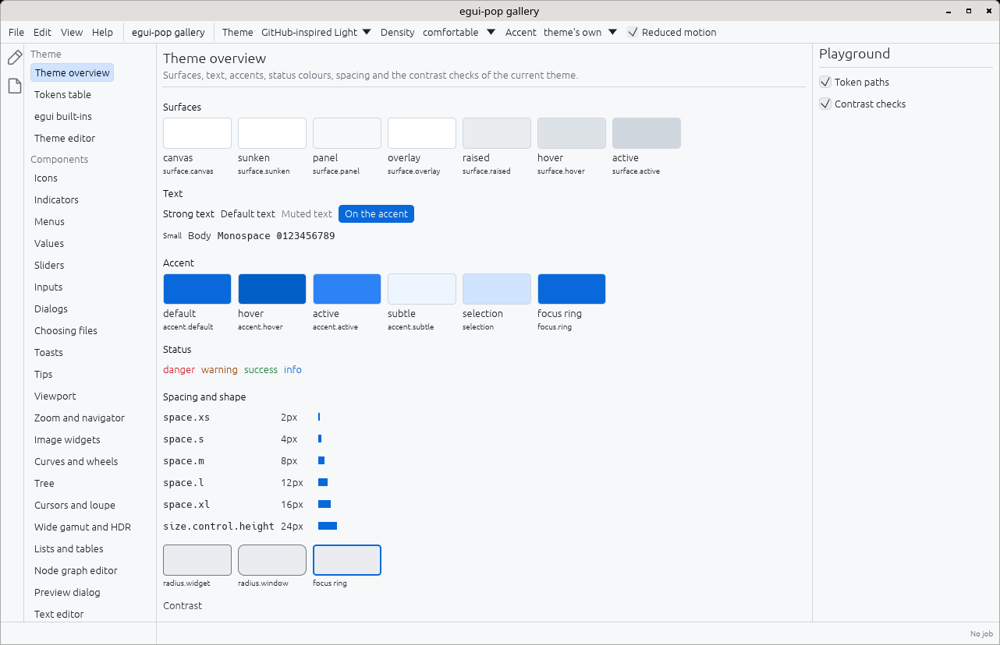</a>

### `github-dark`

<a href="screenshots/themes/github-dark.png">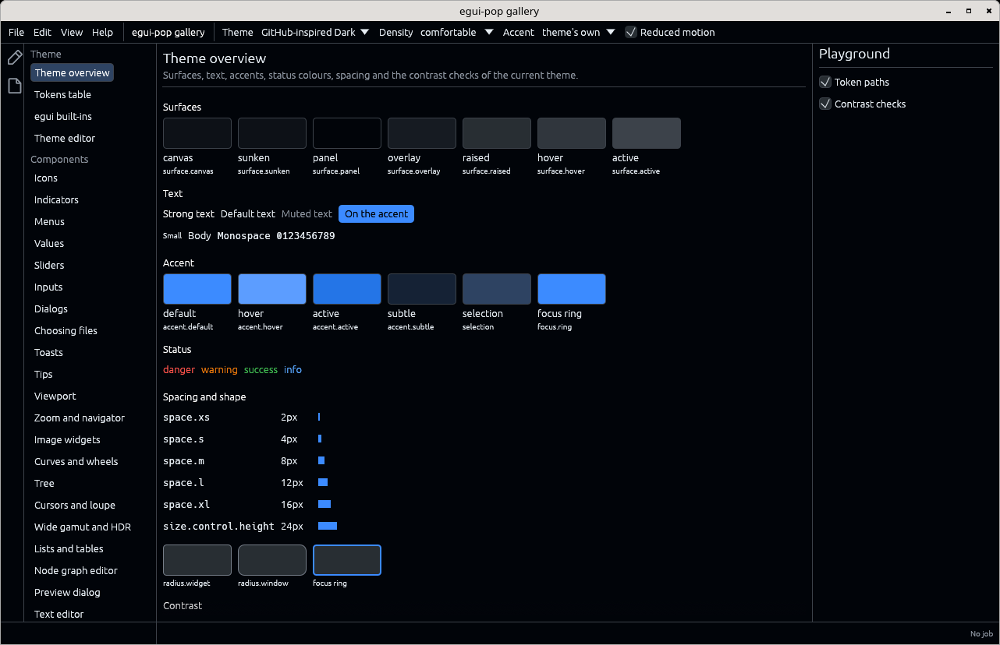</a>

### `github-light-high-contrast`

<a href="screenshots/themes/github-light-high-contrast.png">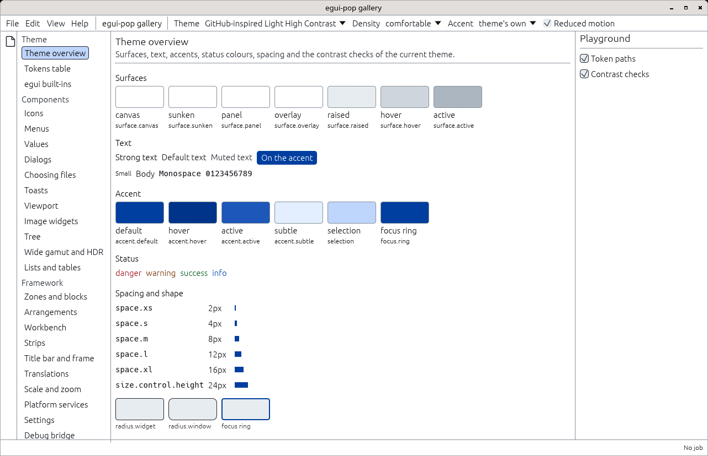</a>

### `github-dark-high-contrast`

<a href="screenshots/themes/github-dark-high-contrast.png">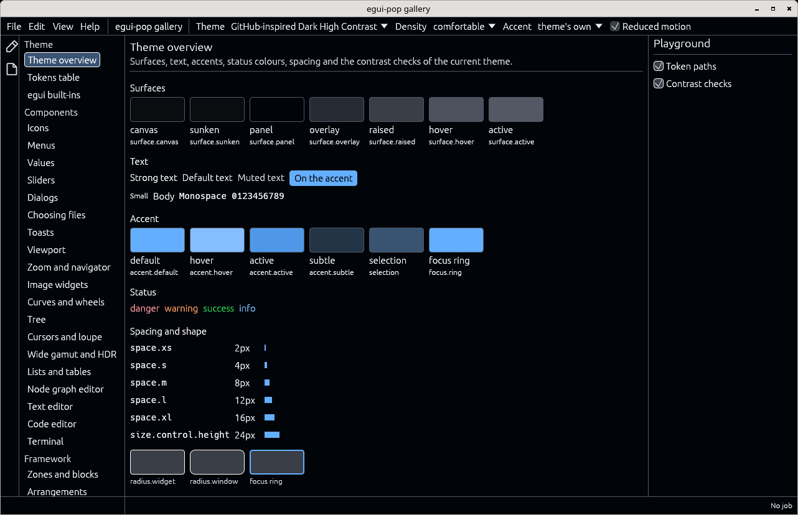</a>

### `catppuccin-latte`

<a href="screenshots/themes/catppuccin-latte.png">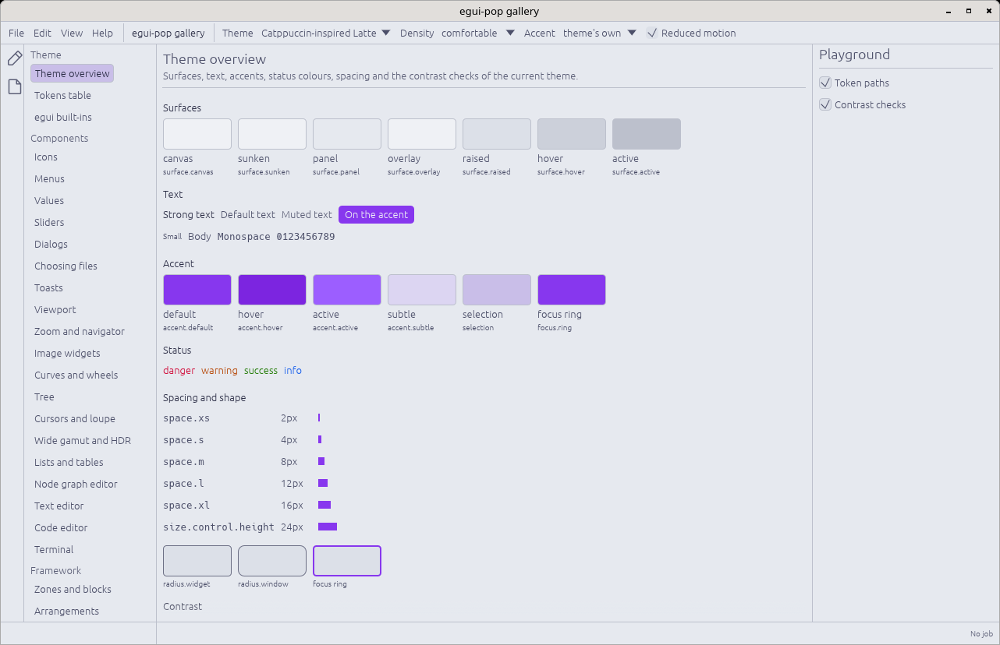</a>

### `catppuccin-mocha`

<a href="screenshots/themes/catppuccin-mocha.png">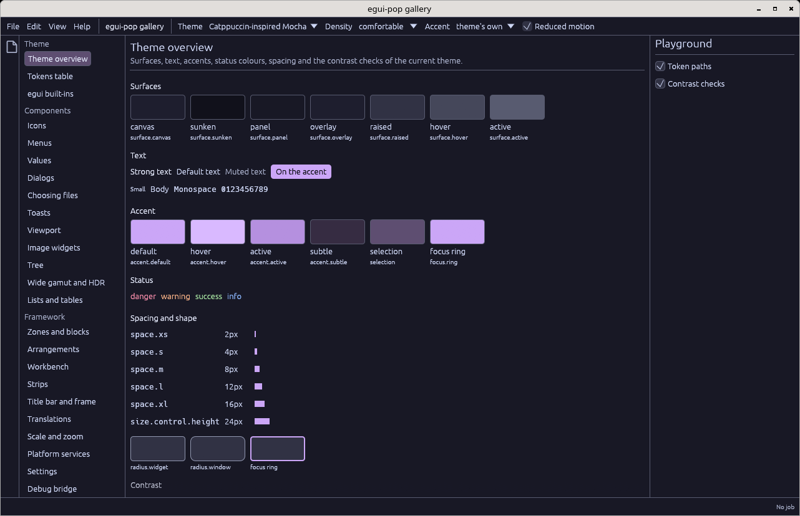</a>

### `one-light`

<a href="screenshots/themes/one-light.png">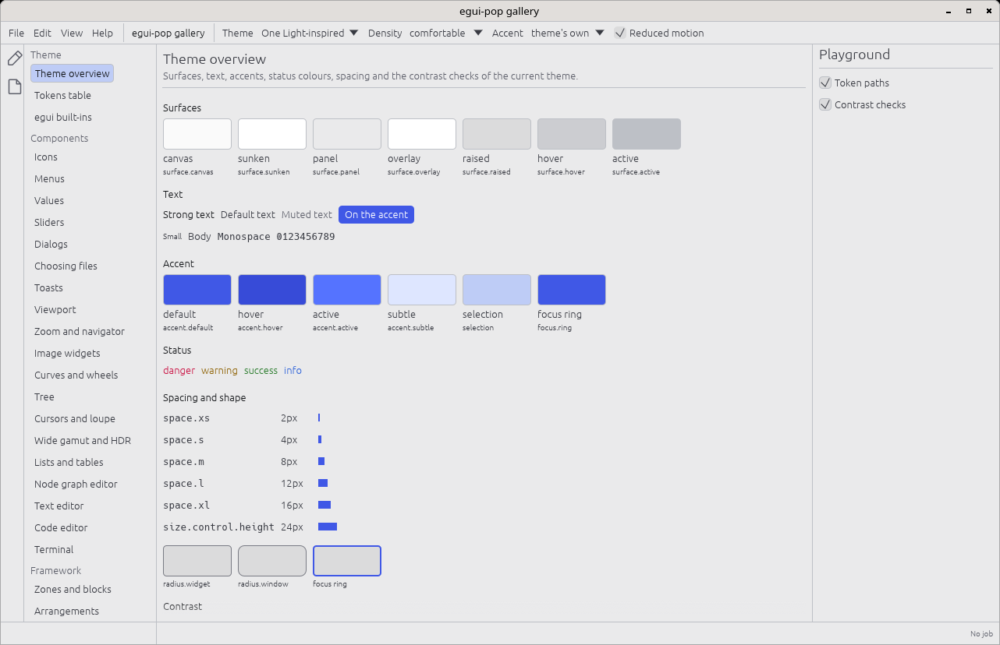</a>

### `one-dark-pro`

<a href="screenshots/themes/one-dark-pro.png">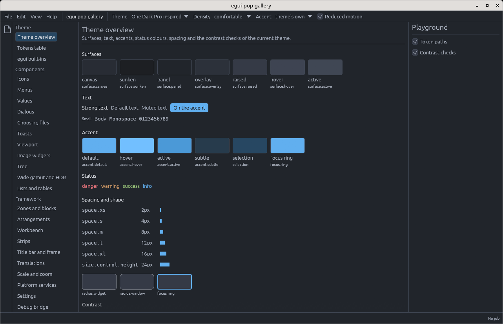</a>

### `solarized-light`

<a href="screenshots/themes/solarized-light.png">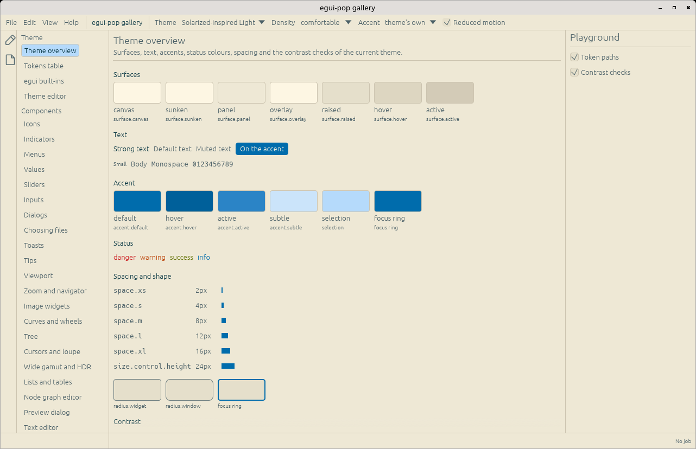</a>

### `solarized-dark`

<a href="screenshots/themes/solarized-dark.png">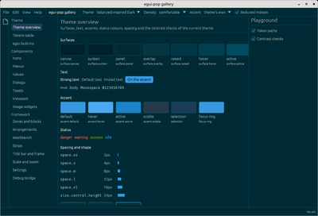</a>

### `gruvbox-light`

<a href="screenshots/themes/gruvbox-light.png">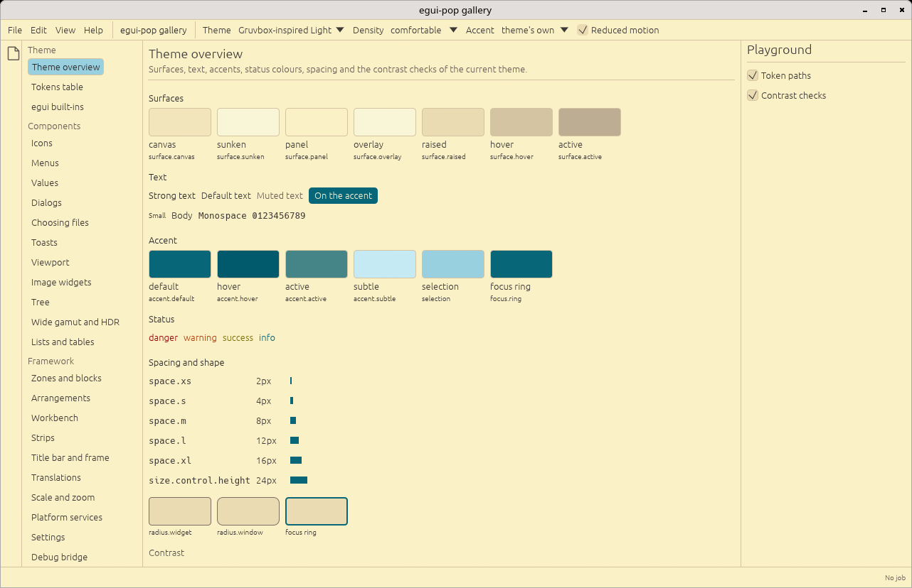</a>

### `gruvbox-dark`

<a href="screenshots/themes/gruvbox-dark.png">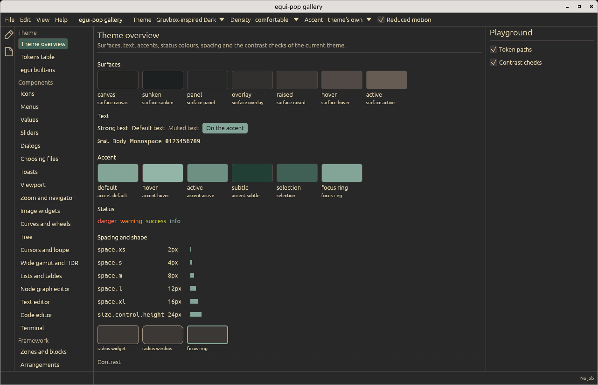</a>

The images are refreshed with the others (`cargo xtask screenshots`, see
the [README](../README.md#refreshing-the-screenshots)).
