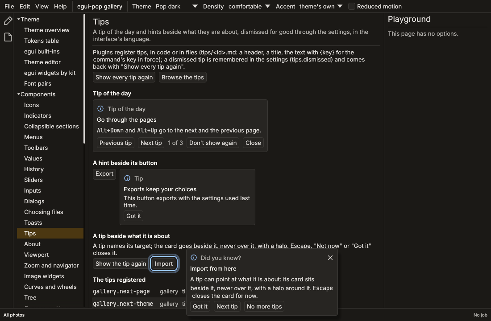

# Tips

A tip of the day and contextual hints, registered by plugins,
translated, dismissed for good and remembered in the settings. The
gallery's `tips` page shows them.



## Registering tips

```rust
use egui_pop::api::tips::{TIPS, TIPS_PLUGIN, Tip, TipsPlugin};
use egui_pop::api::{App, Ctx, Plugin, PluginError};
use egui_pop::model::ids::PluginId;

struct Photos;

impl Plugin for Photos {
    fn id(&self) -> PluginId {
        PluginId::from_static("photos")
    }

    fn requires(&self) -> Vec<PluginId> {
        vec![TIPS_PLUGIN]
    }

    fn connect(&mut self, ctx: &mut Ctx<'_>) -> Result<(), PluginError> {
        let tips = ctx.app().service(&TIPS).expect("required");
        tips.add(Tip::new("photos.rate", "Rate quickly", "Press 1 to 5 to rate the selected photos."));
        tips.add(Tip::new("photos.export-here", "Export from here", "Exports with the last settings.").contextual());
        Ok(())
    }
}

let app = App::builder()
    .plugin(TipsPlugin)
    .plugin(Photos)
    .build(&egui_pop::egui::Context::default())
    .unwrap();
assert_eq!(app.handle().service(&TIPS).unwrap().all().len(), 2);
```

Add `TipsPlugin` to the application. A tip has an id, an English title
and text; a contextual tip is shown only where the application asks for
it, never as the tip of the day.

## Tips in files

A tip is also a file, `tips/<id>.md`: one idea per file, shipped by a
plugin beside its code, with no code of its own.

```text
---
command: photos.rate
surface: focusedPanel == 'photos.grid'
target: photos.rating
---
# Rate quickly

Press {key} to rate the selected photos, **0** to clear the rating.
```

| Header | What | Default |
|---|---|---|
| `id` | The tip's id, prefixed by its plugin's | The file's name |
| `surface` | A `when` clause: where the tip makes sense | Anywhere |
| `command` | The command the tip teaches | None |
| `target` | The name of what the tip is about | None |
| `contextual` | `true`: shown only where the application asks | `false` |

The header is optional; the text starts with a `# Title` heading. It
keeps paragraphs (a blank line between them), `**bold**` and
`` `code` ``. `{key}` is the key bound to the tip's command in the
keymap in force, and `{key:<command>}` another command's: a key the
user rebound shows rebound. A command without a key shows its title in
bold.

`Tips::add_files(origin, files)` registers files built into the binary
(`include_str!`), `Tips::add_dir(origin, dir)` a folder's; both return
the files that could not be read (the line and what is wrong), and
register the others. `origin` is the plugin's id, which groups its
tips. The gallery's own tips are in `crates/egui-pop-gallery/tips`.

## Showing them

- `tips::tip_of_the_day(ui, app)`: a card with the tip in turn among
  those not dismissed, "Previous tip", "Next tip", where it is in the
  turn, "Don't show again" and "Close" (for this session). It returns
  whether it drew a card.
- `tips::hint(ui, app, "photos.export-here")`: the tip as a card where it
  is called, beside what it is about, with "Got it".

The card is a note for screen readers; its buttons are named ("Got it:
do not show `<title>` again").

## Shown by themselves

`Tips::set_auto(true)` lets tips come by themselves, as a card that
never takes the focus and is never modal: once five seconds after the
start, then the first time a tip's `surface` holds (a panel focused, a
mode entered). Off by default: an application turns it on. The rules
choose the tip:

- not contextual, not dismissed ("Got it" is final);
- its command never used: a person who ran it knows it (the commands a
  person runs, from the keyboard, a menu or the palette, are recorded
  in `tips.used`; an agent's or a script's are not);
- its surface holds;
- not shown in the last day (`tips.seen`);
- among the rest, the one shown longest ago, never shown first, then
  the first registered.

`Tips::pick` applies them in a context, `Tips::refusal` says why a tip
would not be chosen, and `tips::pick::Rules` is the same without an
application.

The card says "Did you know?", with "Got it" (never again), "Next tip"
(the next the rules choose), "No more tips" (the `tips.show` setting)
and a close button, "Not now", which Escape is too: the tip may come
back another day.

## Pointing at what it is about

A tip with a `target` names what it is about, and the element names
itself where it is drawn:

```rust,ignore
tips::mark(ui.button("Import"), "photos.import");
// or, for any rectangle: tips::target(ui.ctx(), "photos.rating", rect);
```

The card goes beside the target, after it when there is room, else on
another side (`placement`), a gap away, never over it, and a halo
surrounds the target. A tip whose target is not drawn shows in the
bottom corner at the start (toasts keep the end). Both come from the
theme:

| Token | What | Without it |
|---|---|---|
| `tip-card.halo-color` | The halo around a target | `status.info`, the card's icon's |
| `tip-card.width` | The card's width | A toast's width |

## Commands

| Command | What |
|---|---|
| `tips.show` | Shows the tip the rules choose here (`tip`: that one) |
| `tips.next` | The next tip, in place of the one shown |
| `tips.gotIt` | Dismisses the tip shown for good |
| `tips.notNow` | Closes the card (Escape) |
| `tips.off` | No more tips |
| `tips.current` | For agents: the tip shown, its card's and its target's rectangles |
| `tips.reset` | Shows every tip again |
| `tips.list`, `tips.dismiss` | For agents: every tip, and dismissing one |

`tipShown` is set while a card is shown, for `when` clauses; the
journal says `tip.shown`.

## Remembered in the settings

| Setting | What |
|---|---|
| `tips.show` | Show tips at all (on by default) |
| `tips.dismissed` | The ids of the tips not to show again, separated by commas |
| `tips.seen` | When each tip was shown last, `id@seconds` |
| `tips.used` | The commands a person used, separated by commas |

Dismissing a tip writes `tips.dismissed` without an undo step, through
the `tips.dismiss` step (`tip`, `cause`: `user` or `agent`; a veto keeps
it showing). The settings are saved with the others, so a tip dismissed
stays dismissed in the next run. `tips.reset` ("Show every tip again")
empties the list; for agents, `tips.list` and `tips.dismiss` (`tip`).

## Translated

A tip's title and text are looked up under keys derived from its id,
`tip-<id>.title` and `tip-<id>.text` (the id's dots become dashes), in
the application's catalogues; the English given is the fallback. A
file's tip is translated the same way. In a catalogue, `{key}` is
written `{ $key }` and `{key:<command>}` is `{ $key-<command> }` (the
command's dots become dashes), Fluent's own placeholders. The
gallery's own tips are translated in `crates/egui-pop-gallery/locales`:

```ftl
tip-gallery-next-page =
    .text = { $key } et { $key-gallery-page-previous } passent à la page suivante et à la précédente.
    .title = Parcourir les pages
```

The card's own text ("Tip of the day", "Next tip", "Got it"...) is in
egui-pop's catalogues.

## Survey (2026-10-13)

egui's tooltips (`on_hover_text`) stay what they are, help on hover. No
crate was found offering a tip of the day, onboarding hints or tours
for egui with dismissal kept in settings and translations: owned.

Not done yet: a per-plugin off switch.
