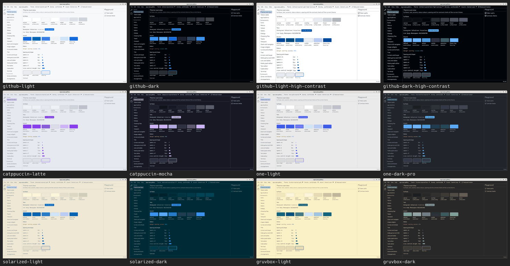
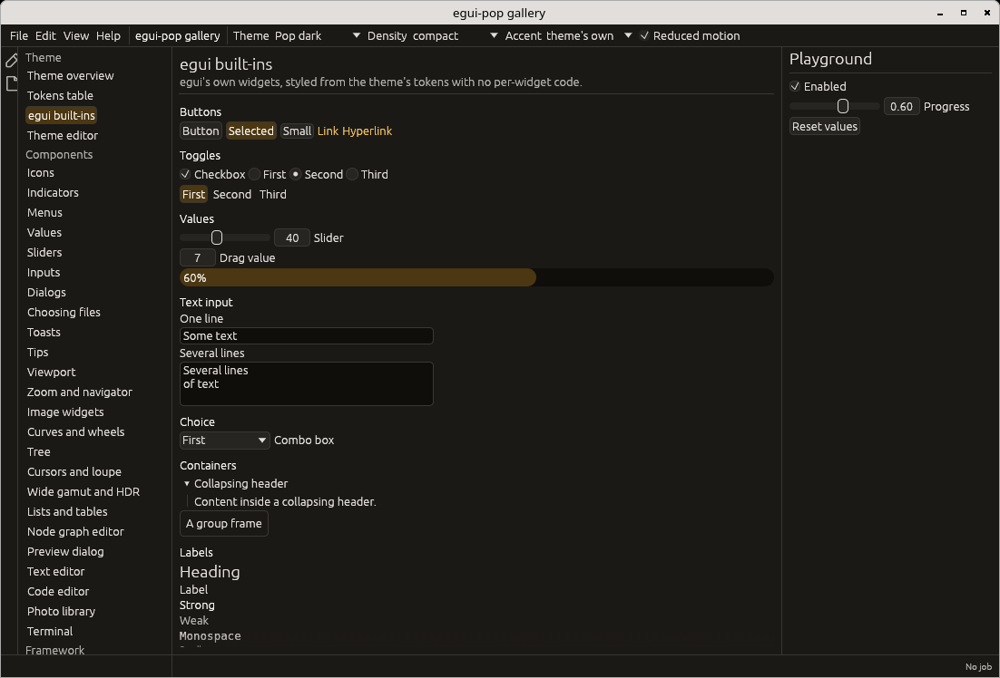

# Design tokens

egui-pop's look comes from design tokens: named, typed values in JSON files
in the format of the W3C Design Tokens Community Group (DTCG 2025.10). No
widget hard-codes a colour or a size; it reads a token.

The files live in [`crates/egui-pop-tokens/themes`](../crates/egui-pop-tokens/themes).
`egui-pop-tokens` reads and resolves them (it has no egui dependency);
`egui_pop::theme` turns the result into egui's style.

## The format, as read here

```json
{
  "$description": "A theme",
  "$extends": "pop-dark",
  "gray": {
    "$type": "color",
    "2": { "$value": { "colorSpace": "oklch", "components": [0.215, 0.006, 75], "hex": "#1b1916" } }
  },
  "surface": {
    "$type": "color",
    "panel": { "$value": "{gray.2}", "$description": "Panels and side bars." }
  },
  "radius": { "widget": { "$type": "dimension", "$value": { "value": 4, "unit": "px" } } }
}
```

- A **token** is an object with `$value`; anything else not starting with
  `$` is a **group**. A token's name is its dotted path (`surface.panel`).
- `$type` is given on the token or inherited from an enclosing group, or
  taken from the token an alias points to.
- An **alias** is a whole value of the form `"{path}"`. Aliases chain;
  a cycle or a reference to nothing is reported, never followed forever.
- `$description` and `$extensions` are kept (tools may store their own data
  under `$extensions`, keyed by a reverse domain name).
- At the root, `$extends` names the theme a file builds on: every token
  not given comes from it, and chains of `$extends` are followed.
- Types read: `color` (colour objects in `srgb`, `srgb-linear`, `oklch` or
  `oklab`, other colour spaces through their `hex` fallback, and
  `#rrggbb`/`#rrggbbaa` strings), `dimension` (`px`, or `rem` at 16 px),
  `number`, `duration` (`ms` or `s`) and `fontFamily`. Other types are
  kept as raw JSON.

Not read yet: references inside composite values, JSON Pointer `$ref`,
`$deprecated`, group-level `$extends`.

## Three tiers

1. **Reference**: the palette, named by what a value is. Each base theme
   has a warm neutral scale `gray.0` to `gray.12` and five hue scales,
   `gold`, `amber`, `red`, `green` and `blue`, steps `1` to `12` plus
   `contrast` (the text colour that reads on step 9). Scale steps mean the
   same in every mode:

   | Steps | Use |
   |---|---|
   | gray 0 to 2 | the deepest backgrounds (in light mode, white paper) |
   | 3 to 5 | subtle fills (hue scales: quiet accent backgrounds, selection) |
   | 6 to 7 | borders |
   | 8 | a solid fill being pressed |
   | 9 | the solid fill (the accent) |
   | 10 | the solid fill under the pointer |
   | 11 | low-contrast text (status colours) |
   | 12 | high-contrast text |

   The light theme redefines the scales (light backgrounds, dark text) and
   keeps the same step meanings, so the system tier mostly aliases the same
   steps in both modes.

   A theme may add hue scales of its own with the same steps (`1` to
   `12` and `contrast`): any such scale is offered as an accent
   (`Themes::accents`). The Catppuccin-inspired themes add `purple`
   (Catppuccin's mauve) and use it as their accent.

2. **System**: roles, what a value is for. These are the tokens widgets
   read, listed in `CONTRACT`:
   `surface.{canvas, panel, raised, hover, active, overlay, sunken}`,
   `text.{default, muted, strong, on-accent}`, `border.{default, strong}`,
   `accent.{default, hover, active, subtle}`, `danger`, `warning`,
   `success`, `info`, `focus.ring`, `selection`, `radius.{widget, window}`,
   `space.{xs, s, m, l, xl}`, `size.control.height`,
   `size.icon.{inline, toolbar, panel}`, `size.dialog.width`, `size.magnet`,
   `size.toast.width`, `font.size.{small, body, heading, mono}`,
   `font.family.{ui, mono}`, `motion.duration`, `opacity.scrim`.

3. **Component**: one component's tokens, each an alias of a system token:
   `button.*`, `slider.{track, fill, thumb}`, `menu.item.*`, `dialog.*`, `palette.*`,
   `toast.*`, `editor.*` and `syntax.*` (one colour per kind of code:
   keywords on the accent, strings on `success`, numbers on `warning`,
   comments muted...), `terminal.*` (its text, cursor, selection, links,
   and `terminal.ansi.0` to `terminal.ansi.15`, the 16 colours programs
   ask for by number: 0 is the colour furthest from the text, 7 the
   text's own, 1 to 6 the status roles and the accent, 8 to 15 their
   stronger forms). A theme may re-alias a component token (high contrast
   outlines every button: `button.border` is `{border.strong}`).

## Naming rules

- Name by **role**, never by hue, outside the reference tier:
  `text.muted`, not `text.gray`; `danger`, not `red`.
- Path segments are lowercase, words joined by hyphens:
  `background-hover`, `on-accent`. Dots separate groups, so a segment never
  contains `.`, `{` or `}`.
- States are suffixes of the thing they modify (`button.background-hover`),
  sizes are `xs`, `s`, `m`, `l`, `xl`.
- A component token points at a system token, a system token at the
  palette or another role, never the other way round (a test checks it).

## The editor-inspired themes

Twelve built-in themes take their colours from popular, permissively
licensed editor themes (their workbench colours, not syntax): five
families with a light and a dark member, and GitHub's high-contrast pair.
Each extends `pop-light`, `pop-dark` or `pop-high-contrast` and gives
its palette and the roles that differ; where an original colour missed a
contrast pair, only its OKLCH lightness was moved. Ids keep the family
names; the labels shown to people say "inspired" (`theme_label`).
Sources and licences are in [NOTICE](../NOTICE).

| id | label | extends |
|---|---|---|
| `github-light`, `github-dark` | GitHub-inspired Light, Dark | `pop-light`, `pop-dark` |
| `github-light-high-contrast`, `github-dark-high-contrast` | GitHub-inspired Light, Dark High Contrast | `pop-light`, `pop-high-contrast` (7:1 text) |
| `catppuccin-latte`, `catppuccin-mocha` | Catppuccin-inspired Latte, Mocha | `pop-light`, `pop-dark` (+ `purple`) |
| `one-light`, `one-dark-pro` | One Light-, One Dark Pro-inspired | `pop-light`, `pop-dark` |
| `solarized-light`, `solarized-dark` | Solarized-inspired Light, Dark | `pop-light`, `pop-dark` |
| `gruvbox-light`, `gruvbox-dark` | Gruvbox-inspired Light, Dark | `pop-light`, `pop-dark` |

[](themes.md#the-built-in-themes)

Each one at full size: [the built-in themes](themes.md#the-built-in-themes).

## Composing a theme

The three base themes, `pop-dark`, `pop-light` and `pop-high-contrast`,
are shown at full size with the others in
[the built-in themes](themes.md#the-built-in-themes) (captured headless;
see CONTRIBUTING.md to regenerate).

The compact density changes spacing and sizes only:



A theme is resolved from a `ThemeSpec`, in this order:

1. the **base theme** (mode and contrast: `pop-dark`, `pop-light`,
   `pop-high-contrast`) with everything it `$extends`;
2. a **density** overlay, `density-comfortable` or `density-compact`, which
   touches `space.*` and `size.*` only (a test checks it);
3. an **accent**: a colour scale whose steps become `accent.default` (9),
   `accent.hover` (10), `accent.active` (8), `accent.subtle` (3),
   `selection` (5) and `text.on-accent` (`contrast`); anything aliasing
   the accent (`focus.ring`, `slider.fill`) follows;
4. **reduced motion**: `motion.duration` becomes 0 (egui's animation time,
   cursor blink and scroll animation follow);
5. the user's **overrides**, raw values by path (aliases allowed).

```rust
use egui_pop::tokens::{Density, ThemeSpec, Themes};
use serde_json::json;

let spec = ThemeSpec::new("pop-light")
    .density(Density::Compact)
    .accent("blue")
    .reduced_motion(true)
    .override_token("radius.widget", json!({ "value": 2, "unit": "px" }));
let tokens = Themes::default().resolve(&spec);
```

Resolving never panics. Problems (an unknown theme, an `$extends` cycle,
an alias cycle, an unknown alias, a wrong type, an unreadable value, a
missing contract token, an unknown override or accent) are listed in
`tokens.problems()`, and every contract token with a problem takes the
built-in `pop-dark` value.

## Contrast

`egui_pop_tokens::contrast` lists, by hand, the token pairs that must stay
legible (`PAIRS`): text over every surface it is drawn on, status colours
used as text, labels on accent fills, component text, and the things that
must be seen (strong borders, the focus ring, slider fill and thumb on the
track). The tests check every built-in theme in every density against WCAG
2.x: 4.5:1 for text, 3:1 for interface parts, 7:1 for text in high
contrast; and every accent in every theme at 4.5:1 and 3:1. Decorative
borders (`border.default`) are not checked. The gallery's overview page
shows the same table live.

## Adding a theme

1. Write `my-theme.tokens.json`. The shortest way is to extend a built-in
   theme and change what differs:

   ```json
   {
     "$extends": "pop-dark",
     "$description": "Cooler greys",
     "gray": { "$type": "color", "2": { "$value": "#171a1f" } },
     "surface": { "$type": "color", "canvas": { "$value": "#000000" } }
   }
   ```

   A theme may also stand alone (no `$extends`): it must then give every
   contract token, or the missing ones fall back to `pop-dark`.

2. Register it and resolve it:

   ```rust
   let mut themes = egui_pop::tokens::Themes::default();
   themes.add_json("my-theme", include_str!("my-theme.tokens.json"))?;
   let tokens = egui_pop::theme::install_with(ctx, &themes, &ThemeSpec::new("my-theme"));
   assert!(tokens.resolved().problems().is_empty());
   ```

3. Check its contrast: `contrast::check(tokens.resolved(), Level::Normal)`
   returns the failing pairs.

For a new **built-in** theme: add the file under `themes/`, list it in
`BUILT_IN_FILES` and `BUILT_IN_THEMES`, and the contrast and contract tests
cover it at once. Add its snapshots to the gallery tests
(`UPDATE_SNAPSHOTS=1 cargo test -p egui-pop-gallery`).

## Into egui

`egui_pop::theme::install` sets both of egui's styles (dark and light) from
the system and component tiers (see the module documentation for the
mapping) and stores a typed `Tokens` set in the context, read with
`Tokens::of(ctx)`. Install between frames; never change the global style
mid-frame to theme one widget.
