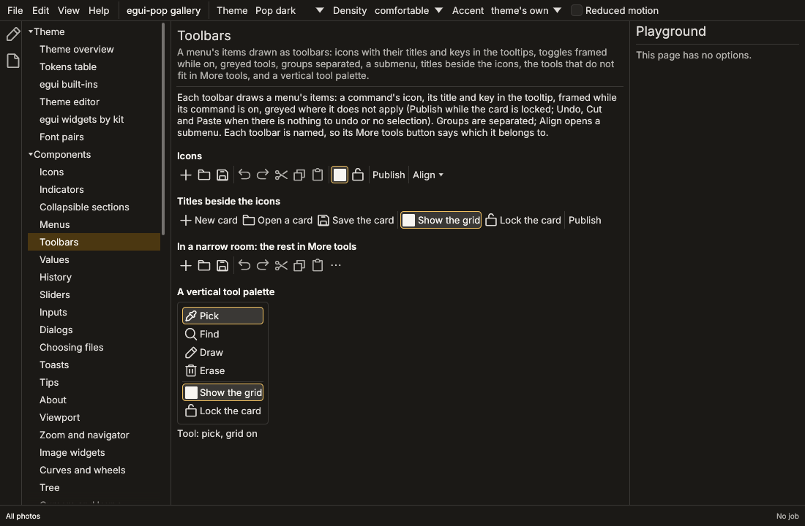

# Toolbars

A toolbar is a row (or a column) of buttons, each running a command:
icon-first, the title and the key in the tooltip, as in Office, VS Code
or Photoshop's tool palette. In egui-pop a toolbar is **declared like a
menu**: it is a menu id whose items plugins contribute, and
`toolbars::Toolbar` draws those items as buttons instead of a list
(VS Code's toolbars are menus contributed to in the same way). Its
icons come from the commands ([icons](icons.md), section 4.2).

```rust,ignore
use egui_pop::api::toolbars::{Labels, Toolbar};
use egui_pop::model::commands::CommandSpec;
use egui_pop::model::ids::{CommandId, MenuId};
use egui_pop::model::menus::MenuItem;

const TOOLBAR: MenuId = MenuId::from_static("demo.toolbar");
const SAVE: CommandId = CommandId::from_static("demo.save");

// In a plugin's `connect`: a command placed in the toolbar...
ctx.command(
    CommandSpec::new(SAVE, "Save", "File")
        .icon("save")
        .key("Ctrl+S")
        .menu(TOOLBAR, "1_file", 0),
    |_| Ok(serde_json::Value::Null),
)?;
// ...and a command someone else declared (egui-pop's own Cut).
ctx.menu_item(MenuItem::command(TOOLBAR, "2_edit", 0, egui_pop::api::clipboard::CMD_CUT))?;

// Where it is drawn (a block, a panel's header):
Toolbar::new(app, &TOOLBAR).show(ui);
Toolbar::new(app, &TOOLBAR).labels(Labels::Beside).vertical().show(ui);
```

## What a tool shows

| Declared | Shown |
|---|---|
| The command's `icon` (`icon_on` while checked) | the button's icon; a command without one shows its title |
| The command's title (or the item's `label`) | the tooltip, with the first key binding (`Save (Ctrl+S)`); beside the icon with `Labels::Beside`, alone with `Labels::Text`; the button's accessible name |
| The item's `checked` clause (the command's, for a `CommandSpec::menu` placement) | the button on: `toolbar-button`'s `selected` state, framed as a checked menu icon is; announced as toggled (a radio item as a chosen radio button) |
| The command's `when`, the item's `when` | greyed where it does not hold, the reason in the tooltip (or hidden, for an item not greyed) |
| A run waiting for its result | the spinner in the icon's place, the button greyed and announced busy |
| Groups | a line between them, as a menu's separators |
| A submenu | a button with its label and a drop-down mark, opening the menu |
| A list (`MenuItem::list`) | a button per entry, with the entry's own icon; asked of its provider when the toolbar is first drawn and again whenever the context changes, since a toolbar stays open |

`Toolbar::args` gives arguments of the moment (the document the toolbar
acts on): merged into every command a tool runs and seen by `when`
clauses as `args.<key>`, as a context menu's are. A click runs the
command as the user, in the context the toolbar was drawn in.

## Room and sizes

The tools are laid out from the start. When they do not all fit, the
last ones go into a **More tools** button (the `more` glyph role) at the
end, which opens them as a menu, with their icons, ticks and keys; a
separator never ends the row nor starts that menu. A column (a tool
palette, `vertical`) is as wide as its widest tool and overflows the
same way downwards; it measures the height its `Ui` offers, which
inside `ui.horizontal` is a single row's, so give it room of its own
(`ui.allocate_ui`, a panel).

`Toolbar::name` names a toolbar for screen readers: its More tools
button is then "More tools: Formatting", so two toolbars shown together
never have two controls of the same name. Name every toolbar of a
window that shows more than one.

A button is the toolbar icon size (`size.icon.toolbar`) padded by
`space.xs` on each side, so the compact density makes the whole
toolbar smaller; titles use the button text style. The kit's
`toolbar-button` ([kit](kit.md)) paints the buttons, based on
`icon-button`: a fill under the pointer and while pressed, the frame
while on, the muted text colour when disabled.

## What agents read

`toolbars::layout(app, &menu)` (the `toolbars` debug collector, by menu
id) gives what a toolbar drew last: its orientation and labels, then
every tool in order, a command with its arguments, a submenu or a
separator, with its title, icon name, key, whether it is enabled and
why not, checked, busy, and whether it went into More tools. The
declared items are the menu's (`AppHandle::menu`). Each icon drawn is
recorded in the icon registry's drawn list (`toolbar`).

The gallery's `toolbars` page shows a toolbar of icons with egui-pop's
Edit commands in it, the same tools with their titles, a narrow one
with More tools, and a vertical tool palette whose tools come from a
list.



## Not yet

- A setting to choose icons, titles or both for every toolbar, and a
  way for the user to customise a toolbar's tools.
- Split buttons (an action and a menu of its variants) and tools that
  are not commands (a field, a zoom box).
- Keyboard navigation along a toolbar with the arrow keys (Tab goes
  through its buttons today).
