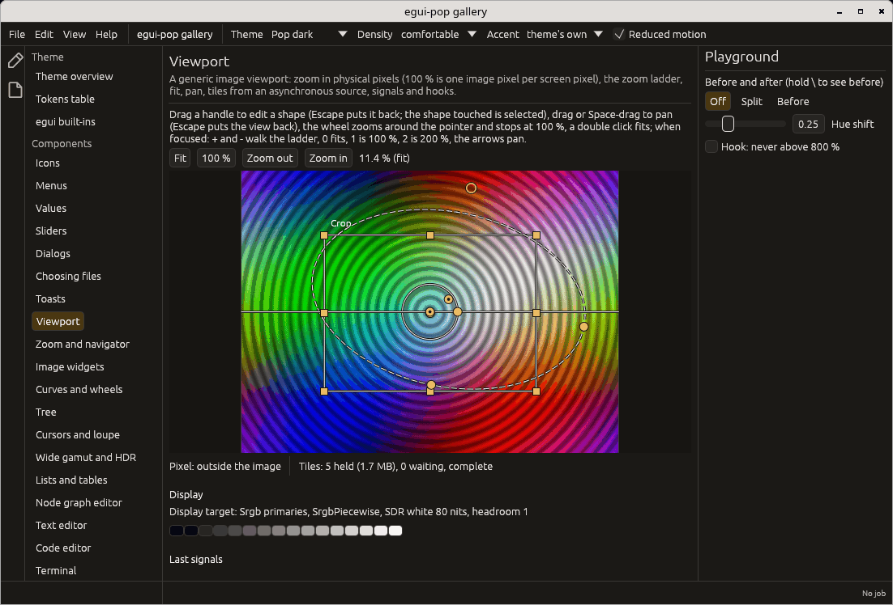

# The image viewport

`egui-pop-viewport` (the facade's `viewport` feature, re-exported as
`egui_pop::viewport`) shows an image the application computes, in tiles:
pan and zoom in physical pixels (100 % is one image pixel per screen
pixel, in every window), a proxy first and exact tiles after, a display
transform where colour management plugs in, overlays with handles,
before and after, a pixel readout. The crate also has thumbnails in a
virtualised grid and the image tools: a histogram, a curve editor,
colour wheels, a zoom control and a navigator (see
[Image tools](image-tools.md)), and the tools' cursors and a loupe (see
[Cursors and the loupe](cursors.md)). What the wheel, a pinch and each
button do on it follows the pointer profile, and a double click may ask
the application to leave the view (`Signal::Leave`): see
[Pointer gestures and profiles](pointer-gestures.md). The
`on_double_click` hook replaces that double click: a hook that handles
it returns its own view without calling the default action it is
given; one that passes it on calls the default, which fits, zooms or
sends `Signal::Leave` as the profile says, exactly as without a hook.

```sh
cargo add egui-pop --features viewport
```

The application implements the tile source; the viewport asks, never
waits, and says what changed with signals.

```rust
use egui_pop::egui;
use egui_pop::viewport::source::{Pixels, Tile, TileRequest, TileSink, TileSource};
use egui_pop::viewport::{Signal, View, Viewport, ViewportState};

/// A flat mid-grey image, answered at once (a real source works on a
/// thread and delivers through the sink when done).
struct Grey {
    sink: TileSink,
}

impl TileSource for Grey {
    fn size(&self) -> Option<[u32; 2]> {
        Some([6000, 4000])
    }

    fn request(&self, requests: Vec<TileRequest>) {
        for r in requests {
            let n = r.size[0] as usize * r.size[1] as usize;
            // Scene-referred floats: the display transform runs on them.
            self.sink.deliver(Tile::answer(&r, Pixels::Scene(vec![0.18; n * 4])));
        }
    }
}

fn draw(ui: &mut egui::Ui, state: &mut ViewportState, view: &mut View, source: &Grey) {
    let out = Viewport::new("main").source(source).readout(true).show(ui, state, view);
    for signal in out.signals {
        if let Signal::View { view, .. } = signal {
            // Keep the view in the document, one undo step per gesture...
            let _ = view;
        }
    }
}

let state = ViewportState::new();
let source = Grey { sink: state.sink() };
let _ = (draw, source);
```

A source may also answer the pixel readout (`TileSource::readout`, then
`TileSink::readout`). Requests the viewport stops wanting get their
cancel token set.

The `viewer` example (`cargo run -p egui-pop-viewport --example viewer`,
a Mandelbrot set computed on a thread) and the gallery's `viewport` page
show it in an application:



## Overlays

The application owns its overlays (`overlay::Overlay`: a shape in image
pixels, its handles, a label) and gives them to the viewport each frame
(`Viewport::overlays`). Dragging a handle is one gesture
(`Signal::Handle`, begin, update, end, or cancel on Escape), which the
application applies to its own data (`Overlay::apply` does it for the
standard shapes); a double click resets (`Signal::HandleReset`), the
wheel adjusts (`Signal::HandleWheel`). The `before_handle` hook may veto
or snap a move; it gets where the handle was when the gesture began
(`HandleMove::start`), where it is, where the pointer would put it and
the keys held (`modifiers`). A click on a handle is
`Signal::HandleClick` (select its shape), a click on an outline away
from the handles `Signal::EdgeClick` with the segment and the nearest
point (add a point there; `overlay::hit_edge` numbers the segments).
Lines and handle outlines are drawn in whole physical pixels at the
window's scale (`scale::stroke`), so they stay sharp at 125 % and 150 %.

Shapes are points, lines, boxes, circles, ellipses (`Shape::Ellipse`,
sized along its axes and turned by its handles) and paths. Each overlay
has a style: `selected()` (a heavier line in the handle colour),
`faint()` (half-transparent, handles included) and `dashed()`. An
overlay may carry handles of its own (`Overlay::handles`), among them
`HandleKind::Control`, a Bézier control drawn as a small diamond, whose
moves the application applies. Two paint hooks extend the drawing:
`under_overlays` between the image and the overlays (a mask's tint),
`after_paint` above the handles.

```rust
use egui_pop::viewport::overlay::{Overlay, Shape};

let overlays = vec![
    Overlay::new("crop", Shape::Rect([100.0, 100.0, 900.0, 700.0])).selected(),
    Overlay::new(
        "vignette",
        Shape::Ellipse { center: [500.0, 400.0], radii: [400.0, 250.0], rotation: 0.0 },
    )
    .dashed()
    .faint(),
];
# let _ = overlays;
```

## Wide gamut and HDR

A window's surface has an encoding (`display::DisplayTarget`: primaries,
transfer, headroom, format); the viewport's display stage converts the
scene into it, on the GPU (its shader) and on the CPU
(`Stage::encode`): Display P3 and BT.2020 primaries (matrices computed
from the chromaticities), the sRGB curve, extended linear (scRGB) and
extended sRGB, SMPTE ST 2084 (PQ) and BT.2100 HLG.

An application says what it wants for a window; the viewport draws for
what the surface carries, and says why when that is less:

```rust
use egui_pop::egui;
use egui_pop::viewport::display::{self, ColorSpace, DisplayTarget, SurfaceFormat, TargetSource};

let ctx = egui::Context::default();
display::want(&ctx, egui::ViewportId::ROOT, DisplayTarget::display_p3());

// Under eframe the surface is 8-bit sRGB: sRGB is drawn, with the reason.
let r = display::resolve(&DisplayTarget::display_p3(), &DisplayTarget::srgb(), true);
assert!(!r.faithful());
assert_eq!(r.drawn.color_space(), Some(ColorSpace::Srgb));
println!("{}", r.reason().unwrap());

// A host that configured an extended sRGB surface on half floats says so,
// and P3 (or HDR) is drawn faithfully.
let surface = DisplayTarget::for_color_space(
    ColorSpace::ExtendedSrgb,
    SurfaceFormat::Rgba16Float,
    4.0,
    TargetSource::Tagged,
);
display::set_target(&ctx, egui::ViewportId::ROOT, surface);
assert!(display::resolve(&DisplayTarget::display_p3(), &surface, true).faithful());
```

What works where:

| Surface | Who configures it | Wide gamut / HDR |
|---|---|---|
| 8-bit sRGB | eframe 0.36, every platform | no: sRGB drawn, the reason given |
| extended sRGB, half floats | a host with its own surface (`gpu::choose_surface`), where wgpu offers it (Metal on macOS; Vulkan drivers exposing `EXTENDED_SRGB_NONLINEAR`) | yes, and egui's interface stays right |
| scRGB, HDR10 (PQ), HLG | a host with its own surface (`SurfacePolicy::Any`): DX12 and Vulkan on Windows, Metal | the image yes; egui's interface is written sRGB-encoded, so the host composes it itself |
| any, CPU path | (no GPU path installed) | no: tiles are 8-bit sRGB textures |

- `gpu::install` records what eframe configured (its format, wgpu's
  default colour space); `gpu::install_for_surface` is for a host that
  configured its surface with another colour space, and
  `gpu::choose_surface` picks the format and colour space to configure
  for a wanted target among the surface's capabilities.
- `ViewportState::display_resolution` gives what the last frame was
  drawn for; the debug bridge's `viewport` collector shows it, and the
  `before_display` hook may veto (draw sRGB) or redirect (a soft proof)
  it.
- Why eframe cannot do more today, and what is missing on Wayland, is
  in [Upstream workarounds](upstream.md).

The gallery's `display` page shows the resolution for each wish and
surface, and the transfers' curves.

### Wide gamut on Wayland

On Wayland, the image can get a surface of its own while the interface
stays the 8-bit sRGB eframe configures (`image_surface`, feature
`wayland`, on by default; the research behind it is in
[wayland-colour.md](wayland-colour.md)). The viewport draws its image
into a subsurface **below** the main window, presented just before the
window in the same compositor frame, and punches a transparent hole in
the interface where the image is: overlays, menus and tooltips are drawn
over it as before. The subsurface is tagged through
`wp_color_management_v1` with the wanted encoding (BT.2020 with a 2.2
power, the encoding a compositor maps to its screen), or presented in a
colour space the driver declares when the driver holds the surface's
colour itself.

```rust
use egui_pop::egui;
use egui_pop::viewport::display::{self, DisplayTarget, Primaries, Transfer};
use egui_pop::viewport::gpu::{self, egui_wgpu};
use egui_pop::viewport::image_surface::{self, Offer, Route, raw_window_handle as rwh};

/// At start-up: `window` is eframe's creation context, its main window
/// built with `ViewportBuilder::with_transparent(true)`.
fn wide_gamut(
    ctx: &egui::Context,
    rs: &egui_wgpu::RenderState,
    window: &(impl rwh::HasWindowHandle + rwh::HasDisplayHandle),
) {
    gpu::install(ctx, rs);
    let offer = image_surface::install(
        ctx,
        rs,
        window,
        image_surface::Options { transparent_window: true },
    );
    if let Some(why) = offer.unavailable {
        eprintln!("no image surface: {why}");
    }
    let rec2020 = DisplayTarget {
        primaries: Primaries::Bt2020,
        transfer: Transfer::Gamma22,
        ..DisplayTarget::srgb()
    };
    display::want(ctx, egui::ViewportId::ROOT, rec2020);
}

// Where the image goes is plain code, tested with fake compositors.
let rec2020 = DisplayTarget {
    primaries: Primaries::Bt2020,
    transfer: Transfer::Gamma22,
    ..DisplayTarget::srgb()
};
let x11 = Offer::unavailable("not a Wayland window (X11 or another system)");
assert_eq!(image_surface::negotiate(&rec2020, &x11).route, Route::Window);
```

| Compositor (Mesa Vulkan driver) | The image | Why |
|---|---|---|
| KWin 6.3+, sway (wlroots 0.19+), Weston 15+ with colour management | tagged by egui-pop: BT.2020, gamma 2.2 (10 bits when offered) | the compositor does not announce the `srgb` transfer, so the driver leaves the subsurface's colour alone |
| GNOME 48+, Hyprland 0.48+ | Display P3, declared by the driver | the compositor announces `srgb` + `srgb` to the driver, which then holds every surface's colour-management object; a second one is a fatal protocol error, so egui-pop does not tag |
| without `wp_color_manager_v1`, X11, Windows, macOS | sRGB, on the window | said by `display::Resolution::reason` |
| an opaque window, a secondary window | sRGB, on the window | said |

- `image_surface::negotiate` decides from an `Offer` (the colour
  manager's announcements, the subsurface's formats and colour spaces);
  `display::target` then answers the image surface's target, and
  `Fallback::Unavailable` carries why the image stayed sRGB.
- The `viewport` collector's `image_surface` field shows the route, the
  compositor's announcements, each image surface (its place, tag and
  configuration) and the compositor's preferred image description for
  the window (its primaries, transfer, luminances and target volume),
  re-read when the window moves to another screen.
- `EGUI_POP_IMAGE_SURFACE=off` turns it off; `=no-tag` keeps the
  driver's colour spaces only (for a driver that would hold the colour
  of surfaces beyond Mesa's rule).
- Limits: the main window only; a transparent window; the subsurface is
  placed on whole logical pixels (at a fractional scale its pixels may
  sit up to one pixel off the interface's); the perceptual intent (the
  one every compositor takes).

Checking it on a screen (automation has no colour-managed Wayland
session):

1. In a Wayland session with colour management (KWin 6.3 or later is
   the reference: the tagged route), on a wide-gamut screen with its
   profile set in the display settings, run
   `cargo run -p egui-pop-gallery -- --wide-gamut --page viewport`.
   A missing image surface is printed on stderr at start-up.
2. Open the `display` page: "Image surface" shows the route (`tagged`
   on KWin, `wsi` on GNOME), the image's encoding, why when less, what
   the compositor announces and its preferred description. Back on the
   `viewport` page, the image must look exactly as it does without
   `--wide-gamut` (the demo's colours are within sRGB: the compositor
   maps the BT.2020 encoding back to them), with no seam or offset at
   its edges, and overlays, the before/after split and menus drawn over
   it. Pan, zoom and resize the window: the image follows in the same
   frame as the interface.
3. `WAYLAND_DEBUG=1 cargo run -p egui-pop-gallery -- --wide-gamut --page viewport 2>&1 | grep -E 'wp_color|wl_subsurface|set_image_description'`
   shows one subsurface per viewport, `set_primaries_named(6)` (BT.2020)
   and `set_tf_named(2)` (gamma 2.2), and `set_image_description` on the
   subsurface (not on the window's surface).
4. In Helios, `helios doctor display` prints what the compositor
   announces; it should agree with the display page. With the
   Wide-gamut preview setting on, a test chart with colours outside
   sRGB (a saturated P3 or BT.2020 green) shows them distinct where
   the sRGB preview clips them.
